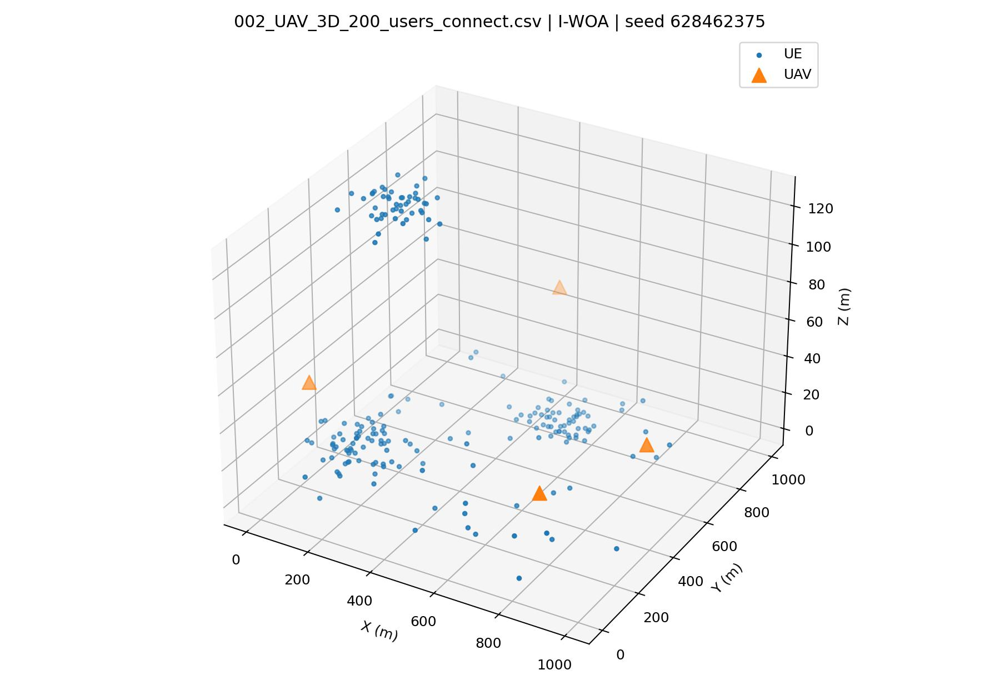
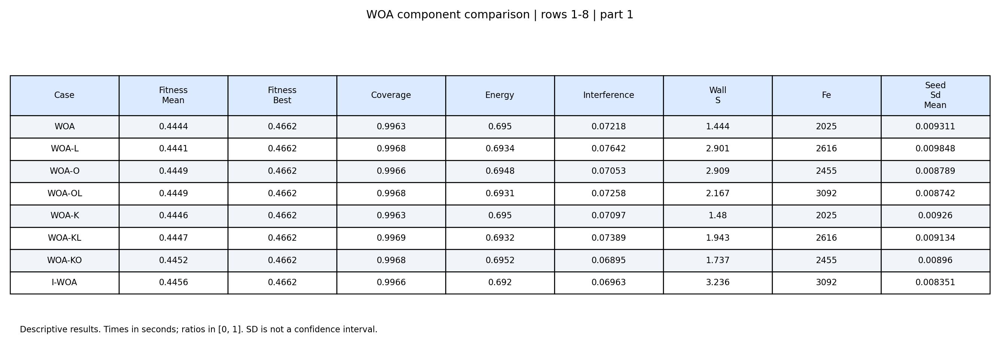
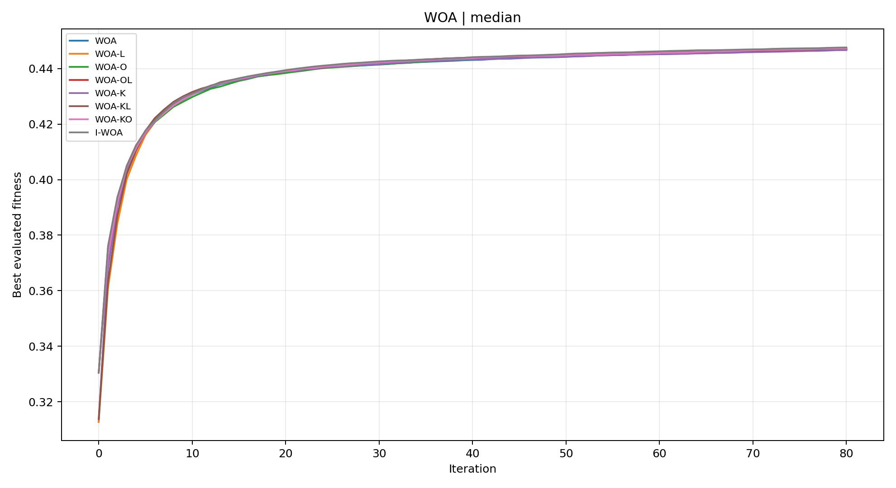
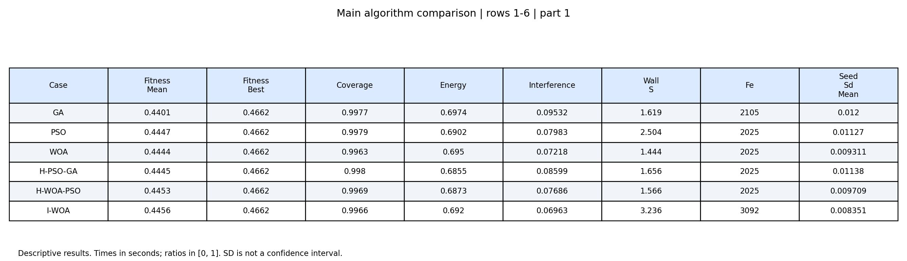
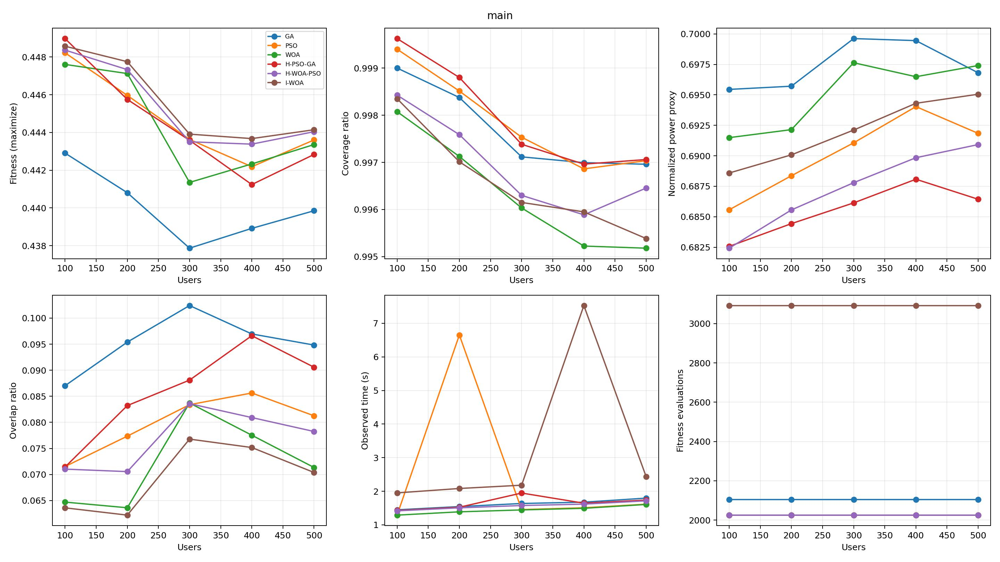
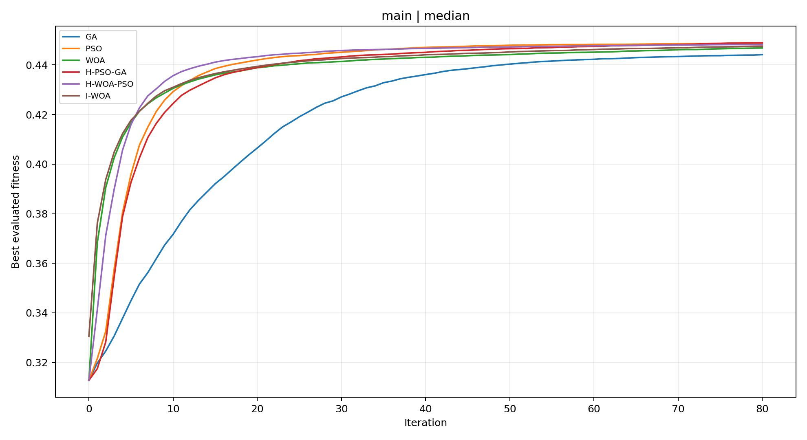
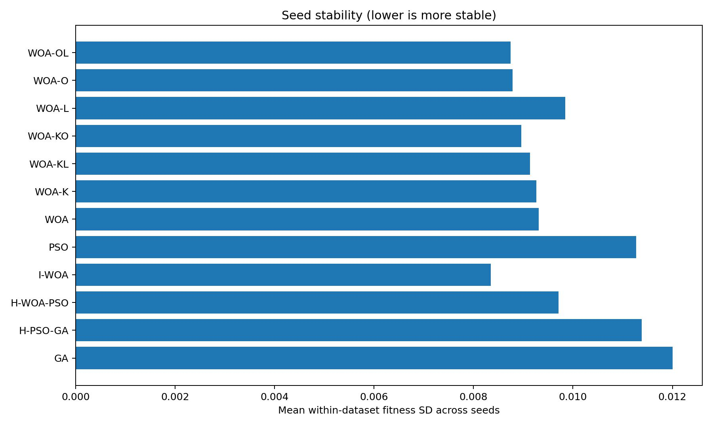
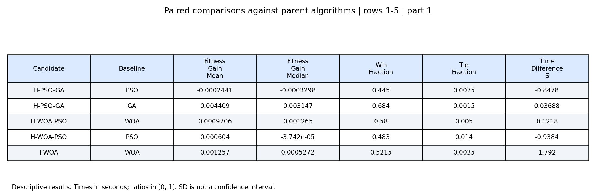

# BÁO CÁO: TỐI ƯU VỊ TRÍ UAV CHO MẠNG KHÔNG DÂY

> Phạm vi bản thảo: Chương 1–4, đối chiếu mã nguồn và artifact tại ngày 28/10/2026. Bộ thực nghiệm được báo cáo gồm **200 dataset, 12 case, 10 seed, 80 vòng lặp, quần thể 25 và 4 UAV**, tổng cộng **24.000 task**. Các con số 500 dataset và 50–500 UE trong đề cương ban đầu không mô tả bộ kết quả này; quy mô hiện hành là 100, 200, 300, 400, 500 UE, mỗi mức 40 dataset. Số trang sẽ cập nhật khi dàn trang, không dùng số trang tạm của đề cương.
>
> Nguồn thực nghiệm: [manifest](implementation/results/study_80_iterations/manifest.json), [kết quả từng lượt chạy](implementation/results/study_80_iterations/runs.csv), [xác nhận xuất báo cáo](implementation/results/study_80_iterations/report_completion.json). Chữ ký nguồn của study là `e028cf11bc3e6002af9afb3ae99fe9f7989355c7461c536e89fb4cecbb6dd573`. Mã hiện tại đã thay đổi sau lần chạy, nên phần giải thích triển khai phản ánh code đang có; không tuyên bố đã phục dựng toàn bộ phiên bản lịch sử chỉ từ chữ ký. Công thức fitness được kiểm tra lại trên 24.000 dòng kết quả, sai lệch số học lớn nhất khoảng $2,22\times10^{-16}$.

## MỤC LỤC

- [CHƯƠNG 1. TỔNG QUAN VỀ BÀI TOÁN TỐI ƯU VỊ TRÍ TRẠM PHÁT SÓNG UAV TRONG MẠNG 5G](#chuong-1)
  - [1.1. Bối cảnh mạng di động 5G và vai trò của trạm phát sóng UAV](#sec-1-1)
    - [1.1.1. Xu hướng phát triển của mạng 5G Sub-6 GHz và các thách thức phủ sóng](#sec-1-1-1)
    - [1.1.2. Trạm phát sóng trên thiết bị bay không người lái (UAV-BS)](#sec-1-1-2)
  - [1.2. Bài toán tối ưu hóa vị trí trạm phát sóng UAV trong không gian 3D](#sec-1-2)
  - [1.3. Tổng quan các công trình nghiên cứu liên quan](#sec-1-3)
    - [1.3.1. Các nghiên cứu về tối ưu hóa độ phủ và công suất trạm phát sóng UAV](#sec-1-3-1)
    - [1.3.2. Ứng dụng của các thuật toán Metaheuristic trong tối ưu hóa vị trí UAV](#sec-1-3-2)
    - [1.3.3. Nhận xét và khoảng trống nghiên cứu](#sec-1-3-3)
  - [1.4. Định hướng nghiên cứu và giải pháp đề xuất của đề tài](#sec-1-4)
- [CHƯƠNG 2. MÔ HÌNH TOÁN HỌC VÀ CƠ SỞ KỸ THUẬT MẠNG 5G](#chuong-2)
  - [2.1. Mô hình kênh truyền sóng không dây không gian – mặt đất (A2G)](#sec-2-1)
    - [2.1.1. Đặc tính truyền sóng ở băng tần 5G Sub-6 (3,5 GHz)](#sec-2-1-1)
    - [2.1.2. Mô hình xác suất tầm nhìn thẳng LoS/NLoS của Al-Hourani](#sec-2-1-2)
    - [2.1.3. Mô hình suy hao đường truyền trung bình và các tham số môi trường](#sec-2-1-3)
  - [2.2. Mô hình kết nối và chất lượng dịch vụ người dùng](#sec-2-2)
    - [2.2.1. Công suất phát, công suất thu và tỷ số SNR; phân biệt với SINR](#sec-2-2-1)
    - [2.2.2. Cơ chế phân phối và kết nối người dùng (UAV–UE Association)](#sec-2-2-2)
  - [2.3. Phát biểu bài toán tối ưu hóa vị trí 3D cho phi đội UAV](#sec-2-3)
    - [2.3.1. Mô tả bài toán và hệ thống ký hiệu toán học](#sec-2-3-1)
    - [2.3.2. Không gian tìm kiếm 12 chiều (12D Continuous Search Space)](#sec-2-3-2)
    - [2.3.3. Các hàm mục tiêu thành phần: độ phủ sóng, năng lượng và can nhiễu](#sec-2-3-3)
    - [2.3.4. Hệ ràng buộc vị trí, độ cao và an toàn chống va chạm trên không](#sec-2-3-4)
    - [2.3.5. Xây dựng hàm độ thích nghi tổng hợp có phạt](#sec-2-3-5)
  - [2.4. Các thuật toán tối ưu hóa cơ sở](#sec-2-4)
    - [2.4.1. Thuật toán phân cụm không gian K-Means](#sec-2-4-1)
    - [2.4.2. Giải thuật di truyền (GA)](#sec-2-4-2)
    - [2.4.3. Thuật toán tối ưu bầy đàn (PSO)](#sec-2-4-3)
    - [2.4.4. Thuật toán tối ưu bầy cá voi nguyên bản (WOA)](#sec-2-4-4)
- [CHƯƠNG 3. THUẬT TOÁN TỐI ƯU BẦY CÁ VOI CẢI TIẾN (I-WOA)](#chuong-3)
  - [3.1. Cấu trúc tổng thể của giải thuật đề xuất](#sec-3-1)
    - [3.1.1. Trình tự thực hiện I-WOA](#sec-3-1-1)
    - [3.1.2. Sơ đồ quy trình tối ưu hóa vị trí 3D](#sec-3-1-2)
    - [3.1.3. Chiến lược tích hợp pha tiền xử lý phân vùng và pha tối ưu hóa liên tục](#sec-3-1-3)
  - [3.2. Biểu diễn nghiệm và không gian tìm kiếm của bài toán](#sec-3-2)
  - [3.3. Tiền xử lý dữ liệu và khởi tạo quần thể có cấu trúc](#sec-3-3)
    - [3.3.1. Phân vùng không gian người dùng bằng K-Means](#sec-3-3-1)
    - [3.3.2. Khởi tạo quần thể từ nghiệm hạt giống và nhiễu ngẫu nhiên](#sec-3-3-2)
  - [3.4. Các cơ chế cải tiến trong thuật toán I-WOA](#sec-3-4)
    - [3.4.1. Khởi tạo định hướng bằng K-Means](#sec-3-4-1)
    - [3.4.2. Cơ chế học đối lập Opposition-Based Learning (OBL)](#sec-3-4-2)
    - [3.4.3. Cơ chế bước nhảy Lévy Flight](#sec-3-4-3)
    - [3.4.4. Cơ chế cập nhật và cân bằng Exploration – Exploitation](#sec-3-4-4)
  - [3.5. Xử lý các ràng buộc vật lý và an toàn va chạm trong quá trình tối ưu](#sec-3-5)
  - [3.6. Các thuật toán lai mở rộng dùng trong đối chuẩn](#sec-3-6)
    - [3.6.1. Thuật toán lai H-PSO-GA](#sec-3-6-1)
    - [3.6.2. Thuật toán lai H-WOA-PSO](#sec-3-6-2)
  - [3.7. Phân tích độ phức tạp thuật toán](#sec-3-7)
  - [3.8. Kết luận Chương 3](#sec-3-8)
- [CHƯƠNG 4. TRIỂN KHAI HỆ THỐNG VÀ KẾT QUẢ THỰC NGHIỆM](#chuong-4)
  - [4.1. Thiết lập môi trường và cấu hình thực nghiệm](#sec-4-1)
    - [4.1.1. Môi trường triển khai và kiến trúc mã nguồn](#sec-4-1-1)
    - [4.1.2. Tập dữ liệu mô phỏng: 200 kịch bản, 100–500 UE](#sec-4-1-2)
    - [4.1.3. Cấu hình siêu tham số và tiêu chí đánh giá hiệu năng](#sec-4-1-3)
  - [4.2. Thực nghiệm Giai đoạn 1: khảo sát các thành phần của thuật toán đề xuất](#sec-4-2)
    - [4.2.1. Phân tích vai trò của các cơ chế cải tiến trong I-WOA](#sec-4-2-1)
  - [4.3. Thực nghiệm Giai đoạn 2: đánh giá so sánh trên diện rộng (200 dataset)](#sec-4-3)
    - [4.3.1. So sánh chất lượng nghiệm và tỷ lệ phủ sóng](#sec-4-3-1)
    - [4.3.2. Phân tích tốc độ và đường cong hội tụ](#sec-4-3-2)
    - [4.3.3. Đánh giá thời gian tính toán và độ ổn định](#sec-4-3-3)
    - [4.3.4. So sánh với các thuật toán lai H-PSO-GA và H-WOA-PSO](#sec-4-3-4)
  - [4.4. Phân tích thống kê và giải thích sự khác biệt về hiệu năng](#sec-4-4)
    - [4.4.1. Kiểm định phi tham số Friedman và Wilcoxon signed-rank](#sec-4-4-1)
    - [4.4.2. Cơ chế cân bằng khám phá và khai thác của I-WOA](#sec-4-4-2)
  - [4.5. Hạn chế của đề tài và định hướng phát triển](#sec-4-5)
  - [4.6. Kết luận Chương 4](#sec-4-6)

# CHƯƠNG 1. TỔNG QUAN VỀ BÀI TOÁN TỐI ƯU VỊ TRÍ TRẠM PHÁT SÓNG UAV TRONG MẠNG 5G

## 1.1. Bối cảnh mạng di động 5G và vai trò của trạm phát sóng UAV

Mạng di động được sử dụng trong nhiều tình huống có yêu cầu khác nhau về dung lượng, số lượng kết nối và độ tin cậy. Khung IMT-2020 phân biệt các nhóm dịch vụ như băng rộng di động nâng cao (eMBB), truyền thông máy số lượng lớn (mMTC) và truyền thông độ tin cậy cao, độ trễ thấp (URLLC). Những định hướng này được nêu trong hệ tài liệu ITU về IMT-2020; tham khảo [ITU-T X.1815](https://www.itu.int/ITU-T/recommendations/rec.aspx?rec=15113) và [ITU-R M.2083](https://www.itu.int/rec/R-REC-M.2083-0-201509-I/en).

Từ góc nhìn quy hoạch, hạ tầng không chỉ cần có tín hiệu mà còn cần phục vụ đúng nơi xuất hiện nhu cầu. Một khu vực đông người trong thời gian ngắn hoặc một vùng cần phục hồi liên lạc có thể đòi hỏi bố trí bổ sung linh hoạt. Trong các tình huống đó, vị trí trạm trở thành biến quyết định: cùng số thiết bị phát và cùng công suất, các cách bố trí khác nhau có thể tạo tỷ lệ người dùng được phủ và mức chồng lấn khác nhau.

Đề tài xem UAV mang thiết bị phát như một phương án bố trí trạm có thể thay đổi theo không gian. Mục tiêu không phải thay thế toàn bộ hạ tầng mặt đất, mà nghiên cứu công cụ lựa chọn vị trí cho một đội UAV trong một vùng phục vụ đã biết. Cách đặt vấn đề này giới hạn bài toán vào khâu quy hoạch vị trí, giúp tách hiệu quả thuật toán tìm kiếm khỏi các vấn đề thiết kế giao thức và điều khiển bay.

### 1.1.1. Xu hướng phát triển của mạng 5G Sub-6 GHz và các thách thức phủ sóng

Trong phạm vi đề tài, thuật ngữ Sub-6 GHz chỉ băng tần dưới 6 GHz; điểm khảo sát cụ thể là 3,5 GHz. Đây là lựa chọn tần số để xây dựng mô phỏng, không phải tuyên bố về thị phần triển khai hoặc chất lượng của một nhà mạng. Khi giới thiệu bối cảnh 5G, cần phân biệt nhu cầu dịch vụ của hệ thống với những đại lượng thật sự được mô hình hóa: chương trình này tính suy hao, SNR và tỷ lệ UE đạt ngưỡng, chưa mô phỏng đầy đủ eMBB, mMTC hoặc URLLC.

Vấn đề phủ sóng trong nghiên cứu được nhìn từ bốn yếu tố. Thứ nhất, khoảng cách làm thay đổi suy hao và công suất thu. Thứ hai, môi trường che khuất làm chất lượng liên kết phụ thuộc vào xác suất LoS/NLoS. Thứ ba, phân bố UE không nhất thiết đồng đều nên bố trí theo lưới cố định có thể không phù hợp với mật độ người dùng. Thứ tư, khi nhiều trạm cùng đủ mạnh tại một UE, tăng phạm vi từng trạm chưa chắc cải thiện hàm mục tiêu chung vì có thể làm tăng mức chồng lấn.

Ở tần số và các tham số đã chọn, thách thức nghiên cứu là tìm cấu hình vừa đạt độ phủ cao vừa hạn chế các thành phần bị phạt. Những thách thức như thiếu tài nguyên vô tuyến, nghẽn tải, nhiễu đồng kênh theo công suất và suy hao xuyên tòa nhà có ý nghĩa trong hệ thống đầy đủ, nhưng không được suy ra đã có trong mô hình chỉ vì tiêu đề đề tài sử dụng “5G”. Chương 2 xác định rõ ranh giới giữa bối cảnh ứng dụng và mô hình tính toán.

### 1.1.2. Trạm phát sóng trên thiết bị bay không người lái (UAV-BS)

UAV-BS là UAV mang thành phần phát/truy nhập vô tuyến để phục vụ người dùng, khác với UAV chỉ đóng vai trò UE kết nối tới trạm mặt đất. Trong cấu trúc khái niệm, hệ thống có liên kết truy nhập UAV–UE và một phương thức kết nối UAV về mạng lõi hoặc hạ tầng truyền dẫn. Ngoài ra còn cần điều khiển bay và quản lý nguồn năng lượng; tối ưu vị trí chỉ là một thành phần của toàn hệ thống.

Ưu điểm được nghiên cứu của nền tảng trên không là có thể điều chỉnh vị trí ngang và độ cao để thích ứng với vùng nhu cầu. Đổi lại, lựa chọn vị trí phải xét giới hạn độ cao, khoảng cách giữa UAV và chi phí duy trì hoạt động. Bay cao có thể cải thiện xác suất nhìn thẳng nhưng cũng tăng khoảng cách tới UE; đặt nhiều UAV gần cùng nhóm người dùng có thể tăng độ phủ cục bộ nhưng gây chồng lấn ở những UE đã được phủ.

Trong mô phỏng của đề tài, UAV-BS được rút gọn thành vị trí và công suất phát cố định. Backhaul, thủ tục mạng lõi, lưu lượng, điều phối tài nguyên, quỹ đạo tới vị trí đích và cấp phép bay nằm ngoài phạm vi tính toán. Vì vậy, nghiệm tối ưu là **phương án bố trí tĩnh trong mô hình**, không phải kế hoạch triển khai bay và mạng đã được chứng nhận khả thi ngoài thực địa.

## 1.2. Bài toán tối ưu hóa vị trí trạm phát sóng UAV trong không gian 3D

Cho một vùng phục vụ và tập UE có tọa độ cố định, cần chọn vị trí ba chiều của một đội bốn UAV. Mỗi UAV có ba biến $(x_i,y_i,z_i)$, nên toàn đội có 12 biến liên tục. Phương án phải nằm trong miền triển khai và giữ khoảng cách tối thiểu giữa mọi cặp UAV. Mỗi ứng viên được chấm bằng cùng mô hình kênh và cùng định nghĩa mục tiêu để các thuật toán được so sánh trên một bài toán thống nhất.

Các tiêu chí có quan hệ đánh đổi. Tăng độ phủ có thể yêu cầu thay đổi độ cao hoặc dịch vị trí tới vùng UE còn thiếu tín hiệu. Những thay đổi đó có thể làm tăng công suất đại diện hoặc đưa thêm UE vào vùng được nhiều UAV cùng phủ. Do đó, tìm vị trí gần UE nhất theo hình học không nhất thiết tối ưu về fitness. Các UAV cũng không thể tối ưu độc lập hoàn toàn vì cùng tác động lên một tập UE và chịu ràng buộc khoảng cách cặp.

Đề tài sử dụng tổng trọng số để chuyển ba thành phần thành một fitness cần tối đa hóa. Bài toán có miền liên tục nhưng các chỉ số coverage/chồng lấn dùng điều kiện ngưỡng, làm hàm mục tiêu không trơn theo vị trí. Ràng buộc khoảng cách tiếp tục tạo ra các vùng không khả thi trong miền hộp. Các đặc điểm này là lý do lựa chọn khảo sát các phương pháp tìm kiếm quần thể không cần gradient; không phải bằng chứng rằng chỉ metaheuristic mới giải được bài toán hoặc rằng chúng đảm bảo nghiệm tối ưu toàn cục.

Ba câu hỏi nghiên cứu được đặt ra:

1. Trong cấu hình mô phỏng đã chọn, tích hợp K-Means, OBL và Lévy vào WOA có cải thiện chất lượng nghiệm và độ ổn định so với WOA không?
2. Tác dụng của từng thành phần thay đổi thế nào khi các cơ chế khác được bật/tắt?
3. Kết quả của I-WOA so với GA, PSO và hai hybrid thay đổi ra sao theo fitness, coverage, công suất đại diện, chồng lấn và ngân sách FE?

Những câu hỏi này được trả lời trong phạm vi thực nghiệm hiện có, không mặc định câu trả lời thuận lợi cho thuật toán đề xuất. Chương 4 trình bày cả các trường hợp không cải thiện và giới hạn của so sánh cùng số vòng.

## 1.3. Tổng quan các công trình nghiên cứu liên quan

Phần tổng quan tập trung vào một số công trình đại diện có liên hệ trực tiếp với mô hình kênh, bài toán bố trí và phương pháp tìm kiếm. Đây là tổng quan có chọn lọc, không phải rà soát hệ thống toàn bộ nghiên cứu về UAV-BS. Nguồn mô hình, nguồn nguyên lý thuật toán và lựa chọn triển khai riêng của đề tài được phân biệt để tránh gán toàn bộ hệ thống cho một bài báo.

### 1.3.1. Các nghiên cứu về tối ưu hóa độ phủ và công suất trạm phát sóng UAV

Mô hình nền của Al-Hourani, Kandeepan và Lardner (2014), *Optimal LAP Altitude for Maximum Coverage*, là tài liệu gắn với quan hệ giữa độ cao, xác suất LoS và vùng phủ. Trong bản thảo này, biểu thức đang dùng được đối chiếu qua bài Alzenad và cộng sự cùng code của dự án; chưa tuyên bố đã kiểm tra lại toàn bộ bản gốc Al-Hourani. [Nguồn công trình nền](https://doi.org/10.1109/LWC.2014.2342736).

Alzenad và cộng sự (2017) nghiên cứu bố trí một UAV-BS nhằm phủ nhiều người dùng và giảm công suất phát cần thiết. Công trình tách bài toán độ cao và vị trí ngang, sử dụng mô hình hình học vùng phủ; đây là nguồn đối chiếu trực tiếp cho LoS/suy hao của đề tài. Khác biệt quan trọng là dự án hiện xét bốn UAV, công suất phát cố định và thêm chỉ số chồng lấn cùng công suất hover đại diện. Vì vậy không dùng kết quả của bài nguồn để chứng nhận fitness hoặc mô hình năng lượng riêng của dự án. [Bài nghiên cứu](https://arxiv.org/html/1705.03415).

Nhóm nghiên cứu tối ưu độ phủ/công suất cho thấy trước khi lựa chọn thuật toán cần xác định rõ biến quyết định và định nghĩa hiệu quả. Công suất phát vô tuyến, công suất hover và năng lượng theo nhiệm vụ là các đại lượng khác nhau. Một phương pháp tối thiểu công suất phát không thể được coi đã giải bài toán năng lượng bay chỉ vì cả hai đều sử dụng từ “energy-efficient”.

### 1.3.2. Ứng dụng của các thuật toán Metaheuristic trong tối ưu hóa vị trí UAV

Shakhatreh và cộng sự (2017), *Efficient 3D Placement of a UAV Using Particle Swarm Optimization*, sử dụng PSO cho một UAV phục vụ UE trong tòa nhà cao tầng, hướng tới giảm tổng công suất phát cần để phủ người dùng. Nguồn này cho thấy ứng dụng PSO trong bố trí 3D và tầm quan trọng của giả định UE trong nhà. Nó không xác nhận mô hình outdoor trung bình của dự án phù hợp với mọi UE có độ cao. [Bản tác giả](https://arxiv.org/abs/1705.09769).

Chin và cộng sự (2025), *Joint aerial base station placement and user association for aerial–terrestrial networks: A whale optimization approach*, đề xuất cách tiếp cận WOA cho bố trí trạm trên không kết hợp association, với mục tiêu thông lượng và cân bằng tải. Thông tin này được đối chiếu ở phần tóm tắt công khai; chưa dùng toàn văn để mô tả chi tiết toán tử. Đây là bằng chứng rằng hướng ứng dụng WOA cho bố trí UAV đã có trước đề tài, không phải một khoảng trống hoàn toàn chưa được nghiên cứu. [Nguồn nhà xuất bản](https://www.sciencedirect.com/science/article/pii/S1570870525000848).

GA, PSO và WOA đều biểu diễn được một cấu hình vị trí như cá thể trong quần thể. Chúng khác nhau ở cách sinh phương án tiếp theo: GA dùng chọn lọc/tái tổ hợp/đột biến; PSO dùng vận tốc và bộ nhớ; WOA dùng tìm kiếm, bao vây và xoắn ốc. Dự án dùng chúng làm các đối chứng có nguyên lý khác nhau, đồng thời khảo sát hai cấu trúc hybrid. Không suy từ kết quả ở một bài báo hoặc một bộ hàm chuẩn rằng một thuật toán sẽ luôn thắng trên mô hình UAV-BS đang xét.

| Công trình/nhóm phương pháp | Bài toán hoặc ý tưởng được tham khảo | Liên hệ với đề tài | Khác biệt cần giữ rõ |
|---|---|---|---|
| Al-Hourani và cộng sự, 2014 | Độ cao và vùng phủ LAP | Nền mô hình A2G | Không phải nguồn fitness C/E/I của dự án |
| Alzenad và cộng sự, 2017 | Bố trí một UAV-BS, độ phủ và công suất phát | LoS/suy hao, tư duy đánh đổi | Đề tài dùng đội bốn UAV và công suất phát cố định |
| Shakhatreh và cộng sự, 2017 | PSO bố trí UAV 3D cho người dùng trong nhà | Đối chứng tìm kiếm quần thể | Môi trường truyền khác mô hình hiện tại |
| Chin và cộng sự, 2025 | WOA kết hợp bố trí và association | Nghiên cứu WOA có liên quan trực tiếp | Đề tài chưa có association, thông lượng và cân bằng tải |
| GA/PSO/WOA và K/O/L trong repository | Sinh ứng viên và tổ chức toán tử | Cơ sở phương pháp của study | Cấu hình cụ thể phải truy về code và FE thực tế |

### 1.3.3. Nhận xét và khoảng trống nghiên cứu

Các công trình được khảo sát khác nhau về số UAV, môi trường người dùng, mục tiêu và ràng buộc. Vì vậy không thể lấy fitness, tỷ lệ phủ hoặc thời gian từ các bài khác mô hình để xếp hạng trực tiếp với dự án này. Một so sánh có giá trị cần giữ chung dữ liệu, hàm chấm điểm, miền khả thi và giao thức ngân sách, hoặc công bố rõ những điểm chưa đồng nhất.

Trong phạm vi đề tài, khoảng trống thực nghiệm cần giải quyết là đánh giá có truy vết tổ hợp K-Means–OBL–Lévy trên cùng lõi WOA và cùng bộ kịch bản. So với chỉ trình bày một đường hội tụ thuận lợi, khảo sát tám tổ hợp giúp nhận diện cơ chế nào có lợi trong nền cụ thể và cơ chế nào không cải thiện. Lặp nhiều seed giúp tách một phần dao động ngẫu nhiên khỏi khác biệt giữa các phương pháp.

Một yêu cầu khác là công bố đồng thời chất lượng và chi phí: OBL/Lévy phát sinh thêm đánh giá nên cùng số vòng không đồng nghĩa cùng FE. Nếu không ghi FE, mức tăng fitness có thể bị diễn giải nhầm thành ưu thế thuần túy của toán tử. Tương tự, độ phủ theo SNR không thể thay cho thông lượng, và proxy chồng lấn không thể thay cho SINR.

Các nội dung trên là **nhu cầu đánh giá và phạm vi đóng góp của dự án**, chưa chứng minh toàn bộ tài liệu trước đây thiếu những yếu tố đó. Bản tổng quan không đủ để tuyên bố “lần đầu kết hợp K/O/L với WOA”, “chưa có nghiên cứu tương tự” hoặc tính mới tuyệt đối. Nếu cần khẳng định tính mới ở mức công bố khoa học, phải mở rộng chiến lược tìm kiếm, tiêu chí chọn bài và đối chiếu toàn văn các cấu hình gần nhất.

## 1.4. Định hướng nghiên cứu và giải pháp đề xuất của đề tài

Đề tài lựa chọn hướng tối ưu bố trí tĩnh một đội bốn UAV ở tần số mô phỏng 3,5 GHz. Đầu vào là tọa độ UE; đầu ra là vector vị trí 12 chiều khả thi và các chỉ số đánh giá. Fitness ưu tiên độ phủ, đồng thời trừ công suất chuẩn hóa và tỷ lệ chồng lấn. Các tham số và giới hạn được phát biểu đầy đủ ở Chương 2, không thay đổi riêng cho phương pháp đề xuất để tạo lợi thế.

Giải pháp đề xuất là I-WOA gồm lõi WOA và ba cơ chế bổ sung. K-Means cung cấp một nghiệm mầm từ phân bố XY của UE. OBL đánh giá các phương án đối lập ở khởi tạo và trong quá trình tìm kiếm. Lévy bổ sung các đề xuất nhiễu theo xác suất, nhận nếu tốt hơn ứng viên WOA vừa tạo. Các mục đích thiết kế là định hướng khởi tạo và mở rộng cơ hội tìm kiếm; hiệu quả thực tế phải kiểm chứng chứ không xem là kết luận sẵn có.

Phương án đánh giá gồm hai nhóm phân tích trong cùng study: ablation tám tổ hợp WOA và so sánh sáu phương pháp chính, với 200 dataset × 12 case × 10 seed. Chỉ số báo cáo gồm fitness, coverage, công suất đại diện, chồng lấn, FE, thời gian quan sát và độ ổn định. Thiết kế hiện tại dùng 80 vòng, không phải đồng FE; giới hạn này được giữ trong mọi diễn giải ưu thế. Không mở rộng kết luận ra các mô hình SINR hoặc năng lượng bay chưa được chạy.

Đóng góp được đặt ở ba mức: hiện thực một mô hình và bộ đánh giá nhất quán; tổ chức I-WOA cùng các đối chứng/ablation có seed và artifact truy vết; phân tích kết quả theo nhiều chỉ số và kiểm định bổ sung. Không gọi việc kết hợp các toán tử quen thuộc là một đột phá lý thuyết khi chưa có chứng minh hoặc khảo sát tính mới tương ứng.

Bố cục báo cáo được sắp theo quá trình nghiên cứu: Chương 1 xác định bối cảnh, công trình liên quan và phạm vi; Chương 2 trình bày mô hình cùng thuật toán cơ sở; Chương 3 trình bày trình tự thực hiện và giải thích phương pháp đề xuất/hybrid; Chương 4 mới đi vào môi trường cài đặt, cấu hình thực nghiệm, so sánh và đánh giá. Trong mỗi mục thuật toán, trình tự thực hiện được đặt trước phần diễn giải chi tiết để người đọc nắm trình tự thao tác trước khi theo dõi công thức.

# CHƯƠNG 2. MÔ HÌNH TOÁN HỌC VÀ CƠ SỞ KỸ THUẬT MẠNG 5G

## 2.1. Mô hình kênh truyền sóng không dây không gian – mặt đất (A2G)

Hệ thống xét một đội UAV mang thiết bị phát vô tuyến, phục vụ tập thiết bị người dùng UE có tọa độ cố định trong từng kịch bản. Quyết định tối ưu là vị trí ba chiều của các UAV; tọa độ người dùng, công suất phát và tần số sóng mang là đầu vào cố định. Mỗi nghiệm tạo ra ma trận liên kết UAV–UE; từ ma trận này tính độ phủ, tỷ lệ chồng lấn liên kết và fitness. Mô hình là mô phỏng bố trí tĩnh, chưa phải mô phỏng đầy đủ giao thức 5G NR hoặc quá trình UAV bay tới vị trí đích.

Kênh truyền A2G được mô tả bằng suy hao không gian tự do và suy hao bổ sung phụ thuộc xác suất nhìn thẳng. Nguồn đối chiếu mô hình LoS và suy hao là [Alzenad và cộng sự, mục II](https://arxiv.org/html/1705.03415); triển khai cụ thể nằm trong [channel.py](implementation/src/physics/channel.py). Các mở rộng về tọa độ UE ba chiều và cách xử lý góc âm là lựa chọn của dự án, cần tách khỏi mô hình tham khảo.

### 2.1.1. Đặc tính truyền sóng ở băng tần 5G Sub-6 (3,5 GHz)

Tần số sóng mang được chọn là $f_c=3,5\times10^9$ Hz. Với vận tốc truyền sóng $c=3\times10^8$ m/s, bước sóng tương ứng là:

$$
\lambda=\frac{c}{f_c}\approx0,0857\ \text{m}=8,57\ \text{cm}.
$$

Trong mô hình suy hao sử dụng, công suất thu phụ thuộc cả khoảng cách không gian và trạng thái LoS/NLoS. Tăng độ cao UAV thường làm tăng khoảng cách truyền, nhưng có thể đồng thời tăng góc ngẩng và xác suất LoS. Hai ảnh hưởng trái chiều này tạo ra sự đánh đổi khi chọn độ cao: UAV cao hơn không mặc nhiên phủ tốt hơn.

Ví dụ tính độc lập: với $d=100$ m, suy hao không gian tự do xấp xỉ $83,32$ dB. Khoảng cách tăng gấp đôi làm thành phần suy hao này tăng khoảng $6,02$ dB. Khi xác suất LoS cố định, tăng tần số cũng làm tăng suy hao theo biểu thức logarithm. Đây là đặc tính của công thức mô phỏng, không phải số đo hiện trường.

Việc chọn 3,5 GHz đặt bài toán trong bối cảnh Sub-6 GHz, nhưng không đủ để khẳng định mô hình đáp ứng đầy đủ 5G. Code chưa mô phỏng băng thông tài nguyên, OFDMA, MIMO, beamforming, lưu lượng ứng dụng, tỷ lệ lỗi hoặc thông lượng UE. Do đó, kết quả được diễn giải là tối ưu vùng phủ theo ngưỡng SNR ở tần số mô phỏng 3,5 GHz.

### 2.1.2. Mô hình xác suất tầm nhìn thẳng LoS/NLoS của Al-Hourani

Gọi UAV $i$ có tọa độ $\mathbf{q}_i=(x_i,y_i,z_i)$ và UE $j$ có tọa độ $\mathbf{u}_j=(u_j,v_j,h_j)$. Khoảng cách hình học được tính bằng:

$$
d_{ij}=\max\left(10^{-3},\sqrt{(x_i-u_j)^2+(y_i-v_j)^2+(z_i-h_j)^2}\right).
$$

Code đặt sàn khoảng cách $10^{-3}$ m để tránh phép logarithm hoặc phép chia tại khoảng cách bằng không. Góc ngẩng dùng đơn vị độ:

$$
\theta_{ij}=\frac{180}{\pi}\arcsin\left[\mathrm{clip}\left(\frac{z_i-h_j}{d_{ij}},0,1\right)\right].
$$

Xác suất LoS và NLoS có dạng:

$$
p_{ij}^{\mathrm{LoS}}=\frac{1}{1+a\exp[-b(\theta_{ij}-a)]},\qquad
p_{ij}^{\mathrm{NLoS}}=1-p_{ij}^{\mathrm{LoS}}.
$$

Trong cấu hình dự án, $a=9,61$ và $b=0,16$. Khi góc ngẩng lớn hơn, mô hình cho xác suất LoS tăng. Xác suất này được đưa trực tiếp vào suy hao trung bình; chương trình không tung biến Bernoulli để quyết định từng liên kết là LoS hay NLoS trong mỗi lần đánh giá. Vì vậy, với cùng nghiệm và dữ liệu, các chỉ số kênh không biến thiên ngẫu nhiên do lấy mẫu trạng thái LoS.

Mô hình nền liên quan công trình [Al-Hourani, Kandeepan và Lardner, 2014](https://doi.org/10.1109/LWC.2014.2342736). Bộ tham số môi trường ở đây là giả định mô phỏng, chưa được hiệu chuẩn cho địa điểm triển khai cụ thể. Đặc biệt, dữ liệu hiện có UE cao tới 130 m, trong khi UAV có thể ở 50 m. Code ép góc âm về $0^\circ$ khi UE cao hơn UAV; giới hạn này phải được ghi nhận, thay vì giả định mọi UE đều nằm trên mặt đất $h_j=0$.

### 2.1.3. Mô hình suy hao đường truyền trung bình và các tham số môi trường

Suy hao không gian tự do và hai thành phần môi trường được xác định như sau:

$$
L_{\mathrm{FS},ij}=20\log_{10}\left(\frac{4\pi f_c d_{ij}}{c}\right),
$$

$$
L_{ij}^{\mathrm{LoS}}=L_{\mathrm{FS},ij}+\eta_{\mathrm{LoS}},\qquad
L_{ij}^{\mathrm{NLoS}}=L_{\mathrm{FS},ij}+\eta_{\mathrm{NLoS}},
$$

$$
\overline{L}_{ij}=p_{ij}^{\mathrm{LoS}}L_{ij}^{\mathrm{LoS}}
+(1-p_{ij}^{\mathrm{LoS}})L_{ij}^{\mathrm{NLoS}}.
$$

Đây là phép lấy trung bình theo xác suất trên suy hao biểu diễn bằng dB, đúng với cách code hiện thực; không thay bằng trung bình công suất tuyến tính khi tái tính kết quả. Các giá trị được lấy từ [network.py](implementation/src/constants/network.py):

| Tham số | Giá trị | Vai trò |
|---|---:|---|
| $f_c$ | 3,5 GHz | Tần số sóng mang |
| $c$ | $3\times10^8$ m/s | Vận tốc truyền sóng |
| $a,b$ | 9,61; 0,16 | Tham số hàm xác suất LoS |
| $\eta_{\mathrm{LoS}}$ | 1 dB | Suy hao bổ sung khi LoS |
| $\eta_{\mathrm{NLoS}}$ | 20 dB | Suy hao bổ sung khi NLoS |
| $P_{\mathrm{tx}}$ | 30 dBm = 1 W | Công suất phát mỗi UAV |
| $P_{\mathrm{noise}}$ | −104 dBm | Mức tạp âm cố định |
| $\gamma$ | 18 dB | Ngưỡng liên kết được coi là phủ |

Mô hình chưa xét bản đồ tòa nhà, shadowing ngẫu nhiên, fading nhanh, tăng ích anten theo hướng hoặc điều khiển công suất. Không gọi các tham số trên là chuẩn bắt buộc cho mọi mạng 5G. Chúng xác định một môi trường mô phỏng có kiểm soát để so sánh phương pháp tối ưu vị trí.

## 2.2. Mô hình kết nối và chất lượng dịch vụ người dùng

### 2.2.1. Công suất phát, công suất thu và tỷ số SNR; phân biệt với SINR

Với công suất phát cố định và không có tăng ích anten riêng trong mô hình, công suất thu trên liên kết $i,j$ là:

$$
P_{\mathrm{rx},ij}[\mathrm{dBm}]=P_{\mathrm{tx}}[\mathrm{dBm}]-\overline{L}_{ij}[\mathrm{dB}],
$$

$$
\mathrm{SNR}_{ij}[\mathrm{dB}]=P_{\mathrm{rx},ij}[\mathrm{dBm}]-P_{\mathrm{noise}}[\mathrm{dBm}].
$$

Ví dụ $\overline{L}_{ij}=110$ dB thì $P_{\mathrm{rx},ij}=-80$ dBm và SNR bằng 24 dB, vượt ngưỡng 18 dB. Với các giá trị cấu hình, điều kiện SNR đạt ngưỡng tương đương $\overline{L}_{ij}\le116$ dB, hoặc $P_{\mathrm{rx},ij}\ge-86$ dBm. Hằng số ngưỡng công suất khác nếu có trong repository không thay thế điều kiện này: luồng fitness đang sử dụng SNR 18 dB.

Để phân biệt về mặt khái niệm, nếu xét UAV phục vụ $i$ và tập UAV đồng kênh còn lại, SINR phải được tính trên công suất tuyến tính:

$$
\mathrm{SINR}_{ij}=\frac{P_{\mathrm{rx},ij}^{\mathrm{linear}}}
{N^{\mathrm{linear}}+\sum_{k\ne i}P_{\mathrm{rx},kj}^{\mathrm{linear}}}.
$$

Biểu thức SINR này chỉ giải thích hướng mở rộng, **không được thực thi trong study hiện tại**. Không được lấy tổng các giá trị dBm làm mẫu số. Kết quả nghiên cứu không đủ để suy luận thông lượng, độ trễ hoặc đảm bảo QoS toàn diện; ngưỡng SNR chỉ là tiêu chí phủ sóng được chọn cho bài toán.

### 2.2.2. Cơ chế phân phối và kết nối người dùng (UAV–UE Association)

Đặt ma trận khả năng kết nối $A\in\{0,1\}^{N\times M}$:

$$
A_{ij}=\mathbf{1}[\mathrm{SNR}_{ij}\ge\gamma],\qquad
n_j=\sum_{i=1}^{N}A_{ij}.
$$

UE có $n_j=0$ chưa được phủ; $n_j\ge1$ được phủ; $n_j\ge2$ được tính vào tỷ lệ chồng lấn. Cách đếm này xử lý đồng thời mọi UAV và không đếm lặp một UE trong chỉ số coverage.

Code hiện tại **không xây dựng phép gán độc quyền một UE cho đúng một UAV**, không cân bằng tải, không đặt giới hạn số UE phục vụ trên mỗi UAV và không phân bổ băng thông. Vì vậy, thuật ngữ association trong phạm vi này được hiểu là kiểm tra các liên kết đủ điều kiện phủ, chưa phải bộ điều phối truy nhập. Có thể dùng $i_j^{\ast}=\arg\max_i\mathrm{SNR}_{ij}$ để thiết kế cơ chế chọn UAV về sau, nhưng không trình bày cơ chế này như tính năng đã có.

K-Means cũng không gán cứng UE vào UAV trong quá trình chấm điểm: nhãn cụm chỉ hỗ trợ tạo nghiệm ban đầu. Khi tối ưu diễn ra, mọi UAV vẫn được xét với mọi UE qua ma trận SNR.

## 2.3. Phát biểu bài toán tối ưu hóa vị trí 3D cho phi đội UAV

### 2.3.1. Mô tả bài toán và hệ thống ký hiệu toán học

Với một tập UE cố định, cần tìm cấu hình đội UAV có fitness lớn nhất, cân bằng độ phủ và hai thành phần bị phạt là công suất chuẩn hóa và chồng lấn liên kết. Đây là bài toán đa tiêu chí được vô hướng hóa bằng tổng trọng số, không phải thuật toán tìm toàn bộ biên Pareto.

| Ký hiệu | Ý nghĩa | Giá trị hoặc đơn vị |
|---|---|---|
| $M$ | Số UE trong một dataset | 100, 200, 300, 400 hoặc 500 |
| $N$ | Số UAV | 4 |
| $D$ | Số chiều nghiệm | $3N=12$ |
| $\mathbf{u}_j$ | Vị trí UE $j$ | Mét, cố định trong task |
| $\mathbf{q}_i$ | Vị trí UAV $i$ | Mét, biến tối ưu |
| $X$ | Vector của toàn bộ đội UAV | $\mathbb{R}^{12}$ |
| $P$ | Kích thước quần thể | 25 cấu hình đội UAV |
| $T$ | Số vòng lặp chính | 80 |
| $C,E,I$ | Coverage, công suất chuẩn hóa, chồng lấn | Không đơn vị |
| $F$ | Fitness cần tối đa hóa | Không đơn vị |
| FE | Số lần đánh giá fitness tìm kiếm | Đếm lời gọi thực tế |
| $d_{\min}$ | Khoảng cách UAV tối thiểu | 10 m |

Mỗi cá thể trong quần thể biểu diễn **toàn bộ bốn UAV**, không phải một UAV. Vì vậy quần thể 25 có nghĩa là 25 phương án bố trí đội bay, không phải 25 thiết bị bay.

### 2.3.2. Không gian tìm kiếm 12 chiều (12D Continuous Search Space)

Nghiệm được mã hóa xen kẽ theo từng UAV:

$$
X=(x_1,y_1,z_1,x_2,y_2,z_2,x_3,y_3,z_3,x_4,y_4,z_4).
$$

Miền hộp là:

$$
\Omega=([0,1000]\times[0,1000]\times[50,300])^4.
$$

Tọa độ liên tục cho phép thuật toán điều chỉnh cả vị trí ngang và độ cao. Miền hộp chỉ giới hạn tọa độ; tập khả thi thực sự còn phải loại các cấu hình vi phạm khoảng cách giữa UAV. Các chiều có thang biến thiên khác nhau: miền ngang rộng 1.000 m còn miền độ cao rộng 250 m. Vì thế đột biến hoặc giới hạn vận tốc trong code thường tỷ lệ theo độ rộng từng chiều.

Vị trí UAV có tính hoán vị: đổi nhãn hai UAV có thể cho cùng chỉ số vật lý. Code vẫn sử dụng vector có thứ tự, không rút gọn các cấu hình tương đương do hoán vị. Độ phủ và chồng lấn dựa trên ngưỡng cũng làm fitness có các đoạn không trơn; không giả định bài toán có gradient liên tục hoặc lồi.

### 2.3.3. Các hàm mục tiêu thành phần: độ phủ sóng, năng lượng và can nhiễu

**Độ phủ sóng** được định nghĩa là tỷ lệ UE có ít nhất một liên kết đạt ngưỡng:

$$
C(X)=\frac1M\sum_{j=1}^{M}\mathbf{1}[n_j\ge1].
$$

Chỉ số này thuộc $[0,1]$; lớn hơn là tốt hơn. Đây là tỷ lệ người dùng được phủ, không phải tỷ lệ diện tích được phủ. Dataset có phân bố UE khác nhau có thể cho coverage khác nhau dù diện tích hình học của các vùng tín hiệu giống nhau.

**Chỉ số năng lượng** thực tế là đại diện công suất theo độ cao. Với mỗi UAV:

$$
\rho_i=\mathrm{clip}\left(\frac{z_i-50}{300-50+10^{-6}},0,1\right),
\quad P_{\mathrm{hover},i}=100(1+0,5\rho_i),
$$

$$
E(X)=\frac{\frac1N\sum_i[P_{\mathrm{hover},i}+1]}{100\times1,5+1}
=\frac{\mathrm{mean}_i[P_{\mathrm{hover},i}+1]}{151}.
$$

Giá trị $E$ không có đơn vị; trong miền độ cao đã chọn, nằm xấp xỉ từ $101/151\approx0,668874$ đến 1. Công suất giả lập gồm hover cơ sở 100 W, tăng tối đa khoảng 50% theo độ cao, và công suất phát 1 W. Không có tích phân theo thời gian, quãng đường bay hoặc trạng thái pin. Vì vậy không diễn giải $E=0,69$ thành 0,69 joule, cũng không khẳng định mức giảm này trực tiếp kéo dài thời gian bay một tỷ lệ tương ứng.

**Chỉ số can nhiễu** trong code là tỷ lệ UE có từ hai UAV đủ mạnh:

$$
I(X)=\frac1M\sum_{j=1}^{M}\mathbf{1}[n_j\ge2].
$$

Mẫu số vẫn là toàn bộ UE, không chỉ UE đã được phủ; luôn có $I\le C$. Chỉ số không đo tổng công suất nhiễu, không phân biệt mức tín hiệu vượt ngưỡng bao nhiêu và không tính SINR. Hai hoặc bốn UAV cùng phủ một UE đều làm UE đó đóng góp một đơn vị vào tử số. Trong báo cáo, tên chính xác là **tỷ lệ chồng lấn liên kết đạt ngưỡng**, có thể gọi tắt là proxy nhiễu khi đã giải thích.

Nguồn định nghĩa và công thức riêng của dự án: [metrics.py](implementation/src/objectives/metrics.py).

### 2.3.4. Hệ ràng buộc vị trí, độ cao và an toàn chống va chạm trên không

Các ràng buộc áp dụng cho mọi UAV và mọi cặp UAV khác nhau:

$$
0\le x_i\le1000,\quad0\le y_i\le1000,\quad50\le z_i\le300,
$$

$$
\|\mathbf{q}_i-\mathbf{q}_k\|_2\ge10\ \text{m},\qquad i<k.
$$

Thuật toán chặn tọa độ vào miền hộp trước khi chấm điểm. Sau đó, cấu hình vi phạm khoảng cách tối thiểu bị coi là không khả thi. Khoảng cách này được tính trong 3D, nên hai UAV trùng vị trí ngang vẫn có thể thỏa ràng buộc nếu chênh cao đủ lớn.

Mức 10 m là tham số mô phỏng của dự án, không được trình bày như chuẩn an toàn hàng không. Ràng buộc chỉ kiểm tra cấu hình vị trí, chưa kiểm tra quỹ đạo giữa các thời điểm, tránh vật cản, vùng cấm bay, gia tốc hoặc khả năng điều khiển. Các cá thể metaheuristic là phương án tính toán, không phải lệnh điều khiển UAV bay trực tiếp qua từng vị trí tìm kiếm.

Mã đối chiếu: [objective.py](implementation/src/problem/objective.py), [constraints.py](implementation/src/problem/constraints.py) và [search_space.py](implementation/src/problem/search_space.py).

### 2.3.5. Xây dựng hàm độ thích nghi tổng hợp có phạt

Fitness khả thi được cực đại hóa:

$$
F(X)=w_1C(X)-w_2E(X)-w_3I(X)
=0,6C(X)-0,2E(X)-0,2I(X).
$$

Trọng số phản ánh lựa chọn của dự án: tăng coverage có lợi, trong khi tăng công suất chuẩn hóa hoặc chồng lấn gây giảm điểm. Do $C,E,I$ cùng là tỷ lệ không đơn vị, chúng được kết hợp trực tiếp; tuy vậy phạm vi biến thiên thực tế không giống nhau. Khi coverage gần bão hòa, thay đổi nhỏ của năng lượng và chồng lấn vẫn có thể quyết định thứ hạng fitness.

Phần “có phạt” trong triển khai phải mô tả đúng bằng hai cơ chế khác nhau. $-0,2E$ và $-0,2I$ là thành phần mục tiêu; còn vi phạm an toàn được xử lý bằng loại cứng:

$$
F_{\mathrm{eval}}(X)=
\begin{cases}
F(\Pi_\Omega X),&\Pi_\Omega X\text{ thỏa khoảng cách tối thiểu},\\
-\infty,&\text{ngược lại},
\end{cases}
$$

trong đó $\Pi_\Omega$ là phép clip theo từng tọa độ. Code không sử dụng hệ số phạt hữu hạn kiểu $F-\lambda\sum g(X)$ và không tự sửa vị trí UAV để tách các cặp quá gần. Khi lưu artifact, chương trình còn kiểm tra nghiệm tốt nhất hợp lệ; nghiệm không khả thi không được chuyển thành một kết quả hợp lệ bằng cách ghi fitness giả.

*Hình 2.1. Sơ đồ kỹ thuật do dự án biên soạn, không phải kết quả thực nghiệm. File ảnh: `implementation/docs/assets/fitness.svg`. Nguồn công thức: `objective.py`, `channel.py`, `metrics.py`.*

## 2.4. Các thuật toán tối ưu hóa cơ sở

### 2.4.1. Thuật toán phân cụm không gian K-Means

**Trình tự thực hiện — phân cụm tạo nghiệm mầm.**

1. Lấy tọa độ ngang của UE và chọn số cụm bằng số UAV.
2. Thực hiện 10 lần khởi tạo K-Means. Trong mỗi lần, luân phiên gán UE vào tâm gần nhất và cập nhật tâm đến điều kiện dừng; chọn kết quả tốt nhất theo tổng bình phương khoảng cách.
3. Ghép mỗi tâm với độ cao mầm 100 m, giới hạn tọa độ trong miền và biểu diễn các vị trí thành nghiệm của cả đội UAV.

Đầu ra là một nghiệm mầm, chưa phải toàn bộ quần thể hoặc phép gán phục vụ UE.

**Nguyên lý và vai trò.**

K-Means được dùng để tìm $N=4$ tâm cụm trên tọa độ ngang của UE. Gọi $\mathcal{C}_i$ là tập UE trong cụm $i$ và $\boldsymbol\mu_i\in\mathbb{R}^2$ là tâm cụm, tiêu chuẩn phân cụm là:

$$
\min_{\{\mathcal{C}_i\},\{\boldsymbol\mu_i\}}
\sum_{i=1}^{N}\sum_{j\in\mathcal{C}_i}
\|(u_j,v_j)-\boldsymbol\mu_i\|_2^2.
$$

Thuật toán luân phiên gán điểm vào tâm gần nhất và cập nhật tâm theo trung bình các điểm thuộc cụm. Trong dự án, lớp `sklearn.cluster.KMeans` được gọi với `n_clusters=4`, `n_init=10` và `random_state=seed`. Ý nghĩa các tham số được mô tả trong [tài liệu KMeans chính thức](https://scikit-learn.org/stable/modules/generated/sklearn.cluster.KMeans.html).

K-Means không tối ưu trực tiếp fitness mạng, không xét công suất thu, độ cao UE hoặc khoảng cách an toàn UAV. Nó tạo bố trí khởi đầu theo mật độ UE; WOA tiếp tục điều chỉnh cả ba chiều. Tâm cụm không được coi là nghiệm tối ưu vật lý, và cùng một UE không bị cố định phục vụ bởi UAV tại tâm cụm tương ứng.

### 2.4.2. Giải thuật di truyền (GA)

**Trình tự thực hiện — GA baseline mã thực.**

1. Khởi tạo quần thể các cấu hình vị trí; trong study dùng quần thể nền ghép cặp. Đánh giá ban đầu và lưu nghiệm tốt nhất.
2. Ở mỗi thế hệ, chọn cha mẹ bằng tournament kích thước 3; lai số học với xác suất 0,9 và đột biến Gaussian với xác suất 0,1 trên mỗi gene, sau đó giới hạn tọa độ trong miền.
3. Sinh con theo cặp đến khi đủ ít nhất kích thước quần thể, đánh giá toàn bộ con; giữ hai cá thể ưu tú của thế hệ cũ và bổ sung các con tốt nhất cho đủ quần thể mới.
4. Cập nhật nghiệm tốt nhất và lịch sử, lặp đến hết số thế hệ. Mọi cá thể con đã được chấm đều được tính vào FE.

**Nguyên lý và toán tử.**

GA biểu diễn mỗi nghiệm bằng nhiễm sắc thể thực 12 gene. Quần thể được đánh giá theo fitness tối đa hóa; cha mẹ được chọn bằng tournament kích thước 3. Cách chọn này ưu tiên cá thể tốt trong một nhóm ngẫu nhiên, đồng thời vẫn tạo cơ hội cho các vùng khác trong quần thể.

Lai ghép số học sinh hai nghiệm con từ hai cha mẹ $X^{(1)},X^{(2)}$, với hệ số ngẫu nhiên theo tọa độ:

$$
Y^{(1)}=\alpha\odot X^{(1)}+(1-\alpha)\odot X^{(2)},\quad
Y^{(2)}=(1-\alpha)\odot X^{(1)}+\alpha\odot X^{(2)}.
$$

Đột biến Gaussian thực hiện $Y_d\leftarrow Y_d+\epsilon_d$ với xác suất 0,1 cho mỗi gene, trong đó $\epsilon_d\sim\mathcal{N}(0,[0,1(U_d-L_d)]^2)$. Tọa độ con được clip về miền. Xác suất lai ghép của baseline là 0,9 và số elite là 2. Study thay giá trị mặc định kích thước quần thể/số thế hệ bằng $P=25$, $T=80$.

GA cung cấp đối chứng tiến hóa có toán tử tái tổ hợp và đột biến, khác với cơ chế dẫn hướng theo best của WOA/PSO. Mọi đánh giá con thực sự đều được tính vào FE, kể cả trường hợp quần thể lẻ tạo dư một con. Nguồn triển khai: [thư mục GA](implementation/src/algorithms/GA/); nền tảng GA mã thực được liệt kê trong [SOURCES.md](implementation/docs/SOURCES.md#ga).

### 2.4.3. Thuật toán tối ưu bầy đàn (PSO)

**Trình tự thực hiện — PSO baseline.**

1. Khởi tạo vị trí và vận tốc các hạt; sử dụng vị trí quần thể nền trong study. Đánh giá để thiết lập nghiệm tốt nhất cá nhân và toàn bầy.
2. Ở mỗi vòng, giảm quán tính tuyến tính từ 0,9 xuống 0,4; cập nhật vận tốc theo bộ nhớ cá nhân và toàn bầy, giới hạn độ lớn theo từng chiều.
3. Dịch chuyển hạt theo vận tốc, chặn tọa độ vào miền và triệt tiêu vận tốc ở chiều vượt biên; đánh giá vị trí mới.
4. Cập nhật bộ nhớ cá nhân/toàn bầy và ghi lịch sử; tiếp tục đến hết số vòng.

**Nguyên lý và công thức cập nhật.**

Mỗi hạt lưu vị trí $X$, vận tốc $V$, vị trí tốt nhất cá nhân $P_i$ và vị trí tốt nhất toàn bầy $G$. Cập nhật dùng:

$$
V_i^{t+1}=w_tV_i^t+c_1r_1\odot(P_i-X_i^t)
+c_2r_2\odot(G-X_i^t),\qquad X_i^{t+1}=X_i^t+V_i^{t+1}.
$$

Trong study, $c_1=c_2=1,5$, vận tốc tối đa theo chiều là $0,2(U_d-L_d)$ và quán tính giảm tuyến tính từ 0,9 xuống 0,4 qua 80 vòng. Giá trị thuộc tính `inertia_weight=0.7` trong dataclass không phải lịch quán tính thực thi của vòng lặp hiện tại. Cần đối chiếu `optimizer.py`, không chỉ sao chép tham số mặc định.

Sau cập nhật vị trí và xử lý biên, fitness mới được dùng cập nhật bộ nhớ cá nhân và toàn cục. Bộ nhớ giúp duy trì thông tin về nghiệm tốt đã tìm thấy dù một hạt di chuyển tới vị trí kém hơn. Tuy nhiên lực hút về vùng tốt cũng có thể làm giảm đa dạng. PSO vì vậy là đối chứng quan trọng cho I-WOA về tốc độ hội tụ và ổn định. Mã nguồn: [PSO](implementation/src/algorithms/PSO/); nguồn lịch sử: [Kennedy và Eberhart, 1995](https://doi.org/10.1109/ICNN.1995.488968).

### 2.4.4. Thuật toán tối ưu bầy cá voi nguyên bản (WOA)

**Trình tự thực hiện — WOA baseline không bật K/O/L.**

1. Khởi tạo quần thể, áp dụng ghép cặp trong study, đánh giá và lưu nghiệm tốt nhất.
2. Với mỗi cá thể trong mỗi vòng, tính các hệ số điều khiển và lấy số ngẫu nhiên để chọn nhánh cập nhật.
3. Trong nhóm bao vây/tìm kiếm, dùng chuẩn hệ số để quyết định tiếp cận nghiệm tốt nhất hoặc tìm quanh một cá thể ngẫu nhiên. Ở nhánh còn lại, tạo vị trí xoắn ốc quanh nghiệm tốt nhất.
4. Giới hạn tọa độ, đánh giá, cập nhật nghiệm tốt nhất khi có cải thiện và ghi lịch sử sau mỗi vòng.

**Nguyên lý và các nhánh cập nhật.**

WOA cung cấp ba cơ chế: tìm kiếm quanh một cá thể ngẫu nhiên, bao vây nghiệm tốt nhất và chuyển động xoắn ốc. Đây là ba toán tử nền được mô tả trên [trang WOA của tác giả](https://seyedalimirjalili.com/woa); các biểu thức dưới đây phản ánh cách code của dự án triển khai.

Tại vòng $t=0,\ldots,T-1$:

$$
a_t=2\left(1-\frac{t}{\max(1,T-1)}\right),\quad
\mathbf{A}=2a_t\mathbf{r}_1-a_t,\quad\mathbf{B}=2\mathbf{r}_2.
$$

Ký hiệu $\mathbf{B}$ ở đây tương ứng vector `C` trong code, được đổi tên để không nhầm với coverage $C(X)$. Với xác suất chọn nhánh $p<0,5$, nếu $\|\mathbf{A}\|_2/\sqrt D<1$ thì:

$$
X'=X^{\ast}-\mathbf{A}\odot|\mathbf{B}\odot X^{\ast}-X|.
$$

Nếu chuẩn trên lớn hơn hoặc bằng 1, thay $X^{\ast}$ bằng một cá thể ngẫu nhiên $X_r$. Với nhánh $p\ge0,5$, cập nhật xoắn ốc:

$$
X'=|X^{\ast}-X|\exp(bl)\cos(2\pi l)+X^{\ast},\quad b=1,\quad l\sim U[-1,1].
$$

Trong các công thức, trị tuyệt đối và tích $\odot$ được áp dụng theo tọa độ. Điều kiện chọn nhánh bằng chuẩn RMS của vector $\mathbf{A}$ là quy tắc của implementation; không mô tả nhầm thành kiểm tra $|A_d|<1$ riêng cho từng chiều. “WOA nguyên bản” trong báo cáo nghĩa là baseline không bật K/O/L của repository, không khẳng định mọi chi tiết hoàn toàn trùng mã gốc của tác giả.

WOA cập nhật vị trí từng cá thể và giữ bản sao best toàn cục khi có cải thiện. Cá thể thường có thể chuyển tới nghiệm kém hơn, nhưng best đã lưu không giảm. Điều này tạo nền tảng để bổ sung K-Means, OBL và Lévy ở Chương 3.

# CHƯƠNG 3. THUẬT TOÁN TỐI ƯU BẦY CÁ VOI CẢI TIẾN (I-WOA)

## 3.1. Cấu trúc tổng thể của giải thuật đề xuất

I-WOA trong đề tài là cấu hình WOA tích hợp ba cơ chế: khởi tạo định hướng bằng K-Means (K), học đối lập OBL (O) và đề xuất bước nhảy Lévy (L). Mục tiêu thiết kế là tận dụng thông tin phân bố người dùng khi khởi tạo, bổ sung các vùng tìm kiếm đối lập và tạo nhiễu có khả năng sinh bước dịch chuyển dài. Đây là cấu hình do dự án tổ chức và đánh giá; tên I-WOA không được hiểu là một thuật toán duy nhất đã được chuẩn hóa trong mọi tài liệu.

Lõi WOA vẫn trực tiếp tối ưu vector 12 chiều. Các cơ chế bổ sung không thay công thức kênh truyền, fitness hoặc ràng buộc. Khi so sánh với baseline, nguyên nhân thay đổi chất lượng có thể đến từ cấu trúc toán tử lẫn số lần đánh giá bổ sung. Vì vậy, hiệu quả của từng cơ chế cần được đánh giá bằng thí nghiệm tắt/bật thành phần và công bố FE.

### 3.1.1. Trình tự thực hiện I-WOA

**Trình tự thực hiện — I-WOA.** Quy trình dưới đây mô tả chế độ theo vòng lặp đang được báo cáo, trình bày bằng các bước thực hiện.

1. Sinh quần thể nền ngẫu nhiên dùng chung theo dataset–seed.
2. Khi bật K, phân cụm UE theo XY, ghép độ cao mầm 100 m và thay cá thể đầu bằng nghiệm K-Means đã giới hạn trong miền.
3. Đánh giá quần thể. Khi bật O, tạo và đánh giá quần thể đối lập theo biên toàn cục; chọn 25 cá thể tốt nhất từ hai tập, lưu nghiệm dẫn hướng và ghi mốc ban đầu.
4. Trong mỗi vòng, lần lượt tạo vị trí mới theo một nhánh WOA, giới hạn tọa độ và đánh giá. Khi bật L, với xác suất 0,3 thử thêm một đề xuất Lévy; chỉ nhận nếu tốt hơn ứng viên WOA vừa tạo.
5. Cập nhật cá thể và nghiệm dẫn hướng. Cuối vòng, khi bật O và được kích hoạt với xác suất 0,2, sinh nghiệm đối lập theo biên quần thể hiện tại, đánh giá và chọn lại 25 cá thể tốt nhất.
6. Ghi nhận nghiệm tốt nhất đã đánh giá tại mỗi mốc. Sau 80 vòng, kiểm tra và lưu vị trí UAV, các chỉ số, FE và 81 mốc lịch sử.

Mọi lần đánh giá đều được tính vào FE; giới hạn tọa độ chỉ sửa biên, không tự bảo đảm khoảng cách UAV.

Observer lưu best của mọi điểm được đánh giá, trong khi optimizer có bộ nhớ best nội bộ phục vụ dẫn hướng. Hai khái niệm có thể khác nhau, chẳng hạn một điểm tốt từng được xét trong OBL khởi tạo nhưng không còn trong quần thể. Vì thế chỉ số chính của study là `fitness` của best đã đánh giá, không tự động thay bằng `optimizer_fitness` hoặc lịch sử nội bộ của optimizer.

### 3.1.2. Sơ đồ quy trình tối ưu hóa vị trí 3D

*Hình 3.1. Sơ đồ thuật toán có sẵn trong dự án. File ảnh: `implementation/docs/assets/iwoa.svg`. Nguồn triển khai: `implementation/src/algorithms/I_WOA/optimizer.py`, `obl.py`, `levy_flight.py`.*

Luồng xử lý gồm: đọc và kiểm tra UE; tạo bài toán; sinh quần thể nền; thay một cá thể bằng nghiệm K-Means; đánh giá ban đầu và OBL khởi tạo; lặp bước WOA, đề xuất Lévy và OBL động; ghi nhận best đã đánh giá. Dữ liệu đầu vào được đọc một lần theo nhu cầu của runner, còn mô hình kênh được gọi nhiều lần khi chấm các cấu hình khác nhau.

Sơ đồ trên mô tả logic, không phải hình chứng minh hiệu năng. Đường cong và bảng thực nghiệm ở Chương 4 mới là bằng chứng định lượng cho chất lượng và chi phí của thuật toán.

### 3.1.3. Chiến lược tích hợp pha tiền xử lý phân vùng và pha tối ưu hóa liên tục

Tiền xử lý dữ liệu cơ bản và phân cụm K-Means có trách nhiệm khác nhau. Bộ tiền xử lý chuẩn hóa việc sử dụng các hàng UE, loại bản ghi trùng `user_id` theo quy tắc hiện tại và giữ tọa độ hợp lệ. K-Means chỉ chạy khi case bật K, được gọi bên trong optimizer để tạo một phương án mầm, không phải bước bắt buộc cho GA, PSO hoặc WOA baseline.

Pha phân cụm chuyển thông tin vị trí người dùng thành bốn tâm trên mặt phẳng XY. Pha tối ưu liên tục sử dụng các tâm đó như thông tin ban đầu, sau đó được phép dịch chuyển UAV ra khỏi tâm cụm và thay đổi độ cao. Nhờ đó, K-Means đóng vai trò định hướng, còn I-WOA chịu trách nhiệm giải bài toán fitness có ràng buộc.

Chiến lược này tránh đồng nhất “gần tâm người dùng” với “tốt nhất về mạng”. Một cấu hình gần tâm có thể gây chồng lấn lớn; dịch UAV ra xa tâm đôi khi giảm nhiễu đại diện và tăng fitness. K-Means cũng không đảm bảo khoảng cách UAV tối thiểu, nên nghiệm mầm vẫn phải đi qua bộ đánh giá khả thi như các cá thể còn lại.

## 3.2. Biểu diễn nghiệm và không gian tìm kiếm của bài toán

I-WOA sử dụng nguyên biểu diễn $X\in\mathbb{R}^{12}$ ở mục 2.3.2. Mỗi hàng của quần thể kích thước $25\times12$ là một đội bốn UAV. Khi đánh giá, vector được giải mã thành ma trận $4\times3$; sau đó kết hợp với ma trận $M\times3$ của UE để tính $4M$ liên kết.

Tất cả toán tử K/O/L và WOA làm việc trên cùng một miền $[L,U]$. Ví dụ các chiều độ cao có biên 50–300 m, trong khi chiều ngang có biên 0–1.000 m. Sử dụng cùng miền và cùng mô hình đánh giá bảo đảm các biến thể đang giải cùng một bài toán; không được vô tình thay độ cao, trọng số hoặc ngưỡng SNR riêng cho thuật toán đề xuất.

Theo góc nhìn tối ưu, vector được cập nhật trong không gian liên tục. Theo góc nhìn vật lý, ràng buộc khoảng cách cặp UAV tạo ra phần miền bị cấm bên trong hộp. Vì thế clip biên chưa đủ để bảo đảm khả thi; đây là điểm cần phân biệt trong mô tả xử lý ràng buộc.

## 3.3. Tiền xử lý dữ liệu và khởi tạo quần thể có cấu trúc

### 3.3.1. Phân vùng không gian người dùng bằng K-Means

Thuật toán lấy hai cột `x_m`, `y_m`, bỏ qua `z_m` trong phép phân cụm, và tìm bốn tâm cụm. Số lần khởi tạo K-Means được đặt là 10; seed theo task làm phép khởi tạo phân cụm có thể tái lập trong cùng môi trường thư viện. Kết quả phân cụm được chuyển thành bốn vị trí UAV sơ bộ:

$$
\mathbf{q}_i^{K}=(\mu_{i,x},\mu_{i,y},100),\qquad i=1,\ldots,4.
$$

Độ cao mầm 100 m xuất phát từ mặc định `DEFAULT_MIN_ALTITUDE_M + 50.0` trong hàm tạo nghiệm, không phải nghiệm độ cao tối ưu của mô hình LoS. Nghiệm này được làm phẳng thành vector 12 chiều và clip theo miền bài toán.

Việc chỉ phân cụm XY giúp tận dụng mật độ người dùng mà không tăng số chiều của bài toán phân cụm. Đổi lại, nó không phản ánh trực tiếp cấu trúc tầng cao của UE hoặc chất lượng vô tuyến. Đây là một heuristic khởi tạo cần được đánh giá thực nghiệm, không phải phép giải chính xác bài toán bố trí.

### 3.3.2. Khởi tạo quần thể từ nghiệm hạt giống và nhiễu ngẫu nhiên

Trong giao thức study, trước mỗi seed trên một dataset, runner sinh quần thể nền:

$$
X_{p,d}^{0}\sim U(L_d,U_d),\qquad p=1,\ldots,25,
$$

bằng luồng số ngẫu nhiên riêng, được khởi tạo từ cặp giá trị gồm seed của task và chỉ số luồng bằng 1. Các case dùng cùng quần thể nền cho một dataset–seed; các toán tử riêng vẫn có thể tạo quần thể hiệu dụng khác nhau.

Với I-WOA, **chỉ cá thể thứ nhất** được thay bằng nghiệm K-Means, 24 cá thể còn lại giữ khởi tạo ngẫu nhiên toàn miền. Code hiện tại **không tạo 25 cá thể bằng cách cộng nhiễu Gaussian quanh một nghiệm K-Means**. Vì vậy, cụm từ “nghiệm hạt giống và nhiễu ngẫu nhiên” trong đề cương được hiểu chính xác là sự kết hợp một cá thể có cấu trúc và các cá thể ngẫu nhiên; không gán một cơ chế nhiễu quanh mầm chưa được triển khai.

Sự kết hợp này giữ cơ hội khám phá nhiều vùng, thay vì buộc toàn quần thể tập trung gần một cấu hình phân cụm. Tuy nhiên, không có bảo đảm rằng nghiệm K-Means tốt hơn mọi cá thể ngẫu nhiên. Nó vẫn được chấm điểm và cạnh tranh trong các bước lựa chọn tiếp theo.

## 3.4. Các cơ chế cải tiến trong thuật toán I-WOA

### 3.4.1. Khởi tạo định hướng bằng K-Means

K làm thay đổi một phần nhỏ quần thể nhưng đưa thông tin dữ liệu vào ngay trước lần đánh giá đầu. Khi người dùng tạo thành các cụm không gian rõ rệt, tâm cụm có thể là vị trí ngang hữu ích. Khi phân bố đồng đều hoặc có chồng lấn mạnh, tác dụng có thể nhỏ hoặc bất lợi.

K-Means không gọi fitness trong quá trình phân cụm, nên không tăng FE trực tiếp ngoài việc cá thể thay thế vẫn được đánh giá trong 25 cá thể ban đầu. Nó có chi phí thời gian riêng do chạy K-Means. Do đó “không tăng FE” không đồng nghĩa “miễn phí tính toán”.

Để đo tác dụng K cần so các cặp giữ nguyên O/L, chẳng hạn WOA với WOA-K hoặc WOA-OL với I-WOA. Không chỉ so WOA với I-WOA rồi quy toàn bộ cải thiện cho K-Means.

### 3.4.2. Cơ chế học đối lập Opposition-Based Learning (OBL)

Trong báo cáo dùng “học đối lập” để tránh nhầm với huấn luyện đối kháng trong GAN. Với nghiệm $X$ nằm trong miền $[L,U]$, phép phản chiếu theo tọa độ là:

$$
X^{\mathrm{opp}}=L+U-X.
$$

Ở khởi tạo, code tạo 25 nghiệm đối lập từ 25 nghiệm hiện có, đánh giá thêm 25 lần, ghép thành 50 ứng viên và giữ 25 nghiệm có fitness cao nhất. Điều này có thể nâng chất lượng phân bố ban đầu nhưng tăng ngân sách đánh giá; khi đọc đồ thị, mốc vòng 0 của I-WOA đã bao gồm OBL khởi tạo.

OBL động được kích hoạt với xác suất 0,2 ở cuối mỗi vòng lặp. Biên phản chiếu lấy theo cực trị hiện tại của quần thể:

$$
L_d^{t}=\min_p X_{p,d}^{t},\qquad U_d^{t}=\max_p X_{p,d}^{t},\qquad
X_{p,d}^{\mathrm{opp}}=L_d^t+U_d^t-X_{p,d}^t.
$$

Sau đánh giá, vẫn chọn 25 cá thể tốt nhất từ tập gốc và đối lập. Đây là cơ chế theo xác suất, không phải cứ mỗi năm vòng chắc chắn áp dụng một lần. Nếu quần thể đã co hẹp, biên động cũng hẹp; OBL động không mặc nhiên sinh nghiệm xa trên toàn miền. Khi các cá thể trùng nhau, nghiệm đối lập có thể trùng nghiệm gốc và vẫn phát sinh FE.

Nguồn ý tưởng OBL: [Tizhoosh, 2005](https://doi.org/10.1109/CIMCA.2005.1631345). Quy tắc biên động, xác suất và chọn lọc cụ thể được mô tả theo [obl.py](implementation/src/algorithms/I_WOA/obl.py) và `optimizer.py`, không gán toàn bộ cấu hình dự án cho bài báo nguồn.

### 3.4.3. Cơ chế bước nhảy Lévy Flight

Bước Lévy tạo nhiễu đuôi nặng: thường có độ dịch chuyển nhỏ nhưng có khả năng sinh bước lớn. Ý tưởng sử dụng Lévy trong metaheuristic có thể tham khảo [Yang và Deb, Cuckoo Search via Lévy Flights](https://arxiv.org/abs/1003.1594); công thức và vị trí chèn cụ thể dưới đây lấy từ implementation của dự án.

Với $\beta=1,5$, code tính:

$$
\sigma_u=\left[\frac{\Gamma(1+\beta)\sin(\pi\beta/2)}
{\Gamma((1+\beta)/2)\,\beta\,2^{(\beta-1)/2}}\right]^{1/\beta},
$$

$$
u_d\sim\mathcal{N}(0,\sigma_u^2),\quad v_d\sim\mathcal{N}(0,1),\quad
s_d=\frac{u_d}{|v_d|^{1/\beta}}.
$$

Sau khi có ứng viên WOA $Y$, đặt:

$$
\delta_d=\begin{cases}
Y_d-X_d^{\ast},&|Y_d-X_d^{\ast}|>10^{-3},\\
0,1(U_d-L_d),&\text{ngược lại},
\end{cases}
$$

$$
Y_d^{L}=\mathrm{clip}(Y_d+0,05s_d\delta_d,L_d,U_d).
$$

Với xác suất 0,3 trên mỗi cá thể ở mỗi vòng, đề xuất Lévy được đánh giá và chỉ thay ứng viên WOA nếu fitness tốt hơn. Số đánh giá tăng ngay cả khi đề xuất bị loại. Không có điều kiện đo “đã kẹt cực trị” trước khi kích hoạt; mô tả nó như toán tử phát hiện đình trệ tự thích nghi sẽ sai với code.

Bước dài có thể mở rộng vùng tìm kiếm, nhưng clip có thể đưa nhiều chiều lên biên và ràng buộc an toàn có thể loại nghiệm. Vì vậy không thể suy ra mọi bước Lévy đều có lợi hoặc thuật toán chắc chắn thoát cực trị địa phương. Công thức nguồn: [levy_flight.py](implementation/src/algorithms/I_WOA/levy_flight.py).

### 3.4.4. Cơ chế cập nhật và cân bằng Exploration – Exploitation

Cân bằng khám phá–khai thác hình thành từ nhiều cơ chế. Ban đầu, hệ số $a$ lớn tạo cơ hội chọn nhánh tìm quanh cá thể ngẫu nhiên. Khi $a$ giảm, nhánh bao vây best có xu hướng chiếm ưu thế hơn trong nhóm $p<0,5$; nhánh xoắn ốc vẫn được chọn theo xác suất khoảng 0,5. K-Means cung cấp một điểm định hướng dữ liệu, OBL bổ sung ứng viên phản chiếu và Lévy tạo nhiễu theo tọa độ.

Trong mỗi cá thể, thứ tự thực thi là WOA → đánh giá → có thể thử Lévy → nhận ứng viên → cập nhật best. Sau khi xử lý toàn quần thể mới có thể thực hiện OBL động. Đề xuất Lévy được chọn tham lam so với ứng viên WOA vừa tạo; riêng bước WOA không bắt buộc tốt hơn vị trí cũ. Best toàn cục được giữ nếu có cải thiện nên lịch sử best không giảm.

Đây là cách giải thích cơ chế theo thiết kế, chưa phải đo lường trực tiếp lượng “khám phá”. Study chưa lưu chỉ số đa dạng quần thể hoặc số lần thoát một basin tối ưu. Những phát biểu như “duy trì đa dạng tốt hơn” chỉ nên coi là giả thuyết cơ chế, cần bằng chứng bổ sung nếu muốn kết luận định lượng.

## 3.5. Xử lý các ràng buộc vật lý và an toàn va chạm trong quá trình tối ưu

Các đề xuất WOA và Lévy được clip về biên vật lý. OBL ban đầu dùng biên toàn cục và OBL động dùng biên quần thể nằm trong miền. Sau đó, bộ đánh giá chung kiểm tra các khoảng cách UAV. Nghiệm vi phạm khoảng cách tối thiểu nhận $-\infty$ và không thể thay thế một best khả thi hữu hạn.

Thao tác clip là sửa biên, không phải sửa toàn bộ tính khả thi. Ví dụ hai UAV cùng bị clip về một góc miền có thể trở nên quá gần; code không tự đẩy chúng ra xa. Nếu chưa đánh giá được bất kỳ nghiệm khả thi nào khi cần ghi lịch sử, observer báo lỗi thay vì lưu một nghiệm không hợp lệ.

Artifact cuối được kiểm tra cấu trúc lịch sử 0–80, tính hữu hạn, chiều nghiệm, tính khả thi và tính nhất quán chỉ số trong luồng ghi/resume. Khi xuất báo cáo, kiểm tra lịch sử và tính đầy đủ không tương đương chạy lại toàn bộ phép xác nhận vật lý theo phiên bản mã lịch sử; giới hạn này được giữ rõ để tránh khẳng định quá mức về khả năng tái lập.

## 3.6. Các thuật toán lai mở rộng dùng trong đối chuẩn

### 3.6.1. Thuật toán lai H-PSO-GA

**Trình tự thực hiện — H-PSO-GA.**

1. Khởi tạo vị trí, vận tốc và các bộ nhớ tốt nhất từ quần thể đã đánh giá.
2. Trong mỗi vòng, giảm quán tính từ 0,9 xuống 0,4; cập nhật toàn bầy theo PSO và xử lý biên.
3. Xáo trộn hạt, ghép cặp để lai số học với xác suất 0,8 và đột biến Gaussian với xác suất 0,15 trên mỗi gene; giới hạn tọa độ và gán vị trí con trở lại hạt.
4. Đánh giá vị trí cuối, cập nhật bộ nhớ cá nhân/toàn bầy và ghi lịch sử. Vị trí trung gian ngay sau PSO không được chấm riêng.

**Cấu trúc lai và cơ chế cập nhật.**

H-PSO-GA kết hợp dẫn hướng PSO với tái tổ hợp và đột biến GA. Trong mỗi vòng, toàn bầy cập nhật vận tốc và vị trí theo PSO; tiếp đó các chỉ số hạt được xáo trộn, ghép thành các cặp để lai ghép số học với xác suất 0,8 và đột biến Gaussian với xác suất 0,15 mỗi gene. Vị trí sau các toán tử mới được đánh giá để cập nhật pbest/gbest.

Hệ số học cá nhân/xã hội đều là 1,5; quán tính giảm 0,9→0,4; vận tốc bị chặn ở 20% độ rộng miền. Với quần thể lẻ 25, một hạt không thuộc cặp lai ghép trong vòng đó nhưng vẫn trải qua bước PSO và được đánh giá.

Implementation không chấm riêng vị trí trung gian ngay sau PSO rồi chấm thêm mọi con GA. Nó chấm vị trí sau chuỗi cập nhật, giải thích vì sao FE quan sát bằng 2.025 như PSO/WOA baseline trong study. Cấu trúc này là phương pháp lai của repository, không mặc định đồng nhất mọi thuật toán có tên PSO-GA trong tài liệu. Mã: [hybrid_pso_ga.py](implementation/src/algorithms/hybrid/hybrid_pso_ga.py).

### 3.6.2. Thuật toán lai H-WOA-PSO

**Trình tự thực hiện — H-WOA-PSO.**

1. Khởi tạo vị trí, vận tốc, đánh giá quần thể và thiết lập bộ nhớ cá nhân/toàn cục.
2. Trong mỗi vòng, giảm quán tính từ 0,9 xuống 0,4; với từng cá thể, tạo đề xuất theo WOA và cập nhật vận tốc theo bộ nhớ PSO.
3. Kết hợp hai thành phần với trọng số bằng nhau thành một vị trí mới; giới hạn tọa độ và đánh giá vị trí này một lần.
4. Cập nhật bộ nhớ cá nhân, nghiệm tốt nhất toàn cục và lịch sử; lặp đến hết số vòng.

**Cấu trúc lai và công thức kết hợp.**

H-WOA-PSO duy trì vị trí cá voi, vận tốc và bộ nhớ cá nhân. Từ vị trí hiện tại, nó tạo đề xuất $X^{W}$ theo một nhánh WOA và vận tốc PSO:

$$
V_i'=wV_i+1,2r_1\odot(P_i-X_i)+1,2r_2\odot(G-X_i),
$$

$$
X_i'=0,5X_i^{W}+0,5(X_i+V_i').
$$

Vận tốc bị chặn ở $0,2(U-L)$, vị trí kết hợp được clip trước đánh giá. Quán tính giảm từ 0,9 xuống 0,4, hằng số xoắn ốc bằng 1. Sau mỗi cá thể, bộ nhớ cá nhân và best toàn cục được cập nhật khi tốt hơn.

Hai nhánh đóng góp vào **một** vị trí được đánh giá cho mỗi cá thể mỗi vòng, nên không thể suy số FE bằng cách cộng ngân sách của hai thuật toán độc lập. Các trọng số 0,5/0,5 là lựa chọn cố định của dự án, chưa phải kết quả tìm kiếm siêu tham số. Mã: [hybrid_woa_pso.py](implementation/src/algorithms/hybrid/hybrid_woa_pso.py).

## 3.7. Phân tích độ phức tạp thuật toán

Trình tự thực hiện tổng thể được đặt ở mục 3.1.1 trước các mục giải thích thành phần. Phần này chỉ phân tích chi phí của phương pháp đã mô tả; cài đặt và so sánh thực nghiệm được trình bày riêng ở Chương 4.

Đặt $Q$ là số vòng lặp K-Means trên một lần khởi tạo và $R=10$ là số lần khởi tạo. Chi phí phân cụm xấp xỉ $O(RQMN)$ trong hai chiều. Một phép chấm cấu hình cần $O(NM)$ để tính ma trận kênh và $O(N^2)$ để kiểm tra khoảng cách UAV. Nếu $B$ là FE thực tế:

$$
\mathrm{Time}=O\left(RQMN+B(NM+N^2)+TPD+T_{\mathrm{sort}}\right).
$$

Sắp xếp OBL tốn $O(P\log P)$ mỗi lần, bên cạnh chi phí chấm điểm. Khi N cố định bằng 4 và M lớn hơn đáng kể, tính kênh thường là thành phần quan trọng; tuy vậy thời gian ghi lịch sử và I/O cũng có thể đáng kể trong runner.

Với cấu hình đầy đủ, kỳ vọng FE theo xác suất kích hoạt, bỏ qua mọi thay đổi giao thức, là:

$$
\mathbb{E}[B]=P+P+TP+0,3TP+0,2TP=3.050.
$$

Hai hạng đầu lần lượt là đánh giá ban đầu và OBL khởi tạo. **3.050 là kỳ vọng lý thuyết, không phải FE đo được**; trung bình quan sát trong study là 3.092. WOA baseline dùng $P+TP=2.025$ FE. Không được dùng cùng 80 vòng để tuyên bố hai thuật toán đã dùng cùng ngân sách tìm kiếm.

Bộ nhớ làm việc của optimizer gồm quần thể/vận tốc $O(PD)$ và ma trận liên kết $O(NM)$. Observer lưu 81 mốc với vị trí và các chỉ số, xấp xỉ $O(TD)$ mỗi task. Đây là bộ nhớ của tối ưu một task, không phải toàn bộ bộ nhớ của bước tổng hợp 24.000 task hoặc notebook chứa ảnh nhúng.

## 3.8. Kết luận Chương 3

I-WOA giữ lõi WOA và bổ sung một nghiệm K-Means, OBL ở khởi tạo/cuối vòng, cùng đề xuất Lévy theo xác suất. Các phương pháp cùng sử dụng vector bố trí 12 chiều, bộ chấm fitness và ràng buộc chung. Khác biệt chủ yếu nằm ở cách sinh ứng viên, chọn lọc và chi phí đánh giá.

Thiết kế tạo cơ sở cho khảo sát ablation K/O/L và so sánh với GA, PSO, WOA, H-PSO-GA, H-WOA-PSO. Không có chứng minh tối ưu toàn cục; hiệu quả cần được đánh giá bằng artifact thực nghiệm, kiểm định và phân tích đánh đổi ở chương tiếp theo.

# CHƯƠNG 4. TRIỂN KHAI HỆ THỐNG VÀ KẾT QUẢ THỰC NGHIỆM

## 4.1. Thiết lập môi trường và cấu hình thực nghiệm

### 4.1.1. Môi trường triển khai và kiến trúc mã nguồn

Kết quả lưu trong artifact môi trường của worker cho biết study chạy bằng Python 3.13.9 trên Windows 11, với các thư viện sau:

| Thư viện | Phiên bản được lưu |
|---|---:|
| NumPy | 2.3.5 |
| pandas | 2.3.3 |
| SciPy | 1.16.3 |
| scikit-learn | 1.7.2 |
| Matplotlib | 3.10.6 |
| threadpoolctl | 3.5.0 |

Nguồn: [env.json của worker 00](implementation/results/study_80_iterations/shards/worker_00/env.json). File không lưu model CPU, RAM và trạng thái tải nền, nên chưa thể mô tả đầy đủ phần cứng hoặc suy khả năng chạy thời gian thực. Bốn subprocess xử lý các nhóm dataset khác nhau; runner đặt giới hạn các thư viện tính toán về một luồng mỗi worker để hạn chế nhân luồng ngoài ý muốn.

Kiến trúc mã tách việc nhập dữ liệu, vật lý, bài toán và thuật toán:

| Khối | Đường dẫn | Trách nhiệm |
|---|---|---|
| Dữ liệu và cấu hình | `data/stores/`, `configs/notebook_study.json` | Tọa độ UE, seed, ngân sách vòng lặp |
| Input và preprocessing | `implementation/src/input/`, `preprocessing/` | Đọc/kiểm tra CSV, xử lý UE, tạo mầm K-Means |
| Problem | `implementation/src/problem/` | Giải mã nghiệm, miền và khả thi |
| Physics/objectives | `implementation/src/physics/`, `objectives/` | Kênh, SNR, C/E/I và fitness |
| Algorithms | `implementation/src/algorithms/` | GA, PSO, WOA, I-WOA và hybrid |
| Study | `implementation/src/notebook_study.py` | Task, observer, kiểm tra artifact và bảng |
| Runner | `implementation/scripts/run_notebook_study.py` | Điều phối tối ưu nhiều worker |
| Xuất báo cáo | `implementation/scripts/export_study_report.py`, `implementation/src/study_report.py` | CSV phân tích, bảng, ảnh và notebook |

*Hình 4.1. File ảnh: `implementation/docs/assets/overview.svg`; hình mô tả kiến trúc, không phải bằng chứng hoàn thành study.*

Quy trình sử dụng hiện được tách hai bước: chạy tối ưu để lưu kết quả, rồi chủ động xuất báo cáo từ artifact. Việc sửa màu, định dạng bảng hoặc cách tổng hợp không yêu cầu chạy lại optimizer. Chữ ký source/config/data vẫn được kiểm tra khi resume tối ưu; bước trình bày đọc manifest của study cũ và không sửa chữ ký để ép chạy tiếp.

### 4.1.2. Tập dữ liệu mô phỏng: 200 kịch bản, 100–500 UE

Bộ dữ liệu thực sự dùng trong study gồm 200 CSV tại `data/stores/`. Có 40 dataset cho mỗi mức 100, 200, 300, 400 và 500 UE, tổng cộng 60.000 bản ghi UE trước khi xét từng task. Dữ liệu không phải 500 dataset có quy mô 50–500 UE như dự kiến ban đầu.

| Số UE/dataset | Số dataset | Số task với 12 case × 10 seed |
|---:|---:|---:|
| 100 | 40 | 4.800 |
| 200 | 40 | 4.800 |
| 300 | 40 | 4.800 |
| 400 | 40 | 4.800 |
| 500 | 40 | 4.800 |
| **Tổng** | **200** | **24.000** |

Nguồn lựa chọn dữ liệu: [dataset_selection_200.json](data/dataset_selection_200.json), seed chọn tập là 20261027; [dataset_renaming_200.csv](data/dataset_renaming_200.csv) lưu ánh xạ đổi tên. Seed chọn dữ liệu khác với seed ngẫu nhiên của optimizer. Kiểm tra tọa độ các CSV hiện tại cho phạm vi X/Y từ 0 đến 1.000 m, Z từ 0 đến 130 m. Đây là dữ liệu UE ba chiều, không được tự đặt mọi độ cao bằng 0 khi mô tả hoặc dựng lại hình.

Chưa có bằng chứng trong lần đối chiếu này để coi 200 dataset là 200 quan sát hiện trường độc lập hoặc một mẫu đại diện cho mọi đô thị. Vì vậy, báo cáo dùng thuật ngữ “kịch bản mô phỏng”. Nếu muốn suy rộng kết quả, cần xác minh thêm quy trình sinh, mức tương đồng giữa các kịch bản và tính độc lập của chúng.

*Hình 4.2. File ảnh: `implementation/notebooks/study_80_iterations/picture/vitribotriuav3d.jpg`. Script chọn dataset `002_UAV_3D_200_users_connect.csv`, seed `628462375`, lấy vị trí cuối của I-WOA và tọa độ UE từ CSV. Nguồn artifact nằm dưới `implementation/results/study_80_iterations/shards/worker_*/tasks/`; có thể đối chiếu bản CSV theo dataset trong `datasets/`. Hình chỉ minh họa một task, không đại diện cho kết quả trung bình hoặc chứng minh phủ tất cả UE.*

### 4.1.3. Cấu hình siêu tham số và tiêu chí đánh giá hiệu năng

Mỗi task là một bộ dataset–case–seed. Study có 12 case: tám tổ hợp tắt/bật K/O/L trên WOA và bốn đối chứng GA, PSO, H-PSO-GA, H-WOA-PSO. Sáu phương pháp chính để trình bày là GA, PSO, WOA, H-PSO-GA, H-WOA-PSO, I-WOA.

| Nhóm tham số | Giá trị dùng trong study |
|---|---|
| Quần thể; vòng lặp; UAV | 25; 80; 4 |
| Miền vị trí | XY: 0–1.000 m; Z: 50–300 m |
| Khoảng cách UAV tối thiểu | 10 m |
| Fitness | $0,6C-0,2E-0,2I$, tối đa hóa |
| WOA | $a:2\to0$, xoắn ốc $b=1$, nhánh $p<0,5$ |
| GA | Lai 0,9; đột biến 0,1/gene; elite 2; tournament 3 |
| PSO | $w:0,9\to0,4$; $c_1=c_2=1,5$; $V_{\max}=0,2(U-L)$ |
| K-Means | 4 cụm XY; `n_init=10`; độ cao mầm 100 m |
| OBL | Có OBL khởi tạo; OBL động xác suất 0,2/vòng |
| Lévy | $\beta=1,5$; bước 0,05; xác suất 0,3/cá thể/vòng |
| H-PSO-GA | Lai 0,8; đột biến 0,15/gene; $c_1=c_2=1,5$ |
| H-WOA-PSO | Trộn WOA/PSO: 0,5/0,5; $c_1=c_2=1,2$ |
| Worker | 4, phân chia theo dataset |

Mười seed optimizer theo manifest là: `1051920946`, `1966284724`, `2999622824`, `820048098`, `3063055571`, `3635841073`, `628462375`, `3078361998`, `1420914352`, `1930276554`. Cùng danh sách seed được dùng cho mọi case; không coi việc lặp seed trên các dataset là tạo thêm dữ liệu độc lập về môi trường.

Các tiêu chí đánh giá gồm fitness cuối, coverage, công suất chuẩn hóa, chồng lấn, đường hội tụ best theo vòng, FE thực tế, thời gian quan sát và độ dao động giữa seed. Với mỗi case có 2.000 task; do thiết kế cân bằng, trung bình toàn task tương đương trung bình các trung bình dataset, nhưng không tương đương cộng tất cả UE rồi tính một tỷ lệ có trọng số theo số người dùng.

Độ ổn định `seed_sd_mean` được tính bằng SD mẫu (`ddof=1`) của 10 fitness trên mỗi dataset, sau đó lấy trung bình trên 200 dataset. Đây không phải SD của toàn bộ 2.000 fitness và không phải khoảng tin cậy. Thứ hạng `mean_rank` được tính bằng trung vị 10 seed trên từng dataset, xếp hạng giảm dần fitness trong **12 case**, rồi lấy trung bình thứ hạng trên 200 dataset.

Luồng này cố định số vòng lặp, **không cố định FE**. Benchmark FE ở `configs/benchmark.yaml` là giao thức khác và không được trộn vào kết quả này. Không có thí nghiệm tuning độc lập được xác nhận; các siêu tham số trên là cấu hình đã chọn để chạy, không được gọi là “tham số tối ưu” chỉ vì đang được sử dụng.

## 4.2. Thực nghiệm Giai đoạn 1: khảo sát các thành phần của thuật toán đề xuất

Trong báo cáo này, “Giai đoạn 1” là nhóm phân tích ablation K/O/L, không khẳng định có một study tuning riêng diễn ra trước study so sánh. Cả ablation và so sánh chính được rút từ cùng bộ 24.000 task. Nếu dùng kết quả ablation này để tiếp tục chọn thuật toán/siêu tham số, cần một tập kiểm chứng khác trước khi tuyên bố khả năng khái quát.

Các case gồm WOA, WOA-K, WOA-O, WOA-L, WOA-KO, WOA-KL, WOA-OL và I-WOA (KOL). Chúng cho phép so các cặp chỉ khác một cờ, chẳng hạn K tác động ra sao khi O/L cùng tắt hoặc cùng bật. Không thay GA/PSO bằng các biến thể K/O/L trong study này.

### 4.2.1. Phân tích vai trò của các cơ chế cải tiến trong I-WOA

| Case | K | O | L | Fitness trung bình | FE trung bình |
|---|:---:|:---:|:---:|---:|---:|
| WOA | – | – | – | 0,444354 | 2.025,0 |
| WOA-K | ✓ | – | – | 0,444601 | 2.025,0 |
| WOA-O | – | ✓ | – | 0,444909 | 2.455,0 |
| WOA-L | – | – | ✓ | 0,444125 | 2.615,6 |
| WOA-KO | ✓ | ✓ | – | 0,445236 | 2.455,0 |
| WOA-KL | ✓ | – | ✓ | 0,444705 | 2.615,6 |
| WOA-OL | – | ✓ | ✓ | 0,444928 | 3.092,0 |
| I-WOA | ✓ | ✓ | ✓ | **0,445611** | 3.092,0 |

Nguồn: [WOA.csv](implementation/results/study_80_iterations/tables/WOA.csv). Dấu ✓ biểu thị bật thành phần. Thứ tự K/O/L trong tên case không phải thứ tự gọi toán tử trong một vòng.

Khi chỉ bật K so với WOA, fitness trung bình tăng khoảng 0,000247 và FE không tăng. Khi chỉ bật O, mức tăng là khoảng 0,000556 với FE tăng lên 2.455. Khi chỉ bật L, fitness trung bình **giảm** khoảng 0,000229 dù FE tăng lên 2.615,6. Vì vậy không thể viết rằng từng cơ chế riêng lẻ đều cải thiện chất lượng trên mọi điều kiện.

Trong nền có O và K, thêm L để chuyển WOA-KO thành I-WOA làm fitness trung bình tăng khoảng 0,000375. Trong nền OL, thêm K tăng khoảng 0,000683 mà không tăng FE của nhóm. Các kết quả này gợi ý tương tác giữa các cơ chế, nhưng không tách được hoàn toàn tác dụng toán tử khỏi các thay đổi về đường đi ngẫu nhiên và ngân sách FE.

*Hình 4.3. File ảnh: `implementation/notebooks/study_80_iterations/picture/bangsosanhcaitienwoa_phan1_trang01.jpg`; nguồn số liệu: `implementation/results/study_80_iterations/tables/WOA.csv`.*

*Hình 4.4. File ảnh: `implementation/notebooks/study_80_iterations/picture/dothihoitu_woa.jpg`; nguồn: `tables/convergence.csv`, lọc nhóm WOA. Trục dọc là trung vị best đã đánh giá trên các task, không phải fitness trung bình.*

Bảng [contributions.csv](implementation/results/study_80_iterations/tables/contributions.csv) cung cấp chênh lệch cặp theo dataset–seed. Ví dụ WOA→WOA-K có tỷ lệ thắng 36,85% và hòa 26,8%; trung vị chênh lệch bằng 0 dù trung bình chênh lệch dương. Đây là minh họa cụ thể rằng tăng trung bình không có nghĩa thắng trên đa số trường hợp. Các phép so này là mô tả, chưa phải kiểm định riêng cho toàn bộ giả thuyết ablation.

## 4.3. Thực nghiệm Giai đoạn 2: đánh giá so sánh trên diện rộng (200 dataset)

“Giai đoạn 2” dùng để tổ chức phần so sánh sáu phương pháp chính trên bộ dữ liệu hiện có. Nó không phải khoảng vòng lặp 20–40 hay 40–60. Các bảng `stages.csv` chia 80 vòng thành các đoạn 0→20→40→60→80 chỉ là phân tích tiến trình trong một task; còn `phan1/phan2` trong tên ảnh là chia cột của bảng quá rộng.

### 4.3.1. So sánh chất lượng nghiệm và tỷ lệ phủ sóng

| Thuật toán | Fitness TB ↑ | Coverage (%) ↑ | Công suất chuẩn hóa ↓ | Chồng lấn (%) ↓ | FE TB |
|---|---:|---:|---:|---:|---:|
| GA | 0,440068 | 99,76891 | 0,697409 | 9,53204 | 2.105 |
| PSO | 0,444721 | 99,78687 | 0,690174 | 7,98289 | 2.025 |
| WOA | 0,444354 | 99,63277 | 0,695035 | 7,21784 | 2.025 |
| H-PSO-GA | 0,444476 | **99,79662** | **0,685529** | 8,59875 | 2.025 |
| H-WOA-PSO | 0,445325 | 99,69310 | 0,687306 | 7,68644 | 2.025 |
| I-WOA | **0,445611** | 99,65695 | 0,692028 | **6,96264** | 3.092 |

Nguồn: [main.csv](implementation/results/study_80_iterations/tables/main.csv). Coverage và chồng lấn được đổi từ tỷ lệ sang phần trăm; công suất chuẩn hóa vẫn giữ thang không đơn vị. I-WOA có chồng lấn thấp nhất trong **sáu phương pháp chính**; xét toàn bộ 12 case, WOA-KO có chồng lấn trung bình thấp hơn I-WOA.

*Hình 4.5. File ảnh: `implementation/notebooks/study_80_iterations/picture/bangsosanhthuattoan_phan1_trang01.jpg`. Ảnh làm tròn khoảng bốn chữ số có nghĩa và để coverage/interference ở thang tỷ lệ; bảng văn bản phía trên đổi chúng sang %. Dùng CSV khi tính chênh lệch nhỏ, không tính từ số đã làm tròn trên ảnh.*

I-WOA đạt fitness trung bình cao nhất trong 12 case, nhưng ưu thế so với H-WOA-PSO chỉ khoảng 0,000286 điểm, tương đương 0,0643% khi lấy H-WOA-PSO làm mốc. So với WOA baseline, tăng khoảng 0,001257 điểm, tương đương 0,2828%. Đây là các mức tăng nhỏ trên hàm fitness đã chọn, không được gọi là tăng tương ứng về tốc độ truyền dữ liệu hay hiệu năng 5G tổng thể.

So với H-PSO-GA, I-WOA thể hiện đánh đổi sau:

| Chỉ số | Chênh lệch của I-WOA so với H-PSO-GA |
|---|---|
| Fitness trung bình | Tăng 0,0011343 điểm, khoảng **0,2552%** |
| Coverage | Giảm **0,13967 điểm phần trăm** |
| Công suất chuẩn hóa | Tăng khoảng **0,9481%** |
| Chồng lấn | Giảm **1,63611 điểm phần trăm**, tương đương **19,0273%** |
| FE | Tăng **52,6914%** |

Phần trăm tương đối được tính bằng $(A-B)/B\times100\%$; điểm phần trăm là hiệu giữa hai tỷ lệ đã đổi sang %. I-WOA nhỉnh hơn fitness chủ yếu nhờ giảm chồng lấn bù cho coverage và công suất bất lợi hơn. Không thể nói I-WOA tốt hơn H-PSO-GA ở mọi chỉ tiêu.

Phân nhóm theo quy mô UE cho thấy hiệu quả không đồng nhất:

| UE | H-PSO-GA | H-WOA-PSO | I-WOA | Cao nhất trong 6 phương pháp chính |
|---:|---:|---:|---:|---|
| 100 | **0,448977** | 0,448366 | 0,448573 | H-PSO-GA |
| 200 | 0,445751 | 0,447331 | **0,447752** | I-WOA |
| 300 | 0,443583 | 0,443505 | **0,443911** | I-WOA |
| 400 | 0,441237 | 0,443380 | **0,443674** | I-WOA |
| 500 | 0,442834 | 0,444040 | **0,444144** | I-WOA |

Nguồn: [by_scale.csv](implementation/results/study_80_iterations/tables/by_scale.csv). Cột cuối chỉ xét sáu phương pháp chính: nếu xét cả ablation, WOA-KO đạt 0,444565 tại 500 UE, cao hơn I-WOA. Điều này củng cố yêu cầu xác định đúng nhóm so sánh khi dùng từ “cao nhất”.

*Hình 4.6. File ảnh: `implementation/notebooks/study_80_iterations/picture/dothisosanhvasonguoi_chinh.jpg`; nguồn `tables/by_scale.csv`. Hình gồm fitness, coverage, công suất đại diện, chồng lấn, thời gian và FE; phần thời gian có ngoại lệ được phân tích tại mục 4.3.3.*

### 4.3.2. Phân tích tốc độ và đường cong hội tụ

*Hình 4.7. File ảnh: `implementation/notebooks/study_80_iterations/picture/dothihoitu_chinh.jpg`; nguồn `tables/convergence.csv`. Mỗi điểm là trung vị của best đã đánh giá trên 2.000 task của case tại vòng tương ứng. Dữ liệu có Q1/Q3 nhưng ảnh hiện tại chỉ vẽ đường trung vị, không vẽ dải tin cậy.*

| Phương pháp | Vòng 0 | Vòng 20 | Vòng 40 | Vòng 60 | Vòng 80 |
|---|---:|---:|---:|---:|---:|
| GA | 0,312759 | 0,406491 | 0,436131 | 0,442294 | 0,444173 |
| PSO | 0,312759 | 0,442008 | 0,447072 | 0,448297 | 0,448688 |
| WOA | 0,312759 | 0,438871 | 0,443094 | 0,445166 | 0,446851 |
| H-PSO-GA | 0,312759 | 0,438944 | 0,445094 | 0,447469 | **0,448946** |
| H-WOA-PSO | 0,312759 | **0,443340** | 0,446659 | 0,447748 | 0,448241 |
| I-WOA | **0,330542** | 0,439425 | 0,444114 | 0,446225 | 0,447601 |

Bảng trên là trung vị cùng loại với đường cong, không phải các trung bình ở bảng 4.3.1. H-WOA-PSO nổi bật ở vòng 20, PSO cao ở vòng 40 và H-PSO-GA có trung vị cuối cao nhất trong sáu phương pháp. GA tăng chậm hơn ở giai đoạn đầu. Các đường vẫn có thay đổi nhỏ gần cuối; không có tiêu chí dừng hội tụ được đo để khẳng định một thuật toán “hội tụ hoàn toàn” tại vòng cụ thể.

I-WOA xuất phát ở trung vị cao hơn do quần thể hiệu dụng đã có K-Means và OBL khởi tạo. Vì vậy mốc 0 không biểu diễn cùng FE giữa các phương pháp. Dù I-WOA có fitness **trung bình** cuối cao nhất, đường **trung vị** cuối thấp hơn PSO và hai hybrid; hai nhận xét không mâu thuẫn vì dùng phép tổng hợp khác nhau.

Trục ngang là vòng lặp, không phải thời gian hoặc FE. Muốn kết luận tốc độ đạt chất lượng với cùng chi phí, cần đồ thị theo FE hoặc benchmark đồng ngân sách. Các đoạn 0→20, 20→40, 40→60, 60→80 trong [stages.csv](implementation/results/study_80_iterations/tables/stages.csv) chỉ đo mức tăng, thời gian và FE giữa hai mốc; không đại diện cho các pha PSO/GA bên trong hybrid.

### 4.3.3. Đánh giá thời gian tính toán và độ ổn định

Thời gian `wall_s` là thời gian quan sát của task ở mốc cuối, bao gồm công việc tính toán và ghi lịch sử theo observer; không bao gồm toàn bộ bước xuất báo cáo cuối study. Do có bốn worker đồng thời, giá trị này phụ thuộc tải máy và lập lịch, không phải benchmark lõi thuật toán trong điều kiện cách ly.

| Thuật toán | Thời gian TB (s) | Trung vị (s) | Lớn nhất (s) | SD fitness theo seed, lấy TB |
|---|---:|---:|---:|---:|
| GA | 1,6193 | 1,6522 | 3,1119 | 0,012001 |
| PSO | 2,5041 | 1,4740 | **2.111,2614** | 0,011269 |
| WOA | 1,4439 | 1,4599 | 2,8972 | 0,009311 |
| H-PSO-GA | 1,6562 | 1,6201 | 139,3866 | 0,011380 |
| H-WOA-PSO | 1,5657 | 1,5877 | 3,9462 | 0,009709 |
| I-WOA | 3,2362 | 2,2083 | **2.111,3676** | **0,008351** |

Nguồn cột thời gian trung bình và SD: `tables/main.csv`; trung vị và cực đại được tính trực tiếp từ `runs.csv`, nhóm theo case. Dấu chấm trong số 2.111,2614 là phân cách hàng nghìn: khoảng 2.111 giây, không phải 2,111 giây.

Hai task PSO/I-WOA có thời gian hơn 2.100 giây, lớn hơn rất nhiều so với trung vị khoảng 1,5–2,2 giây. Chưa xác định nguyên nhân từ artifact hiện có; các khả năng như gián đoạn máy hoặc tranh chấp tài nguyên chỉ là giả thuyết. Không tự xóa các task này và không kết luận H-WOA-PSO nhanh hơn PSO theo tỷ số thời gian trung bình. Bảng thời gian nên được trình bày như số đo quan sát có ngoại lệ; muốn so tốc độ đáng tin cậy cần phép đo lại trong thiết kế được phê duyệt.

Về ổn định, I-WOA có `seed_sd_mean` thấp nhất trong 12 case, thấp hơn H-PSO-GA khoảng 26,61% và thấp hơn WOA khoảng 10,31%. Kết quả nói rằng fitness cuối ít dao động giữa 10 seed hơn trung bình trên các dataset. Nó không chứng minh mọi dataset đều ổn định hơn hoặc mọi lần chạy I-WOA đều tốt.

*Hình 4.8. File ảnh: `implementation/notebooks/study_80_iterations/picture/dothidoondinh.jpg`; nguồn `tables/stability_summary.csv`. Cột ngắn hơn tương ứng SD trung bình thấp hơn; SD không phải khoảng tin cậy của trung bình.*

### 4.3.4. So sánh với các thuật toán lai H-PSO-GA và H-WOA-PSO

H-PSO-GA nổi bật về coverage và công suất chuẩn hóa, đồng thời có `mean_rank` tốt nhất khi xét 12 case. H-WOA-PSO cho fitness trung bình gần I-WOA hơn và dùng FE tương đương WOA/PSO baseline. I-WOA giảm chồng lấn và có SD giữa seed thấp hơn, nhưng tốn FE hơn cả hai hybrid.

Bảng so cặp theo dataset–seed hiện có cho thấy H-PSO-GA so với PSO có chênh lệch fitness trung bình −0,000244 và tỷ lệ thắng 44,5%; so với GA tăng 0,004409 và tỷ lệ thắng 68,4%. H-WOA-PSO so với WOA tăng 0,000971 và tỷ lệ thắng 58%; so với PSO tăng trung bình 0,000604 nhưng chỉ thắng 48,3% và trung vị chênh lệch âm. Các con số mô tả này cho thấy một số trường hợp cải thiện lớn có thể nâng trung bình dù không thắng ở đa số cặp.

*Hình 4.9. File ảnh: `implementation/notebooks/study_80_iterations/picture/bangsosanhhybrid_phan1_trang01.jpg`; nguồn `tables/paired_comparison.csv`. Bảng này có một số cặp đã định nghĩa trong script, không chứa sẵn mọi cặp I-WOA–hybrid. Kiểm định bổ sung cho các cặp đó được trình bày ở mục 4.4.1.*

Không chọn thuật toán tốt nhất chỉ dựa trên một cột. Nếu tiêu chí là fitness trung bình trong thiết kế 80 vòng, I-WOA đứng đầu. Nếu ưu tiên coverage, công suất hoặc thứ hạng theo dataset, H-PSO-GA có lợi thế mô tả. Nếu ưu tiên ngân sách FE, cần so sánh đồng FE trước khi khẳng định I-WOA là lựa chọn hiệu quả nhất.

## 4.4. Phân tích thống kê và giải thích sự khác biệt về hiệu năng

### 4.4.1. Kiểm định phi tham số Friedman và Wilcoxon signed-rank

Phần này là **phân tích bổ sung sau khi quan sát kết quả**, tính trực tiếp từ `runs.csv` ngày 28/10/2026; không phải bảng kiểm định đã được runner xuất sẵn hoặc một giả thuyết đăng ký trước. Cần đọc cùng giới hạn mẫu và ngân sách FE. Cách dùng kiểm định trên nhiều dataset tham khảo [Demšar, 2006](https://www.jmlr.org/papers/v7/demsar06a.html).

Đơn vị ghép cặp là **dataset**, không dùng 2.000 lần chạy như 2.000 dataset độc lập. Trước hết tính:

$$
S_{d,a}=\mathrm{median}_{s=1,\ldots,10}F_{d,a,s},
$$

trong đó $d$ là dataset và $a$ là case. Ma trận thống kê có 200 hàng × 12 cột. Cách gộp này phù hợp với cơ sở xếp hạng trong `ranking.csv`, nhưng khác `fitness_mean` của bảng chính. Việc coi các dataset là khối độc lập vẫn là giả định chưa được xác nhận đầy đủ từ nguồn dữ liệu; các seed lặp không khắc phục được sự phụ thuộc giữa kịch bản nếu có.

**Friedman cho 12 case.** Kiểm định xét giả thuyết các case không khác nhau về thứ hạng trên các dataset. Sử dụng phép kiểm định Friedman của SciPy có hiệu chỉnh đồng hạng, thu được:

$$
Q_F=182,126629,\qquad df=11,\qquad p\approx3,7295\times10^{-33}.
$$

Ở mức $\alpha=0,05$, bác bỏ giả thuyết không khác biệt toàn cục theo phép xấp xỉ chi-bình phương của hàm. Điều này chỉ cho thấy có khác biệt giữa một số case, không chỉ ra I-WOA tốt nhất. Kendall $W=Q_F/[200(12-1)]\approx0,082785$ được đưa kèm để mô tả mức đồng thuận thứ hạng; p rất nhỏ không đồng nghĩa chênh lệch thực tiễn lớn. Cách trả về thống kê/p-value được đối chiếu [tài liệu SciPy](https://docs.scipy.org/doc/scipy/reference/generated/scipy.stats.friedmanchisquare.html).

**Wilcoxon hậu kiểm cho I-WOA.** Thực hiện năm so sánh hai phía với GA, PSO, WOA, H-PSO-GA và H-WOA-PSO. Chênh lệch trung vị theo dataset được làm tròn 12 chữ số thập phân trước khi xếp hạng nhằm hạn chế đồng hạng giả do dấu phẩy động; loại hiệu bằng không theo quy ước Wilcox, dùng xấp xỉ chuẩn và không hiệu chỉnh liên tục. Sau đó áp dụng Holm cho đúng họ năm so sánh này, mức ý nghĩa 5%. Tài liệu phương pháp và cảnh báo sai số khi lấy hiệu nằm trong [SciPy Wilcoxon](https://docs.scipy.org/doc/scipy/reference/generated/scipy.stats.wilcoxon.html).

| I-WOA so với | W Wilcoxon | p chưa hiệu chỉnh | p hiệu chỉnh Holm | Trung vị hiệu $S_{d,I}-S_{d,a}$ | Số dataset I-WOA thắng / 200 |
|---|---:|---:|---:|---:|---:|
| GA | 4.724 | $8,106\times10^{-11}$ | **$4,053\times10^{-10}$** | +0,0029100 | 136 |
| PSO | 9.296 | 0,357568 | 0,357568 | −0,0010479 | 82 |
| WOA | 8.096 | 0,017116 | 0,068463 | +0,0007078 | 113 |
| H-PSO-GA | 8.628 | 0,082726 | 0,165453 | −0,0013690 | 75 |
| H-WOA-PSO | 8.466 | 0,053267 | 0,159801 | −0,0005495 | 79 |

Trong năm phép so, chỉ khác biệt với GA còn có ý nghĩa ở mức 5% sau Holm, với hướng chênh lệch quan sát thuận lợi cho I-WOA. Với WOA, p chưa hiệu chỉnh nhỏ hơn 0,05 nhưng sau Holm là 0,068463; không được bỏ bước hiệu chỉnh để tuyên bố có ý nghĩa. Với PSO và hai hybrid, chưa đủ bằng chứng bác bỏ giả thuyết không ở mức đã chọn. “Chưa có ý nghĩa” không chứng minh hai thuật toán tương đương.

Wilcoxon xét phân bố sai khác ghép cặp với giả định đối xứng cho diễn giải vị trí; báo cáo chưa kiểm chứng riêng giả định đó. Phép kiểm định cũng không chứng minh I-WOA tốt hơn về kỳ vọng fitness trung bình hay hiệu quả dưới cùng ngân sách FE. Kiểm tra độ nhạy bằng sign test/permutation, xác minh tính độc lập dataset và thiết kế đồng FE là các bước củng cố sau này, không phải kết quả đã thực hiện ở đây.

Thứ hạng trung bình trong nhóm 12 case giúp giải thích vì sao kết luận không trùng thứ tự fitness trung bình:

| Case | Mean rank trong 12 case ↓ |
|---|---:|
| H-PSO-GA | **5,0175** |
| H-WOA-PSO | 5,2225 |
| PSO | 5,2275 |
| I-WOA | 6,2725 |
| WOA | 7,1200 |
| GA | 8,8350 |

Đây là sáu dòng trích từ [ranking.csv](implementation/results/study_80_iterations/tables/ranking.csv), không phải tính lại hạng trong nhóm sáu. Fitness trung bình có thể cao nhờ một phần dataset cải thiện mạnh, còn xếp hạng chỉ phản ánh thứ tự trong từng dataset và bỏ qua độ lớn khoảng cách. Vì vậy, I-WOA đứng đầu trung bình nhưng không đứng đầu thứ hạng là kết quả có thể xảy ra.

Phụ lục A trình bày quy trình xử lý số liệu, tham số kiểm định và nguồn CSV để đối chiếu kết quả. Chương này không gán các p-value bổ sung cho ảnh bảng mô tả hiện có vì các ảnh đó không chứa kết quả kiểm định.

### 4.4.2. Cơ chế cân bằng khám phá và khai thác của I-WOA

K-Means và OBL khởi tạo có thể giải thích mức trung vị ban đầu cao hơn của I-WOA. WOA cung cấp hướng khai thác quanh best khi hệ số $a$ giảm. Lévy và OBL động bổ sung các ứng viên khác; điều này phù hợp về mặt thiết kế với mục tiêu giảm nguy cơ co cụm sớm. Tuy nhiên, giảm SD hoặc tăng fitness không tự chứng minh chính cơ chế khám phá là nguyên nhân duy nhất.

Kết quả ablation cho thấy Lévy đơn lẻ không tăng fitness trung bình so với WOA, còn cấu hình đầy đủ lại cao nhất về trung bình. Đây là bằng chứng mô tả rằng tác dụng có thể phụ thuộc vào nền K/O và tương tác ngẫu nhiên. Cần tránh suy luận tuyến tính rằng đóng góp ba cơ chế bằng tổng ba mức tăng riêng lẻ.

FE bổ sung cũng là một lời giải thích cạnh tranh: I-WOA thử nhiều điểm hơn baseline khoảng 52,7%. Để tách tác động chất lượng toán tử khỏi số cơ hội đánh giá, cần thực nghiệm đồng FE. Trong phạm vi study hiện tại, kết luận phù hợp là **I-WOA đạt mức fitness trung bình và độ ổn định có lợi trong thiết kế 80 vòng đã dùng**, kèm đánh đổi FE, coverage và công suất; chưa có bằng chứng về ưu thế thống kê trên mọi đối chứng hoặc tối ưu toàn cục.

## 4.5. Hạn chế của đề tài và định hướng phát triển

**Giới hạn mô hình vô tuyến.** Hệ thống dùng SNR và xác suất LoS trung bình, chưa có SINR, tái sử dụng phổ, fading hoặc anten hướng tính. Proxy chồng lấn không phản ánh mức công suất gây nhiễu thực tế. Hướng phát triển là bổ sung mô hình đồng kênh và association có kiểm soát tải; cần một thiết kế thí nghiệm mới vì thay SINR sẽ thay bài toán fitness và thứ hạng có thể thay đổi.

**Giới hạn công suất và bay.** Công suất hover tăng tuyến tính theo độ cao là giả định đơn giản, chưa hiệu chuẩn thiết bị. Không có mô hình động lực học, pin, đường bay hoặc thời gian phục vụ để tính năng lượng joule. Có thể phát triển mô hình năng lượng theo nhiệm vụ và ràng buộc quỹ đạo, nhưng không chuyển trực tiếp kết quả $E$ hiện có thành thời lượng pin.

**Giới hạn hình học.** UAV chỉ bị giới hạn trong hộp và khoảng cách cặp; chưa xét vật cản, địa hình và quy định vùng bay. UE có độ cao vượt UAV được xử lý bằng ép góc âm về 0; cần mô hình phù hợp nếu tập trung vào người dùng trong nhà cao tầng. Mức tách 10 m không thay thế đánh giá an toàn thực địa.

**Giới hạn thực nghiệm.** Bộ study gồm 200 dataset và 10 seed, không phải 500 dataset. Chưa có tập kiểm chứng độc lập cho tuning và chưa xác minh đầy đủ tính độc lập của các kịch bản. Cần công bố nguồn sinh dữ liệu, thiết kế chia tập và tăng độ đa dạng môi trường nếu muốn suy rộng. Hiện chưa đủ để kết luận khả năng triển khai cho mọi mạng 5G.

**Giới hạn công bằng ngân sách và thời gian.** Các case cùng 80 vòng nhưng khác FE; thời gian có ngoại lệ lớn trong môi trường đa tiến trình. Hướng tiếp theo là benchmark cùng FE, đo trong môi trường kiểm soát và báo cả trung vị, phân vị, thông tin phần cứng. Không trộn artifact benchmark mới vào study hiện tại hoặc loại ngoại lệ mà không nêu tiêu chí.

**Giới hạn thống kê và tái lập.** Phân tích Friedman/Wilcoxon là bổ sung sau quan sát, phụ thuộc phép gộp trung vị và giả định khối dataset. Cần đăng ký trước tiêu chí chính/họ kiểm định, kiểm tra độ nhạy và lưu phiên bản mã tương ứng mỗi study. Source hiện tại khác chữ ký study cũ; giữ nguyên manifest, artifact và nguồn phân tích là điều kiện để tránh trộn lịch sử tính toán với thay đổi trình bày.

## 4.6. Kết luận Chương 4

Study hoàn thành 24.000 task trên 200 dataset với 12 case và 10 seed. Trong thiết kế 80 vòng, I-WOA đạt fitness trung bình cao nhất, có độ dao động fitness giữa seed thấp nhất và giảm chồng lấn so với các phương pháp chính. Đổi lại, I-WOA sử dụng nhiều FE hơn, không đạt coverage cao nhất và không có công suất chuẩn hóa thấp nhất.

H-PSO-GA có coverage và công suất đại diện tốt nhất trong sáu phương pháp chính, đồng thời dẫn đầu về thứ hạng trung bình theo dataset trong nhóm 12 case. H-WOA-PSO đạt fitness trung bình gần I-WOA với ít FE hơn. Vì vậy kết quả hỗ trợ một phân tích đánh đổi, thay vì khẳng định một thuật toán tốt nhất cho mọi tiêu chí.

Kiểm định bổ sung phát hiện khác biệt toàn cục giữa các case; sau Holm, trong năm cặp I-WOA–đối chứng chỉ cặp với GA có ý nghĩa thống kê ở mức 5%. Các kết quả cùng ngân sách FE và mô hình vô tuyến/năng lượng đầy đủ hơn là cần thiết trước khi đưa ra kết luận mạnh hơn về tính vượt trội hoặc khả năng triển khai thực tế.

# PHỤ LỤC A. TRUY NGƯỢC SỐ LIỆU VÀ TÁI TẠO KIỂM ĐỊNH

## A.1. Phân biệt nguồn kết quả và file trình bày

| Vị trí | Nội dung và vai trò |
|---|---|
| `implementation/results/study_80_iterations/manifest.json` | Thiết kế và danh tính study đã chạy |
| `implementation/results/study_80_iterations/shards/worker_00/tasks/` đến `worker_03/tasks/` | Artifact gốc `.json.gz` theo dataset–case–seed, có kết quả và lịch sử |
| `implementation/results/study_80_iterations/runs.csv` | 24.000 dòng kết quả cuối, một dòng/task |
| `implementation/results/study_80_iterations/datasets/` | CSV xuất theo dataset: kết quả, vị trí UAV và hội tụ |
| `implementation/results/study_80_iterations/tables/main.csv` | Các trung bình của sáu thuật toán chính |
| `implementation/results/study_80_iterations/tables/WOA.csv` | So sánh tám tổ hợp WOA |
| `implementation/results/study_80_iterations/tables/convergence.csv` | Trung vị, Q1, Q3 của best theo vòng |
| `implementation/results/study_80_iterations/tables/checkpoints.csv` | Trung bình chỉ số tại mốc 0, 20, 40, 60, 80 |
| `implementation/results/study_80_iterations/tables/stages.csv` | Hiệu chỉ số và chi phí giữa hai mốc liên tiếp |
| `implementation/results/study_80_iterations/tables/ranking.csv` | Hạng của trung vị seed theo dataset, trong 12 case |
| `implementation/results/study_80_iterations/tables/stability_summary.csv` | Trung bình/cực đại SD giữa seed trên từng dataset |
| `implementation/notebooks/study_80_iterations/picture/` | Ảnh biểu đồ và ảnh bảng JPEG dùng trong báo cáo |
| `implementation/notebooks/study_80_iterations/study_results.ipynb` | Notebook báo cáo với bảng/ảnh nhúng |
| `implementation/results/study_80_iterations/report_completion.json` | Xác nhận xuất báo cáo thành công, không chứng nhận thêm mô hình vật lý |

Các ảnh `.jpg` là bản trình bày làm tròn của bảng hoặc đồ thị. CSV và artifact mới là nguồn để tính phần trăm hoặc kiểm định. `datasets/` là nơi xem kết quả dạng CSV thuận tiện, còn `.json.gz` là nguồn gốc dùng tái tạo báo cáo; hai loại không phải hai study khác nhau.

`progress.json` cấp toàn study có thể còn ghi `aggregating` từ coordinator cũ. Bước xuất báo cáo riêng không sửa trạng thái đó. Bộ báo cáo hiện tại có `report_completion.json` với `complete=true`, `actual=24000` và chữ ký study cũ; không suy rằng PID coordinator trong progress vẫn đang hoạt động.

## A.2. Quy trình xử lý số liệu và kiểm định bổ sung

Phân tích bổ sung tại mục 4.4.1 sử dụng kết quả từng lượt chạy đã lưu, với môi trường Python 3.13.9, NumPy 2.3.5, pandas 2.3.3 và SciPy 1.16.3. Quy trình gồm các bước:

1. Đối chiếu danh sách dataset, case và seed với manifest; xác nhận đủ 24.000 task, không trùng bộ ba định danh và các giá trị dùng phân tích đều hữu hạn.
2. Kiểm tra fitness nhất quán với tổng trọng số coverage, công suất chuẩn hóa và chồng lấn; sai lệch lớn nhất quan sát được khoảng $2,22\times10^{-16}$.
3. Tính trung vị fitness của 10 seed cho từng dataset–case, tạo ma trận 200 dataset × 12 case; không xem 2.000 lần chạy mỗi case là 2.000 dataset độc lập.
4. Áp dụng Friedman có hiệu chỉnh đồng hạng trên 12 case. Xếp hạng giảm dần theo fitness trong mỗi dataset và lấy trung bình hạng để đối chiếu bảng xếp hạng.
5. So sánh I-WOA với năm đối chứng bằng Wilcoxon hai phía. Làm tròn hiệu ghép cặp tới 12 chữ số thập phân, loại hiệu bằng không theo quy ước Wilcox, dùng xấp xỉ chuẩn và không hiệu chỉnh liên tục.
6. Hiệu chỉnh Holm cho đúng họ năm phép so, lấy mức ý nghĩa 5%. Diễn giải cùng hướng và độ lớn chênh lệch, không dùng p-value để thay thế đánh giá ý nghĩa thực tiễn.
7. Tính trung bình, trung vị và cực đại thời gian theo thuật toán; giữ lại các ngoại lệ và công bố giới hạn đo trong môi trường đa tiến trình.

Nguồn dữ liệu là [runs.csv](implementation/results/study_80_iterations/runs.csv) và [manifest.json](implementation/results/study_80_iterations/manifest.json). Dấu vân tay SHA-256 của CSV dùng trong bản thảo là **d65d6070b4a833eb9319989d1cb0bb8811e6cd20109abdd04ace1d79f0ff9c6c**. Nếu nguồn dữ liệu thay đổi, cần tính lại các kết quả thay vì giữ nguyên p-value của bản thảo.

Quy trình này kiểm tra và phân tích CSV, không thay thế việc xác minh toàn bộ artifact gốc hoặc phục dựng phiên bản mô hình vật lý lịch sử. Giả định độc lập giữa các dataset và giả định cần cho diễn giải Wilcoxon vẫn là giới hạn của phân tích.

## A.3. Phân biệt giai đoạn tối ưu và xuất báo cáo

Giai đoạn tối ưu thực hiện tìm kiếm vị trí và lưu kết quả từng task cùng lịch sử. Giai đoạn xuất báo cáo đọc các kết quả đã lưu, kiểm tra tính đầy đủ, tổng hợp bảng và dựng hình; không chạy lại thuật toán tối ưu.

Với bộ 24.000 task đã hoàn thành, việc cập nhật cách trình bày chỉ cần giai đoạn xuất báo cáo. Bảng và hình xuất lại có thể thay thế bản trình bày cũ, còn artifact gốc và manifest được giữ nguyên. Hướng dẫn vận hành bằng lệnh được đặt trong [README.md](README.md), tách khỏi nội dung học thuật của báo cáo.

# TÀI LIỆU THAM KHẢO VÀ NGUỒN TRIỂN KHAI

1. M. Alzenad, A. El-Keyi, F. Lagum, H. Yanikomeroglu (2017), *3D Placement of an Unmanned Aerial Vehicle Base Station (UAV-BS) for Energy-Efficient Maximal Coverage*. [Bản tác giả](https://arxiv.org/html/1705.03415). Nguồn đối chiếu LoS và suy hao, không phải nguồn cho toàn bộ fitness của dự án.
2. A. Al-Hourani, S. Kandeepan, S. Lardner (2014), *Optimal LAP Altitude for Maximum Coverage*. [DOI](https://doi.org/10.1109/LWC.2014.2342736). Công trình nền của mô hình A2G; chưa đối chiếu lại toàn văn trực tiếp khi biên soạn bản này, xem giới hạn nguồn ở `implementation/docs/SOURCES.md`.
3. S. Mirjalili, A. Lewis (2016), *The Whale Optimization Algorithm*, Advances in Engineering Software 95, 51–67. [DOI](https://doi.org/10.1016/j.advengsoft.2016.01.008), [trang thuật toán của tác giả](https://seyedalimirjalili.com/woa). Các chi tiết khác biệt của implementation được nêu tại mục 2.4.4.
4. J. Kennedy, R. Eberhart (1995), *Particle Swarm Optimization*. [DOI](https://doi.org/10.1109/ICNN.1995.488968). Thông tin nguồn được lưu trong tài liệu dự án; các hệ số thực nghiệm của báo cáo được lấy từ code, không gán nguyên bộ tham số cho bài gốc.
5. F. Herrera, M. Lozano, J. L. Verdegay (1998), *Tackling Real-Coded Genetic Algorithms: Operators and Tools for Behavioural Analysis*. [DOI](https://doi.org/10.1023/A:1006504901164). Tham khảo nền tảng GA mã thực; không dùng để chứng nhận từng toán tử/tham số riêng của repository.
6. H. R. Tizhoosh (2005), *Opposition-Based Learning: A New Scheme for Machine Intelligence*. [DOI](https://doi.org/10.1109/CIMCA.2005.1631345). Nguồn ý tưởng OBL; phần mô tả thuật toán đang chạy đối chiếu trực tiếp `obl.py`.
7. X.-S. Yang, S. Deb (2009), *Cuckoo Search via Lévy Flights*, NaBIC 2009. [Bản tác giả trên arXiv, đăng năm 2010](https://arxiv.org/abs/1003.1594). Tham khảo ý tưởng Lévy trong metaheuristic, không phải nguồn thuật toán I-WOA riêng của đề tài.
8. J. Demšar (2006), *Statistical Comparisons of Classifiers over Multiple Data Sets*, JMLR 7, 1–30. [Bài báo](https://www.jmlr.org/papers/v7/demsar06a.html). Tham khảo cách tổ chức so sánh phi tham số trên nhiều dataset; báo cáo này áp dụng cho fitness tối ưu, không phải kết quả phân loại của bài nguồn.
9. SciPy, [Friedman](https://docs.scipy.org/doc/scipy/reference/generated/scipy.stats.friedmanchisquare.html) và [Wilcoxon](https://docs.scipy.org/doc/scipy/reference/generated/scipy.stats.wilcoxon.html). Tài liệu API trực tuyến có thể thuộc phiên bản mới hơn; các giá trị kiểm định tại đây được tính bằng SciPy 1.16.3 và tham số được ghi rõ ở Phụ lục A.
10. scikit-learn, [KMeans API](https://scikit-learn.org/stable/modules/generated/sklearn.cluster.KMeans.html). Tham số thực thi của study lấy từ code và môi trường 1.7.2 đã lưu, không suy từ mặc định của phiên bản tài liệu trực tuyến.
11. Repository của đề tài: [công thức và ánh xạ code](implementation/docs/formulas.md), [nguồn công thức](implementation/docs/SOURCES.md), [cấu hình study](configs/notebook_study.json), [manifest thực nghiệm](implementation/results/study_80_iterations/manifest.json), [bảng chính](implementation/results/study_80_iterations/tables/main.csv). Các chỉ số C/E/I, trọng số, ràng buộc 10 m và cấu trúc hybrid là định nghĩa/triển khai của dự án.
12. ITU-R (2015), *M.2083: IMT Vision — Framework and overall objectives of the future development of IMT for 2020 and beyond*. [Trang khuyến nghị chính thức](https://www.itu.int/rec/R-REC-M.2083-0-201509-I/en). ITU-T (2023), *X.1815: Security guidelines and requirements for IMT-2020 edge computing services*. [Trang chính thức](https://www.itu.int/ITU-T/recommendations/rec.aspx?rec=15113). Dùng cho bối cảnh IMT-2020, không dùng để chứng nhận mô hình mô phỏng đạt toàn bộ yêu cầu 5G.
13. H. Shakhatreh, A. Khreishah, A. Alsarhan, I. Khalil, A. Sawalmeh, N. S. Othman (2017), *Efficient 3D Placement of a UAV Using Particle Swarm Optimization*. [Bản tác giả](https://arxiv.org/abs/1705.09769). Phần tổng quan chỉ sử dụng phạm vi bài toán và phương pháp được xác nhận trong tóm tắt, không mượn số liệu hiệu năng để so trực tiếp với study này.
14. Y. H. Chin và cộng sự (2025), *Joint aerial base station placement and user association for aerial–terrestrial networks: A whale optimization approach*. [Nhà xuất bản](https://www.sciencedirect.com/science/article/pii/S1570870525000848), [DOI](https://doi.org/10.1016/j.adhoc.2025.103836). Đã tra cứu tóm tắt công khai; toàn văn bị hạn chế truy cập, nên không dùng làm nguồn cho công thức hoặc chi tiết implementation chưa kiểm tra.
