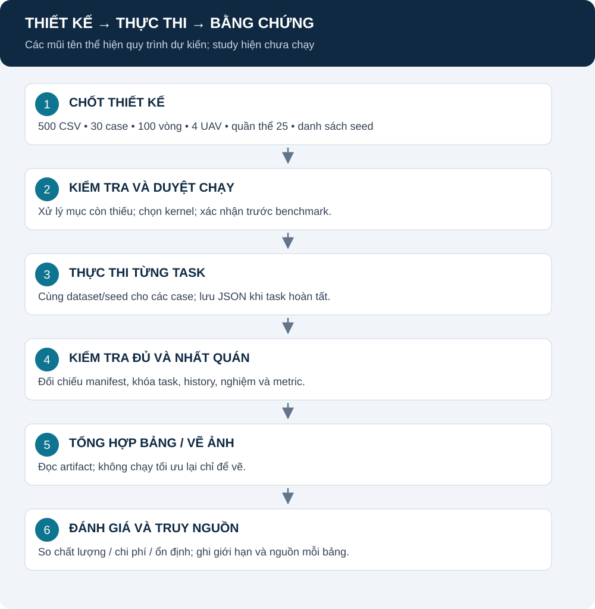

# Hướng dẫn chuẩn bị, thực thi và đọc lại kết quả

[Trang đầu](README.md) · [Thiết kế nghiên cứu](NOTE.md) · [Mục lục kỹ thuật](implementation/docs/README.md)

**Study đã dừng; kết quả, log và file tạm đã được xóa theo yêu cầu.** Dữ liệu và cấu hình được giữ nguyên. Chỉ chạy lại khi được yêu cầu; xem [RUN_STATUS](implementation/docs/RUN_STATUS.md).

## Mục lục

1. [Mô hình quy trình](#quy-trinh)
2. [Chọn đúng luồng](#chon-luong)
3. [Môi trường và kernel](#moi-truong)
4. [Cấu hình notebook 80 vòng](#cau-hinh)
5. [Thực thi sau khi được duyệt](#thuc-thi)
6. [Dừng và tiếp tục](#resume)
7. [Đọc bảng và truy nguồn](#doc-ket-qua)
8. [Luồng FE riêng](#fe)
9. [Lỗi thường gặp và giới hạn](#loi)

<a id="quy-trinh"></a>

## 1. Mô hình quy trình



**Giải thích:** chuẩn bị môi trường không đồng nghĩa chạy tối ưu. Tạo task không đồng nghĩa study đã đủ. Vẽ lại từ artifact không phải chạy optimizer lại. Chỉ viết kết quả sau khi kiểm tra đầy đủ.

<a id="chon-luong"></a>

## 2. Chọn đúng luồng

| Bạn muốn làm gì? | Dùng gì? | Input |
|---|---|---|
| 12 case, 80 vòng, code và kết quả cùng trang | [Notebook study](implementation/notebooks/full_study_80_iterations.ipynb) | 200 CSV hiện có |
| Đối chứng cùng FE | [Runner FE](run_benchmark.py) | Kịch bản sinh từ YAML và seed manifest |
| Chạy một CSV hoặc batch sáu phương pháp | [Script CSV](implementation/scripts/README.md) | CSV hiện có |

Các luồng khác schema và cách đo thời gian. Không đổi tên cột rồi coi chúng là cùng thí nghiệm.

<a id="moi-truong"></a>

## 3. Môi trường và kernel

Code dùng cú pháp Python từ 3.10. Môi trường phiên trước là Python 3.13.9; cài sạch từ lock chưa được xác minh.

| Thành phần | Dùng cho |
|---|---|
| numpy, pandas | Mảng số và bảng |
| matplotlib | Hình từ kết quả |
| scikit-learn | K-Means |
| scipy | Phân tích thống kê của luồng FE |
| tabulate | Xuất bảng Markdown |
| threadpoolctl | Giới hạn luồng tính toán |
| Jupyter / ipykernel | Mở notebook và chạy bằng kernel phù hợp |
| PyYAML | Cấu hình FE/sensitivity |

requirements.txt đã sửa dòng chú thích sai; không cần cài lại các thư viện đang có chỉ để theo dõi lần chạy này.

Ví dụ chuẩn bị môi trường riêng sau khi xử lý file phụ thuộc:

```powershell
python -m venv .venv-study
.\.venv-study\Scripts\python.exe -m pip install -r implementation\requirements.txt
```

Chọn kernel trỏ đúng interpreter này trong VS Code/Jupyter. .venv cũ có bố cục bin/lib và từng không có Scripts/python.exe dùng được trên Windows; không suy ra môi trường hoạt động chỉ vì thấy thư mục.

<a id="cau-hinh"></a>

## 4. Cấu hình notebook 80 vòng

Nguồn: [configs/notebook_study.json](configs/notebook_study.json).

| Khóa | Giá trị hiện tại | Ý nghĩa |
|---|---|---|
| iterations | 80 | Số vòng/generation |
| population | 25 | Số cấu hình UAV trong quần thể |
| num_uavs | 4 | Số UAV trong mỗi cấu hình |
| seeds | 10 số cố định | Đã chốt theo lựa chọn người dùng |
| output | implementation/results/study_80_iterations | Thư mục riêng cho một thiết kế |

200 × 12 × số seed = số task. Hai seed chỉ là tối thiểu kỹ thuật, không tự bảo đảm độ tin cậy thống kê. Chốt danh sách trước khi xem kết quả.

seeds/seeds.csv phục vụ runner FE, không tự điền danh sách seed notebook. Không dùng nhầm hai nguồn.

<a id="thuc-thi"></a>

## 5. Thực thi sau khi được duyệt

1. Xử lý các mục trong PRE_RUN_REVIEW; lưu phiên bản code/config.
2. Chốt seed; kiểm tra đúng 200 CSV và output riêng.
3. Mở notebook, chọn kernel, nạp cấu hình và xem bảng 12 case.
4. Kiểm tra số task và thông số.
5. Chỉ khi được duyệt benchmark mới đặt CONFIRM_RUN=True và thực thi ô chạy.
6. Đủ task và completion rồi mới đọc bảng/ảnh.

Bản lưu trong repo hiện mặc định False, không có output thực nghiệm. Đừng commit một notebook đang bật chạy như bản mặc định dùng chung.

<a id="resume"></a>

## 6. Dừng và tiếp tục

| Tình huống | Hành vi / cách xử lý |
|---|---|
| Task hoàn tất | Lưu một JSON nguyên tử |
| Ngắt trước khi lưu task | Task đó cần chạy lại |
| Chạy lại cùng thiết kế | Runner bỏ qua file task đã có |
| Source/config/data đổi | Chữ ký đổi; dùng output khác |
| Hai kernel cùng output | Khóa .running ngăn ghi đồng thời |
| Kernel bị kill | Khóa có thể còn; xác minh tiến trình cũ đã dừng trước khi xử lý |
| Artifact cũ hỏng | Cần validator đầy đủ; đây là mục chưa hoàn thiện trong rà soát |

Không xóa output chỉ để vượt lỗi resume. Không coi file tồn tại là bằng chứng nội dung đúng.

<a id="doc-ket-qua"></a>

## 7. Đọc bảng và truy nguồn

| Artifact | Dùng để |
|---|---|
| manifest.json | Kiểm tra thiết kế và chữ ký |
| tasks/*.json | Truy một dataset–case–seed và history |
| runs.csv | Xem các result sau khi đủ task |
| completion.json | Đối chiếu expected/actual |
| tables/*.csv và *.md | Đọc phép gộp mô tả |
| figures/*.png | Hình được các ô phân tích xuất từ artifact |

Một ô bảng phải truy ngược được về trường result/history và phép gộp. Xem [DATA_FORMAT](implementation/docs/DATA_FORMAT.md) và [REPORT_EVIDENCE](implementation/docs/REPORT_EVIDENCE.md). Notebook chưa lưu metadata môi trường đầy đủ như runner FE và chưa có kiểm định cho 12 case.

<a id="fe"></a>

## 8. Luồng FE riêng

[benchmark.yaml](configs/benchmark.yaml) và [seeds.csv](seeds/seeds.csv) khai báo dữ liệu/seed. Runner sinh tọa độ mới, mặc định P=30 và max_fe=3030. Mức này không bảo đảm mọi phương pháp có đúng 80 vòng.

Ví dụ lệnh để tham khảo, chưa thực hiện trong đợt tài liệu:

```powershell
python run_benchmark.py --smoke --output tmp_audit/my_fe_smoke --workers 1
python run_benchmark.py --output results/benchmark_fe_01 --workers 1
python run_benchmark.py --output results/benchmark_fe_01 --workers 1 --resume
```

Smoke là kiểm tra nhỏ, không thay nghiên cứu. Xem [EXPERIMENT_DESIGN](implementation/docs/EXPERIMENT_DESIGN.md). Analyzer FE sáu phương pháp không nhận trực tiếp log 12 case notebook.

<a id="loi"></a>

## 9. Lỗi thường gặp và giới hạn

| Biểu hiện | Cần kiểm tra |
|---|---|
| Thiếu module | Kernel/interpreter và requirements |
| Không chạy vì seeds | Danh sách seed chưa chốt hoặc không hợp lệ |
| WinError 5 khi tạo process | Môi trường từng chặn multiprocessing; notebook hiện chạy tuần tự |
| Signature không khớp | Source/config/data đã đổi |
| Không có bảng | Study chưa đủ task hoặc artifact chưa hợp lệ |
| Công thức hiện như văn bản | Mở GitHub Preview/Markdown có math; xem cách đọc bằng lời cạnh công thức |
| Hình không mở trên GitHub | Commit cả SVG ở docs/assets và giữ đúng đường dẫn tương đối |

Không cần chạy test hoặc optimizer để đọc tài liệu. Khi thực thi kiểm tra về sau, ghi nguồn và phạm vi; dữ liệu test không dùng làm kết quả nghiên cứu.
