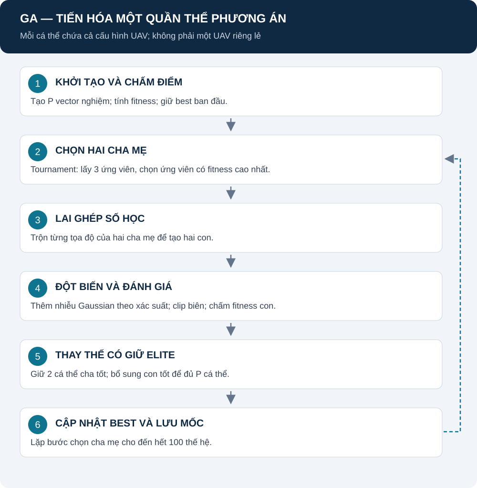

# GA: chọn lọc, lai ghép và đột biến cấu hình UAV

[Mục lục](README.md) · [Mô hình chung](REPORT.md) · [Nguồn GA](SOURCES.md#ga)

**Đọc trước:** mỗi cá thể là một vector vị trí cho cả N UAV; fitness được dùng chung theo REPORT. GA thay đổi ứng viên, không đổi công thức coverage.

## Mục lục

1. [Mô hình hoạt động](#mo-hinh)
2. [Trạng thái và ký hiệu](#ky-hieu)
3. [Chọn cha mẹ](#selection)
4. [Lai ghép](#crossover)
5. [Đột biến](#mutation)
6. [Thay thế và best](#replacement)
7. [Biến thể, nguồn và mã](#nguon)

## 1. Mô hình hoạt động

**Giải thích:** sau khi chấm quần thể ban đầu, GA liên tục chọn hai cha mẹ để sinh con. Con được đánh giá; một phần cha tốt được giữ lại qua elitism. Lặp tới đủ số thế hệ; study notebook dùng 100 thế hệ.

Hình biên soạn theo [optimizer.py](../src/algorithms/GA/optimizer.py). Mũi tên nét đứt là vòng lặp về chọn cha mẹ.

## 2. Trạng thái và ký hiệu

| Ký hiệu | Ý nghĩa | Đơn vị |
|---|---|---|
| X_a, X_b | Hai cấu hình cha mẹ, mỗi cấu hình 3N tọa độ | Mét |
| Y_1, Y_2 | Hai cấu hình con | Mét |
| P | Số cá thể | Study: 25 |
| d, D | Chỉ số chiều, tổng số chiều | D=3N=12 khi N=4 |
| L_d, U_d | Biên dưới/trên tọa độ d | Mét |
| F(X) | Fitness cần cực đại hóa | Không đơn vị |

Không dùng E để ký hiệu số elite vì E đã chỉ proxy công suất trong mô hình; dưới đây dùng n_elite.

## 3. Chọn cha mẹ bằng tournament

Mỗi lần chọn: lấy k=3 cá thể khác nhau trong quần thể, chọn fitness cao nhất. Thực hiện hai lần để có hai cha mẹ; hai lần chọn có thể trả cùng cá thể.

$$
X_{\mathrm{parent}}=\mathrm{arg\,max}_{X\in S}F(X),\qquad \mathrm{card}(S)=3.
$$

| Thành phần | Ý nghĩa |
|---|---|
| S | Tập ba ứng viên được lấy ngẫu nhiên không lặp trong một tournament |
| card(S) | Số phần tử của S, bằng 3 |
| arg max | Trả ứng viên, không phải chỉ giá trị điểm |
| F | Hàm chung từ REPORT |

**Nguồn:** cơ chế chính xác theo [selection.py](../src/algorithms/GA/selection.py). [GA-1](SOURCES.md#ga) là tài liệu nền về GA mã thực, không phải chứng minh k=3 tối ưu.

## 4. Lai ghép số học theo tọa độ

Với xác suất p_c=0,9, tạo alpha_d độc lập trong [0,1] và trộn cha mẹ:

$$
Y_{1,d}=\alpha_d X_{a,d}+(1-\alpha_d)X_{b,d}.
$$

$$
Y_{2,d}=(1-\alpha_d)X_{a,d}+\alpha_d X_{b,d}.
$$

| Thành phần | Ý nghĩa |
|---|---|
| alpha_d | Hệ số trộn riêng cho chiều d, không phải một hệ số cố định toàn vector |
| p_c | Xác suất thực hiện crossover; không thực hiện thì sao chép cha mẹ |
| Y_1,d / Y_2,d | Tọa độ con trước mutation |

**Ví dụ minh họa:** một tọa độ cha là 100 và 300 m, alpha=0,25 thì tọa độ con thứ nhất là 250 m. Ví dụ chỉ giải thích phép trộn.

**Nguồn:** biểu thức đang triển khai trong [crossover.py](../src/algorithms/GA/crossover.py); nguyên lý GA mã thực tham khảo GA-1. p_c và cách rút alpha là lựa chọn code.

## 5. Đột biến Gaussian và xử lý biên

Với xác suất p_m=0,1 trên từng tọa độ:

$$
Y'_d=Y_d+\varepsilon_d,\qquad
\varepsilon_d\sim\mathcal{N}\left(0,[0.1(U_d-L_d)]^2\right).
$$

Sau đó clip từng tọa độ vào [L_d,U_d].

| Thành phần | Ý nghĩa |
|---|---|
| epsilon_d | Nhiễu Gaussian; đơn vị mét |
| 0,1(U_d−L_d) | Độ lệch chuẩn theo chiều, không phải phương sai |
| p_m | Xác suất một tọa độ bị đột biến |
| Clip | Đưa tọa độ vượt miền về biên; khoảng cách UAV vẫn do problem kiểm tra |

**Nguồn:** [mutation.py](../src/algorithms/GA/mutation.py). Hệ số 0,1 và p_m là tham số triển khai, không khẳng định trích nguyên từ một bài báo.

## 6. Thay thế, elitism và best

Giữ n_elite=2 cá thể tốt nhất từ cha; lấy P−2 con tốt nhất để đủ P. Cập nhật best nếu có cải thiện.

**Điểm cần nhớ với P=25:** bộ sinh con theo cặp có thể tạo 26 con rồi đánh giá cả 26 trước replacement. FE phải đếm thực tế, không coi mỗi generation luôn đúng P đánh giá.

Notebook báo best của mọi ứng viên đã đánh giá, kể cả con bị loại; optimizer_fitness lưu thêm best do optimizer trả về để truy vết. Nguồn: [replacement.py](../src/algorithms/GA/replacement.py), [notebook_study.py](../src/notebook_study.py).

## 7. Biến thể, nguồn và mã

| Nội dung | Vị trí |
|---|---|
| Quần thể, chromosome, vòng lặp | [GA](../src/algorithms/GA/) |
| Cờ K/O/L và tham số | [parameters.py](../src/algorithms/GA/parameters.py) |
| Toán tử tùy chọn | [enhancements.py](../src/algorithms/base/enhancements.py) |
| Tám cấu hình GA | [NOTEBOOK_STUDY](NOTEBOOK_STUDY.md) |
| Nguồn nguyên lý và giới hạn xác minh | [SOURCES — GA](SOURCES.md#ga) |

GA gốc mặc định không bật K/O/L. Trong các case cải tiến, K thay một cá thể ban đầu; Lévy/OBL được gọi sau replacement. Chưa có kết quả để nói case nào tốt hơn.

Đọc tiếp [PSO](DWPSO.md) để hiểu họ bầy đàn, hoặc [H-PSO-GA](DWH_PSO_GA.md) để xem cách ghép hai cơ chế.
