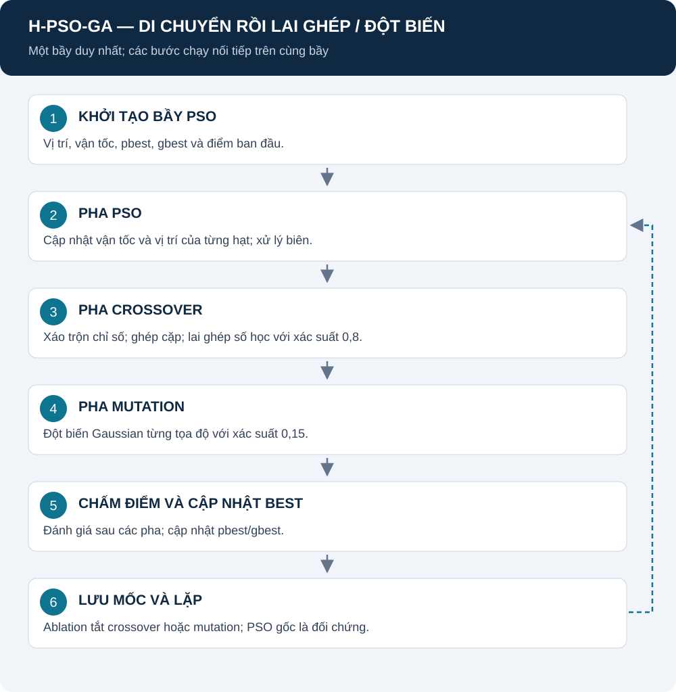

# H-PSO-GA: bước PSO nối tiếp toán tử GA

[Mục lục](README.md) · [PSO](DWPSO.md) · [GA](DWGA.md) · [Nguồn bản lai](SOURCES.md#hybrid)

Đây là cấu trúc lai trong repository: một bầy di chuyển theo PSO, sau đó các cặp hạt đi qua crossover/mutation, rồi mới chấm fitness và cập nhật bộ nhớ.

## Mục lục

1. [Mô hình hoạt động](#mo-hinh)
2. [Trạng thái và ký hiệu](#ky-hieu)
3. [Pha PSO](#pso)
4. [Pha crossover/mutation](#ga)
5. [Đánh giá và ablation](#ablation)
6. [Nguồn và mã](#nguon)

## 1. Mô hình hoạt động

**Giải thích:** các pha nối tiếp trên cùng bầy, không chia hai nửa thành hai thuật toán độc lập. Vị trí trung gian sau PSO chưa được chấm riêng trong mỗi vòng hiện tại; điểm được chấm sau pha GA.

Hình theo [hybrid_pso_ga.py](../src/algorithms/hybrid/hybrid_pso_ga.py). Từng cá thể vẫn biểu diễn cả đội UAV.

## 2. Trạng thái và ký hiệu

| Ký hiệu | Ý nghĩa |
|---|---|
| X_i, V_i | Vị trí và vận tốc của hạt i |
| p_i, g | Personal best và global best |
| X_i,tmp | Vị trí sau PSO, trước crossover |
| Y_i | Vị trí sau lai ghép/đột biến |
| alpha_d | Hệ số trộn ở chiều d |
| L_d, U_d | Miền tọa độ d, mét |

Các vector vị trí có D=3N chiều. P là số hạt; mặc định study P=25.

## 3. Pha PSO

$$
V_i'=wV_i+c_1r_1\odot(p_i-X_i)+c_2r_2\odot(g-X_i).
$$

$$
X_{i,\mathrm{tmp}}=\mathrm{clip}(X_i+V_i',L,U).
$$

**Giải thích:** quán tính giữ hướng cũ; hai lực hút hướng về bộ nhớ cá nhân và toàn bầy. c1=c2=1,5; w giảm 0,9→0,4 theo tiến độ vòng, hoặc FE trong chế độ FE. Vận tốc bị chặn ±0,2(U−L).

Nguồn nguyên lý và ký hiệu chi tiết: [DWPSO](DWPSO.md), [SOURCES — PSO](SOURCES.md#pso). Công thức hiện hành theo velocity_update và hybrid_pso_ga.

## 4. Pha crossover và mutation

Xáo trộn chỉ số rồi ghép cặp hai hạt. Với p_c=0,8:

$$
Y_{i,d}=\alpha_dX_{i,\mathrm{tmp},d}+(1-\alpha_d)X_{j,\mathrm{tmp},d}.
$$

$$
Y_{j,d}=(1-\alpha_d)X_{i,\mathrm{tmp},d}+\alpha_dX_{j,\mathrm{tmp},d}.
$$

alpha_d độc lập trong [0,1]. Nếu không lai ghép, giữ hai vị trí trung gian.

Với p_m=0,15 trên mỗi tọa độ của hạt được ghép cặp:

$$
Y'_{i,d}=Y_{i,d}+\varepsilon_d,\qquad
\varepsilon_d\sim\mathcal{N}\left(0,[0.1(U_d-L_d)]^2\right).
$$

Sau mutation, clip miền. Công thức theo [crossover.py](../src/algorithms/GA/crossover.py) và [mutation.py](../src/algorithms/GA/mutation.py). Đây là tái sử dụng toán tử GA, không phải thêm một quần thể GA độc lập hoặc elitism của baseline GA.

**Trường hợp P lẻ:** vòng ghép cặp bỏ lại một hạt không qua crossover/mutation trong vòng đó. Với P=25, điều này khác baseline GA có thể sinh 26 con. Cần giữ mô tả và đếm FE theo code.

## 5. Đánh giá và ablation

Chấm tất cả vị trí cuối của bầy, rồi cập nhật pbest/gbest theo quy tắc PSO. Bộ nhớ cũ không bị xóa chỉ vì mutation làm vị trí hiện tại kém hơn.

| Case | Crossover | Mutation | Mục đích |
|---|:---:|:---:|---|
| PSO | Không | Không | Đối chứng lõi |
| PSO+Crossover | Có | Không | Xem ảnh hưởng lai ghép |
| PSO+Mutation | Không | Có | Xem ảnh hưởng đột biến |
| H-PSO-GA | Có | Có | Bản lai đầy đủ |

Các case lai dùng tham số 0,8/0,15 khi bật, không thay bằng tham số 0,9/0,1 của GA gốc. Tắt toán tử có thể đổi tiêu thụ RNG; cùng seed không đồng nghĩa mọi bước ngẫu nhiên tương đồng.

## 6. Nguồn và mã

Cơ chế PSO và toán tử GA có nguồn tương ứng ở [SOURCES](SOURCES.md). **Thứ tự kết hợp, xác suất và cách ghép cặp của trang này được mô tả theo code dự án**, không tuyên bố trích nguyên một thuật toán hybrid trong tài liệu tham khảo.

Mã chính: [hybrid_pso_ga.py](../src/algorithms/hybrid/hybrid_pso_ga.py). Cấu hình study và cách gộp: [NOTEBOOK_STUDY](NOTEBOOK_STUDY.md). Mục tiêu chung: [REPORT](REPORT.md).

Chưa có kết quả để quy việc thắng/thua cho crossover hoặc mutation. Cần bảng ablation ghép cặp và số FE/thời gian.
