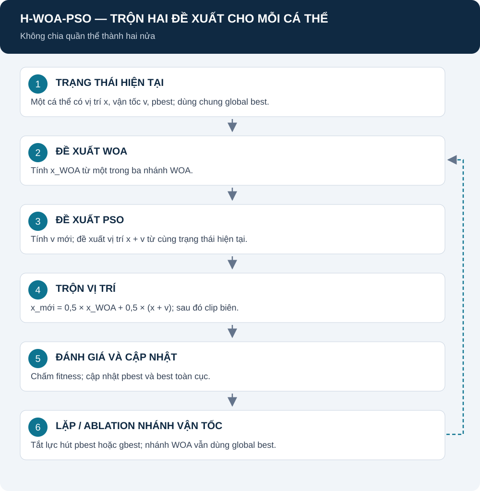

# H-WOA-PSO: trộn đề xuất WOA và PSO trên từng cá thể

[Mục lục](README.md) · [WOA](DWWOA.md) · [PSO](DWPSO.md) · [Nguồn bản lai](SOURCES.md#hybrid)

Mỗi cá thể tạo hai đề xuất từ cùng trạng thái, sau đó trộn chúng. **Không chia quần thể thành nửa WOA, nửa PSO.**

## Mục lục

1. [Mô hình hoạt động](#mo-hinh)
2. [Trạng thái và hai nhánh](#trang-thai)
3. [Phương trình trộn](#tron)
4. [Cập nhật best và ablation](#ablation)
5. [Nguồn, mã và giới hạn](#nguon)

## 1. Mô hình hoạt động

**Giải thích:** bước 2 và 3 trong hình tạo hai đề xuất trước khi thay X. Vị trí cuối là tổ hợp có trọng số của đề xuất WOA và đề xuất PSO; chỉ vị trí sau trộn được chấm trong mỗi cập nhật.

Hình theo [hybrid_woa_pso.py](../src/algorithms/hybrid/hybrid_woa_pso.py).

## 2. Trạng thái và hai nhánh

| Ký hiệu | Ý nghĩa | Đơn vị |
|---|---|---|
| X_i | Cấu hình hiện tại của cá thể | Mét |
| V_i | Bước vận tốc trong không gian nghiệm | Mét/vòng |
| p_i | Best lịch sử của cá thể | Mét |
| g | Best toàn cục | Mét |
| X_WOA | Đề xuất từ nhánh WOA | Mét |
| X_PSO | Đề xuất từ nhánh PSO | Mét |
| lambda | Trọng số trộn | 0,5 |

**Nhánh WOA:** chọn bao vây, khám phá hoặc xoắn ốc theo [DWWOA](DWWOA.md). Điều kiện hệ số là norm(A)/sqrt(D); không hiểu |A| như kiểm tra riêng mỗi chiều.

**Nhánh PSO:**

$$
V_i'=wV_i+c_1r_1\odot(p_i-X_i)+c_2r_2\odot(g-X_i).
$$

$$
X_{\mathrm{PSO}}=X_i+V_i'.
$$

Code dùng c1=c2=1,2; giới hạn vận tốc ±0,2(U−L). w giảm theo vòng hoặc FE như giao thức tương ứng. Các giá trị này là tham số của bản lai, khác PSO gốc c1=c2=1,5.

Nguồn nguyên lý: [SOURCES — WOA](SOURCES.md#woa), [SOURCES — PSO](SOURCES.md#pso). Nguồn biểu thức thực thi: hybrid_woa_pso.py.

## 3. Phương trình trộn

$$
X_i'=\operatorname{clip}\left(\lambda X_{\mathrm{WOA}}+(1-\lambda)X_{\mathrm{PSO}},L,U\right).
$$

Với lambda=0,5:

$$
X_i'=\operatorname{clip}\left(0.5X_{\mathrm{WOA}}+0.5(X_i+V_i'),L,U\right).
$$

| Thành phần | Giải thích |
|---|---|
| Hai đề xuất | Cùng biểu diễn một cấu hình UAV, cùng đơn vị mét |
| lambda | Chọn tỷ trọng mỗi đề xuất; code cố định 0,5 |
| Clip | Chặn tọa độ trước đánh giá; chưa thay kiểm tra khoảng cách UAV |
| F(X_i') | Điểm của vị trí sau trộn, không phải trung bình hai fitness |

**Ví dụ minh họa:** một tọa độ WOA là 100 m, PSO là 300 m thì trước clip tọa độ trộn là 200 m. Fitness không nhất thiết bằng trung bình điểm hai ứng viên vì hàm chấm phi tuyến/rời rạc.

**Nguồn:** công thức kết hợp của code dự án; không gán lambda=0,5 hoặc biểu thức này cho một bài báo chỉ có tên hybrid tương tự.

## 4. Cập nhật best và ablation

Sau đánh giá, thay pbest nếu điểm cải thiện, rồi cập nhật global best. Mỗi cá thể giữ vận tốc và bộ nhớ qua vòng.

| Case | Lực hút pbest trong V | Lực hút gbest trong V | Nhánh WOA |
|---|:---:|:---:|---|
| H-WOA-PSO | Có | Có | Giữ |
| H-WOA-PSO-no-pbest | Không | Có | Giữ |
| H-WOA-PSO-no-gbest-velocity | Có | Không | Giữ |

Bỏ lực hút gbest trong vận tốc **không bỏ mọi ảnh hưởng global best**: nhánh WOA vẫn dùng best. Hai đối chứng bổ sung là WOA gốc và PSO gốc; tất cả dùng kết quả case duy nhất trong registry.

Các cờ không phải phép thử tất cả tỷ lệ lambda. Khảo sát lambda là một thiết kế khác, chưa có trong 30 case.

## 5. Nguồn, mã và giới hạn

- [hybrid_woa_pso.py](../src/algorithms/hybrid/hybrid_woa_pso.py): nguồn chính xác cho bản lai.
- [SOURCES — hybrid](SOURCES.md#hybrid): phân biệt nguyên lý kế thừa với kết hợp riêng.
- [REPORT](REPORT.md): cùng C/E/I/F và ràng buộc.
- [NOTEBOOK_STUDY](NOTEBOOK_STUDY.md): 100 vòng, seed và bảng đánh giá.

Không khẳng định phép trộn luôn cân bằng khám phá/khai thác tốt hơn. Cần kết quả chất lượng, FE/thời gian và ablation trên cùng dataset/seed. Study hiện chưa chạy.
