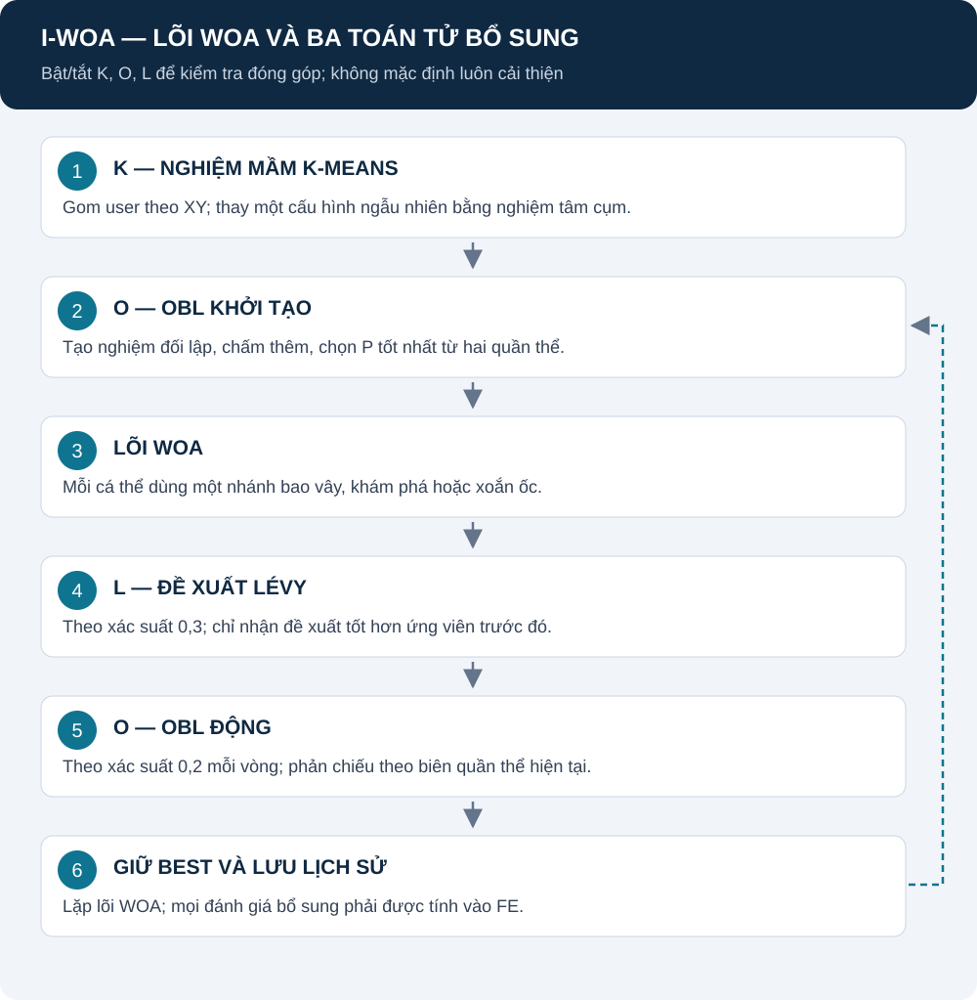

# I-WOA: WOA kết hợp K-Means, OBL và Lévy

[Mục lục](README.md) · [WOA gốc](DWWOA.md) · [Mô hình chung](REPORT.md) · [Nguồn toán tử](SOURCES.md#operators)

Trang này mô tả bản I-WOA của repository. Không đồng nhất tên I-WOA với mọi thuật toán cùng tên trong các bài báo.

## Mục lục

1. [Mô hình hoạt động](#mo-hinh)
2. [K: nghiệm mầm K-Means](#kmeans)
3. [O: nghiệm đối lập](#obl)
4. [L: bước nhảy Lévy](#levy)
5. [Trình tự, FE và ablation](#ablation)
6. [Nguồn và mã triển khai](#nguon)

## 1. Mô hình hoạt động

**Giải thích:** K hoạt động lúc khởi tạo; O có cả lúc khởi tạo và trong vòng; L đề xuất bước thêm sau cập nhật WOA. Mỗi thành phần có thể tắt để đo đóng góp. Lặp tìm kiếm không phải chuỗi xử lý user một lần rồi kết thúc.

Hình theo [optimizer.py](../src/algorithms/I_WOA/optimizer.py). Tắt cả ba cho phép đối chiếu với lõi WOA, nhưng registry notebook dùng WOAOptimizer gốc cho case WOA.

## 2. K: tạo một nghiệm mầm theo cụm user

K-Means phân cụm XY của M user thành N cụm. Ghép N tâm cụm với độ cao gợi ý để tạo **một cấu hình N UAV**, thay cá thể đầu trong quần thể ngẫu nhiên. Không tạo toàn bộ P cá thể bằng K-Means.

$$
X_{\mathrm{seed}}=(\mu_{1,x},\mu_{1,y},z_0,\ldots,\mu_{N,x},\mu_{N,y},z_0).
$$

| Thành phần | Ý nghĩa |
|---|---|
| mu_k,x / mu_k,y | Tâm cụm thứ k theo XY, mét |
| N | Số cụm bằng số UAV |
| z_0 | Gợi ý mặc định 100 m, rồi clip vào miền |
| random_state | Seed tái lập bước K-Means |
| n_init | Code đặt 10, không phụ thuộc mặc định thư viện |

**Nguồn:** [K-1, tài liệu KMeans chính thức](SOURCES.md#operators); cách chuyển tâm cụm thành một nghiệm là quy tắc dự án tại [kmeans_init.py](../src/preprocessing/kmeans_init.py). z_0 không phải độ cao đã chứng minh tối ưu/an toàn.

## 3. O: học đối lập

### Công thức

$$
X^{\mathrm{opp}}=L+U-X.
$$

| Thành phần | Ý nghĩa |
|---|---|
| X | Vector cấu hình cần phản chiếu |
| L, U | Vector biên đối xứng |
| X_opp | Cấu hình đối lập, tiếp tục clip theo miền bài toán |

**Ví dụ minh họa:** một tọa độ X=200 trong miền [0,1000] cho X_opp=800. Không suy ra nghiệm đối lập tốt hơn.

### Khởi tạo và OBL động

Khởi tạo dùng L/U của toàn miền, đánh giá P đối lập, chọn P tốt nhất từ 2P. Dynamic OBL dùng min/max của quần thể hiện tại và xác suất obl_rate=0,2 mỗi vòng.

Code chỉ đánh giá thêm đối lập, không tính lại fitness gốc chỉ vì ghép quần thể. Tắt use_obl tắt cả hai pha.

**Nguồn:** nguyên lý [O-1](SOURCES.md#operators); biểu thức và cách chọn theo [obl.py](../src/algorithms/I_WOA/obl.py). L/U động và xác suất là lựa chọn triển khai, không phải bảo đảm bao phủ mọi miền.

## 4. L: đề xuất Lévy

### Bước ngẫu nhiên theo code

$$
\sigma_u=
\left[
\frac{\Gamma(1+\beta)\sin(\pi\beta/2)}
{\Gamma((1+\beta)/2)\,\beta\,2^{(\beta-1)/2}}
\right]^{1/\beta}.
$$

$$
u_d\sim\mathcal{N}(0,\sigma_u^2),\qquad
v_d\sim\mathcal{N}(0,1),\qquad
s_d=\frac{u_d}{|v_d|^{1/\beta}}.
$$

| Ký hiệu | Ý nghĩa | Mặc định |
|---|---|---|
| beta | Tham số bước đuôi nặng | 1,5 |
| Gamma | Hàm gamma toán học | Không phải ngưỡng SNR |
| sigma_u | Độ lệch chuẩn dùng sinh u | Tính từ beta |
| u_d, v_d | Hai số Gaussian mỗi chiều | Không phải vận tốc PSO |
| s_d | Bước ngẫu nhiên mỗi chiều | Không đơn vị |

Nguồn chính xác biểu thức: [levy_flight.py](../src/algorithms/I_WOA/levy_flight.py). [L-1](SOURCES.md#operators) là nguồn ý tưởng Lévy trong metaheuristic; không gán mọi chi tiết sigma cho bài đó khi chưa xác minh bài sơ cấp.

### Chuyển bước thành đề xuất vị trí

Đặt delta_d bằng X_d−X*_d nếu độ lớn chênh lệch lớn hơn 10^-3; ngược lại dùng 0,1(U_d−L_d). Sau đó:

$$
X'_d=\mathrm{clip}(X_d+\alpha s_d\delta_d,L_d,U_d).
$$

alpha=0,05; X ở đây là ứng viên sau bước WOA. Delta dùng mét; alpha và s không có đơn vị.

Kích hoạt với xác suất levy_rate=0,3 mỗi cá thể, không có kiểm tra chắc chắn “đang kẹt”. Chấm X' và chỉ nhận nếu tốt hơn ứng viên WOA vừa có. Đây là bước bổ sung, không bảo đảm thoát mọi cực trị.

## 5. Trình tự, chi phí và ablation

| Pha | FE bổ sung |
|---|---|
| K-Means | Không gọi fitness trực tiếp, nhưng tốn thời gian |
| Khởi tạo P cá thể | P |
| OBL khởi tạo | P nếu bật |
| WOA | Một đánh giá cho mỗi ứng viên mới |
| Lévy | Một đánh giá cho mỗi đề xuất được thử, kể cả bị loại |
| OBL động | P mỗi lần kích hoạt |
| Tính metric báo cáo | Ngoài FE tìm kiếm theo giao thức |

Các cặp so K/O/L và 8 tổ hợp nằm trong [ABLATION](ABLATION.md). Notebook áp dụng tương tự trên GA/PSO nhưng vị trí chèn theo lõi riêng; xem [NOTEBOOK_STUDY](NOTEBOOK_STUDY.md). Không mặc định KOL luôn tốt hơn K hoặc O.

## 6. Nguồn và mã triển khai

| Phần | Nguồn |
|---|---|
| Ba nhánh WOA | [DWWOA](DWWOA.md), WOA-1 |
| K-Means thư viện | K-1 và kmeans_init.py |
| Đối lập | O-1; code obl.py |
| Lévy | L-1 cho ý tưởng; code levy_flight.py cho biểu thức hiện tại |
| Thứ tự, xác suất, một nghiệm mầm | Thiết kế dự án; optimizer.py/parameters.py |
| Fitness và ràng buộc | [REPORT](REPORT.md), không lấy từ một bài I-WOA khác |

Trạng thái nguồn: [SOURCES](SOURCES.md). Chưa có study hoàn tất để kết luận I-WOA tốt nhất hoặc thời gian thực. Đọc tiếp [hai thuật toán lai](DWH_WOA_PSO.md).
