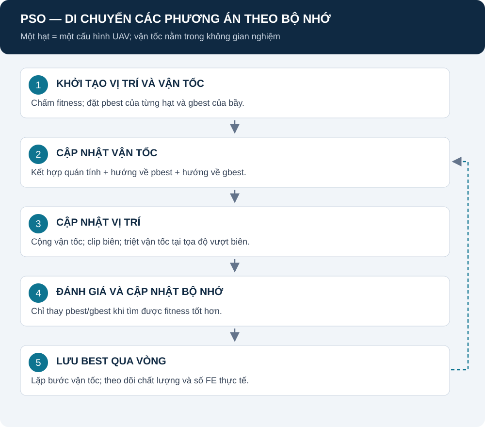

# PSO: tìm kiếm bằng vận tốc và bộ nhớ

[Mục lục](README.md) · [Mô hình chung](REPORT.md) · [Nguồn PSO](SOURCES.md#pso)

Một hạt chứa cả cấu hình UAV. Vận tốc là bước thay đổi trong vector nghiệm; không phải mô hình động học bay của drone thực.

## Mục lục

1. [Mô hình hoạt động](#mo-hinh)
2. [Trạng thái và ký hiệu](#ky-hieu)
3. [Vận tốc và lịch quán tính](#velocity)
4. [Vị trí và biên](#position)
5. [Cập nhật pbest/gbest](#best)
6. [Biến thể, nguồn và mã](#nguon)

## 1. Mô hình hoạt động

**Giải thích:** mỗi hạt nhớ nơi tốt nhất mình từng đến và chịu ảnh hưởng best của bầy. Hai hướng này kết hợp với quán tính để tạo bước di chuyển mới. Sau khi chấm lại, bộ nhớ chỉ đổi nếu điểm tốt hơn.

Hình theo [optimizer.py](../src/algorithms/PSO/optimizer.py); sơ đồ trình bày một lượt cập nhật bầy.

## 2. Trạng thái và ký hiệu

| Ký hiệu | Ý nghĩa | Đơn vị |
|---|---|---|
| x_i,d | Tọa độ d của cấu hình hạt i | Mét |
| v_i,d | Bước thay đổi tọa độ trên một vòng | Mét/vòng tìm kiếm |
| p_i,d | Tọa độ của personal best hạt i | Mét |
| g_d | Tọa độ của global best | Mét |
| w | Trọng số quán tính | Không đơn vị |
| c_1, c_2 | Hệ số lực hút cá nhân/toàn cục | 1,5 và 1,5 mặc định |
| r_1,d, r_2,d | Số ngẫu nhiên độc lập trong [0,1] | Không đơn vị |

Bộ nhớ g và p là vector toàn cấu hình, không phải tâm cụm user.

## 3. Vận tốc và lịch quán tính

$$
v_{i,d}^{t+1}=wv_{i,d}^{t}
+c_1r_{1,d}(p_{i,d}-x_{i,d}^{t})
+c_2r_{2,d}(g_d-x_{i,d}^{t}).
$$

**Bằng lời:** giữ một phần hướng cũ, thêm hướng trở về nơi cá nhân tốt nhất và hướng tới best toàn bầy.

Giới hạn bước theo chiều:

$$
v_{\max,d}=0.2(U_d-L_d).
$$

Ở chế độ vòng, t=0..T−1:

$$
w(t)=0.9-(0.9-0.4)\frac{t}{\max(1,T-1)}.
$$

| Thành phần | Ý nghĩa |
|---|---|
| U_d−L_d | Bề rộng miền chiều d; vận tốc XY và Z có giới hạn khác nhau |
| T | Tổng vòng cấu hình; notebook dùng 100 |
| w(t) | Giảm từ 0,9 về 0,4 nếu T>1 |
| inertia_weight trong parameter | Không được dùng như w hằng trong vòng lặp hiện tại |

**Nguồn:** [velocity_update.py](../src/algorithms/PSO/velocity_update.py), [optimizer.py](../src/algorithms/PSO/optimizer.py). [PSO-1/PSO-2](SOURCES.md#pso) là nguồn nguyên lý; lịch và hệ số cụ thể theo code. Luồng FE dùng tiến độ FE ở đầu sweep thay t/(T−1).

## 4. Vị trí và xử lý biên

$$
x_{i,d}^{t+1}=\operatorname{clip}(x_{i,d}^{t}+v_{i,d}^{t+1},L_d,U_d).
$$

Nếu vị trí trước clip vượt biên, đặt vận tốc của chiều đó về 0. Khoảng cách giữa UAV vẫn do problem kiểm tra; clip tọa độ chưa bảo đảm toàn bộ cấu hình khả thi.

**Nguồn:** [position_update.py](../src/algorithms/PSO/position_update.py), [boundary_handler.py](../src/algorithms/PSO/boundary_handler.py). Đây là quy tắc triển khai, không bảo đảm tối ưu toàn cục.

## 5. Cập nhật pbest và gbest

| Điều kiện | Hành động |
|---|---|
| F(vị trí mới) > fitness pbest | Thay pbest bằng vị trí mới |
| pbest tốt hơn gbest đã lưu | Thay gbest |
| Điểm bằng nhau | Giữ bộ nhớ cũ |
| Vị trí kém hơn | Vẫn có thể là vị trí hiện tại nhưng không xóa pbest tốt |

Nguồn: [best_update.py](../src/algorithms/PSO/best_update.py). Phân biệt “hạt đang ở đâu” với “hạt từng tốt nhất ở đâu”.

## 6. Biến thể, nguồn và mã

PSO gốc tắt K/O/L. Trong study, K thay một vị trí khởi tạo; Lévy/OBL chạy sau bước cập nhật bầy, trước cập nhật best. Khi toán tử thay vị trí, code đặt vận tốc về 0 và bảo toàn pbest tốt hơn. Quy tắc: [enhancements.py](../src/algorithms/base/enhancements.py).

Tám case PSO, điều kiện chung và cách đo nằm trong [NOTEBOOK_STUDY](NOTEBOOK_STUDY.md). Công thức mục tiêu không đổi. Chưa có kết quả để nói PSO-KOL tốt hơn PSO.

Nguồn nguyên lý, DOI và phần chưa đọc được toàn văn: [SOURCES — PSO](SOURCES.md#pso). Đọc tiếp [H-PSO-GA](DWH_PSO_GA.md) hoặc [H-WOA-PSO](DWH_WOA_PSO.md).
