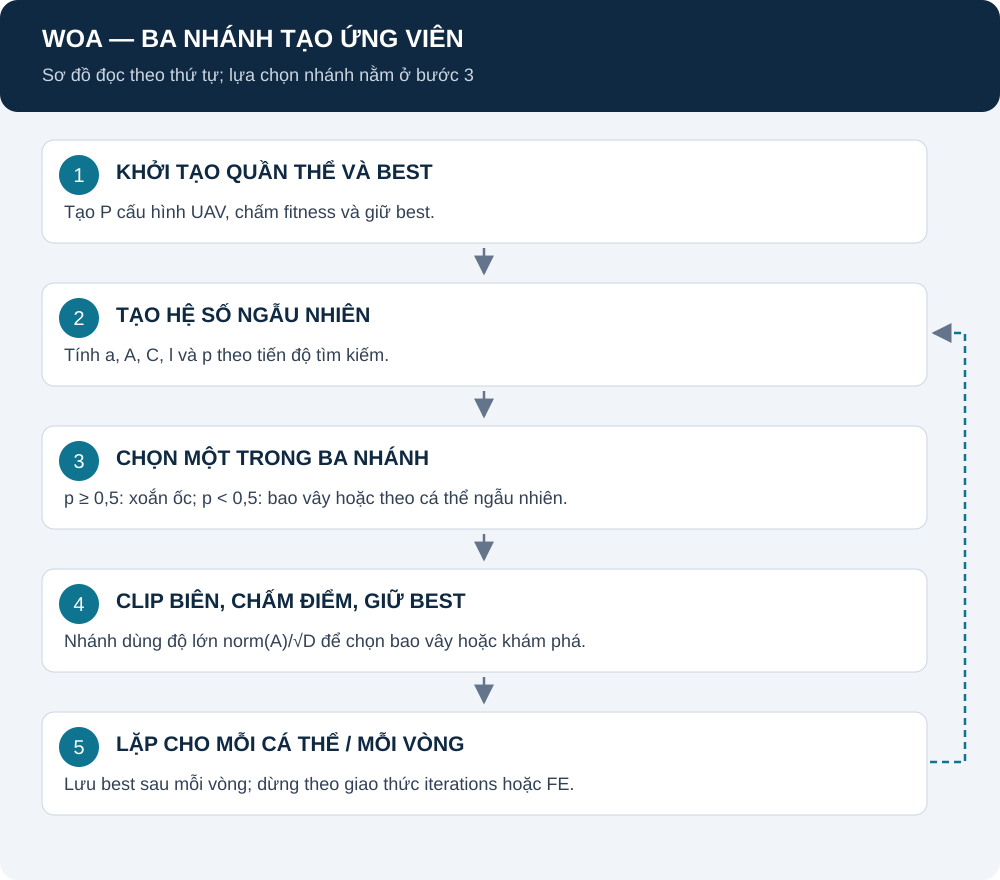

# WOA: bao vây, khám phá và xoắn ốc

[Mục lục](README.md) · [Mô hình chung](REPORT.md) · [Nguồn WOA](SOURCES.md#woa)

WOA tạo ứng viên mới bằng ba nhánh toán học. “Cá voi” là tên cá thể trong không gian nghiệm, không phải một UAV riêng lẻ.

## Mục lục

1. [Mô hình hoạt động](#mo-hinh)
2. [Ký hiệu và hệ số](#he-so)
3. [Chọn nhánh theo code](#chon-nhanh)
4. [Ba công thức cập nhật](#cap-nhat)
5. [Giữ best, biến thể và nguồn](#nguon)

## 1. Mô hình hoạt động

**Giải thích:** mỗi cá thể rút hệ số, chọn nhánh và tạo một vị trí mới; chấm vị trí này rồi cập nhật best. Best được giữ qua lịch sử, không chỉ lấy max quần thể hiện tại ở mỗi thời điểm.

Hình theo [optimizer.py](../src/algorithms/WOA/optimizer.py). Nhánh ngẫu nhiên không chứng minh đã khám phá hết không gian.

## 2. Ký hiệu và hệ số

| Ký hiệu | Ý nghĩa |
|---|---|
| X, X* | Vị trí hiện tại, best đã lưu; vector mét |
| X_rand | Vị trí của cá thể chọn ngẫu nhiên trong quần thể |
| D | Số chiều nghiệm; 12 khi có 4 UAV |
| A, C | Vector hệ số tìm kiếm; C ở đây không phải coverage |
| p, l | Số ngẫu nhiên: p trong [0,1], l trong [−1,1] |
| b_s | Hệ số xoắn ốc; mặc định 1; khác b trong mô hình LoS |
| odot | Nhân từng phần tử |

Để tránh nhầm coverage, bên dưới ký hiệu hệ số WOA là C_w.

$$
a(t)=2-2\frac{t}{\max(1,T-1)}.
$$

$$
A=2a\,r_1-a,\qquad C_w=2r_2.
$$

r_1 và r_2 là vector ngẫu nhiên độc lập; p và l được rút cho mỗi lần cập nhật. T là tổng vòng. FE mode thay phân số t bằng tiến độ FE, xem [EXPERIMENT_DESIGN](EXPERIMENT_DESIGN.md).

**Nguồn:** công thức chính xác theo [coefficient_update.py](../src/algorithms/WOA/coefficient_update.py); nguyên lý tham khảo [WOA-1](SOURCES.md#woa).

## 3. Chọn nhánh theo code

Đặt q=norm(A)/sqrt(D).

| Điều kiện | Nhánh |
|---|---|
| p≥0,5 | Xoắn ốc quanh X* |
| p<0,5 và q<1 | Bao vây X* |
| p<0,5 và q≥1 | Theo cá thể ngẫu nhiên X_rand |

q là độ lớn vector chuẩn hóa, không phải kiểm tra trị tuyệt đối riêng từng thành phần A. Đây là chi tiết triển khai cần nêu khi đối chiếu bài gốc.

## 4. Ba công thức cập nhật

### 4.1. Bao vây

$$
R=|C_w\odot X^*-X|,\qquad X'=X^*-A\odot R.
$$

R là vector khoảng cách có trọng số, đơn vị mét. Dấu giá trị tuyệt đối áp dụng từng tọa độ; A/C_w không có đơn vị.

### 4.2. Khám phá theo cá thể ngẫu nhiên

$$
R=|C_w\odot X_{\mathrm{rand}}-X|,\qquad X'=X_{\mathrm{rand}}-A\odot R.
$$

Đổi điểm tham chiếu từ best sang cá thể ngẫu nhiên. Không gọi đây là tìm kiếm toàn bộ không gian theo nghĩa vét cạn.

### 4.3. Xoắn ốc

$$
R'=|X^*-X|,\qquad X'=R'\exp(b_s l)\cos(2\pi l)+X^*.
$$

R' theo từng tọa độ; l điều khiển bước xoắn. Khi l gần 0, hệ số tiến gần 1, nên không bảo đảm X' tiến sát X* nếu R' còn lớn.

**Nguồn các biểu thức:** [encircling.py](../src/algorithms/WOA/encircling.py), [exploration.py](../src/algorithms/WOA/exploration.py), [spiral_update.py](../src/algorithms/WOA/spiral_update.py); nguồn nguyên lý WOA-1. Sau nhánh, clip miền rồi gọi fitness chung.

## 5. Giữ best, biến thể và nguồn

Khi F(X') tốt hơn best đã lưu, cập nhật best. Ở chế độ vòng, history khởi tạo cộng 100 mốc vòng cho study. Ở chế độ FE, counter có thể dừng giữa quần thể; không gọi đó là đủ 100 vòng.

[WOA-1](SOURCES.md#woa) có trang tác giả và DOI. Công thức ở trang này mô tả mã repository, có chỉ rõ khác biệt q; không khẳng định đã kiểm tra toàn văn bài in trong lượt biên tập này.

WOA gốc không bật K/O/L. Các case WOA cải tiến dùng IWOAOptimizer với cờ tương ứng; xem [I-WOA](DWI_WOA.md) và [NOTEBOOK_STUDY](NOTEBOOK_STUDY.md). Chưa có kết quả để kết luận vượt GA hoặc PSO.
