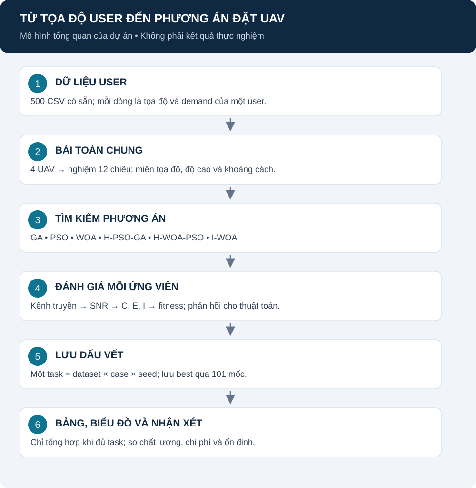

# Hướng dẫn người mới: từ dữ liệu tới kết quả

## Mục lục

1. [1. Đầu vào và đầu ra](#doc-section-01)
2. [2. Một run hoạt động thế nào?](#doc-section-02)
3. [3. Ba luồng không dùng lẫn](#doc-section-03)
4. [4. Tìm mã ở đâu?](#doc-section-04)
5. [5. Đọc đầu ra](#doc-section-05)
6. [6. Trạng thái và việc tiếp theo](#doc-section-06)

[Mục lục](README.md) · [Trang đầu](../../README.md) · [Thuật ngữ](GLOSSARY.md)

Mục tiêu trang này là giúp người chưa tham gia dự án hiểu được đầu vào, phần nào tìm nghiệm và kết quả được tạo ra thế nào. Trạng thái cập nhật 25/10/2026: có mã và thiết kế study; chưa chạy study notebook 100 vòng, seed còn để trống.

**Cách đọc:** user đi vào problem; optimizer lặp đề xuất/chấm vị trí UAV; history được lưu để dựng bảng/ảnh. Khối đánh giá được gọi nhiều lần. Đây là sơ đồ theo mã, không phải kết quả đo.

## 1. Đầu vào và đầu ra

Đầu vào notebook là 500 CSV trong data/stores. Mỗi dòng chứa user_id, x_m, y_m, z_m và demand. Đó là tọa độ user, không phải vị trí UAV. Xem [DATA_FORMAT](DATA_FORMAT.md).

Đầu ra của một run là cấu hình tọa độ cho 4 UAV, fitness và lịch sử tìm kiếm. Một cá thể biểu diễn cả bốn UAV bằng vector 12 chiều. Quần thể 25 nghĩa là 25 cấu hình UAV ứng viên, không phải 25 UAV.

Mỗi dataset được dùng lại cho mọi đối chứng. Đổi seed tạo một lần tìm kiếm khác trên cùng tọa độ user; không tự tạo dataset mới trong notebook.

## 2. Một run hoạt động thế nào?

1. Đọc CSV, kiểm tra dữ liệu và tiền xử lý.
2. Tạo bài toán với số UAV, giới hạn tọa độ, độ cao và khoảng cách tối thiểu.
3. Tạo quần thể ngẫu nhiên nền dùng chung giữa các case trên cùng dataset/seed.
4. Nếu case bật K-Means, thay một cá thể bằng nghiệm mầm.
5. Tính fitness cho ứng viên; chạy cập nhật của thuật toán và các toán tử được bật.
6. Ghi best-so-far sau khởi tạo và mỗi vòng.
7. Lưu task JSON; chỉ khi đủ toàn bộ task mới tổng hợp các bảng.

Fitness gọi mô hình kênh để tính SNR, sau đó tính C/E/I. Thuật toán tìm kiếm không tự đọc CSV hoặc quyết định cách vẽ biểu đồ. [formulas](formulas.md) nối các bước này với module cụ thể.

## 3. Ba luồng không dùng lẫn

| Luồng | Điểm vào | Dữ liệu | Cách dừng |
|---|---|---|---|
| Study hiện tại | [notebook](../notebooks/full_study_100_iterations.ipynb), [notebook_study.py](../src/notebook_study.py) | 500 CSV sẵn có | 100 vòng |
| FE | [run_benchmark.py](../scripts/run_benchmark.py) | Sinh từ YAML/manifest | max_fe |
| Legacy CSV | [run_batch.py](../scripts/run_batch.py), run_optimizer.py | CSV sẵn có | iterations/generations |

Notebook dùng 30 case; batch cũ mặc định sáu thuật toán. FE mặc định quần thể 30; notebook 25. 3030 FE được chọn từ ngân sách tham chiếu của WOA, không biến mọi thuật toán thành đúng 100 vòng. Chi tiết: [NOTEBOOK_STUDY](NOTEBOOK_STUDY.md), [EXPERIMENT_DESIGN](EXPERIMENT_DESIGN.md).

## 4. Tìm mã ở đâu?

| Phần | Đường dẫn | Trách nhiệm |
|---|---|---|
| Đọc đầu vào | [input](../src/input/) | Loader và kiểm tra schema |
| Tiền xử lý | [preprocessing](../src/preprocessing/) | Làm sạch và tạo nghiệm K-Means khi được gọi |
| Kênh | [channel.py](../src/physics/channel.py) | Khoảng cách, góc, LoS, suy hao, SNR |
| Hàm mục tiêu | [metrics.py](../src/objectives/metrics.py) | C/E/I và fitness |
| Miền và ràng buộc | [objective.py](../src/problem/objective.py) | Chung cho các thuật toán |
| Thuật toán | [algorithms](../src/algorithms/) | Các cơ chế tìm kiếm |
| Toán tử GA/PSO tùy chọn | [enhancements.py](../src/algorithms/base/enhancements.py) | K-Means, OBL và Lévy |
| Study | [notebook_study.py](../src/notebook_study.py) | Registry, chạy task, lưu và tổng hợp |
| Tham số mô hình | [network.py](../src/constants/network.py) | Mặc định vật lý |
| Cấu hình | [notebook_study.json](../../configs/notebook_study.json), [benchmark.yaml](../../configs/benchmark.yaml) | Hai thiết kế riêng |
| Kiểm tra | [tests](../tests/) | Kiểm tra mã, không phải kết quả nghiên cứu |

## 5. Đọc đầu ra

Một task notebook có khóa dataset–case–seed. JSON chứa result và history, trong đó history có 101 mốc. completion.json chỉ được ghi khi đủ task. Bảng tổng hợp có thể đọc lại từ task mà không chạy optimizer.

Mean fitness, best fitness, median và SD trả lời các câu hỏi khác nhau. SD qua seed phải tính trên cùng dataset trước khi tổng hợp. Ranking dùng trung vị seed theo dataset; không tự chứng minh ý nghĩa thống kê. Xem [NOTEBOOK_STUDY](NOTEBOOK_STUDY.md) và [STATISTICS](STATISTICS.md).

figures/scenario_*.csv minh họa các bộ sinh scenario. Chúng không phải tọa độ UAV tối ưu và không phải kết quả của 500 CSV. reports và tmp_audit có thể chứa test/audit; cần xem nguồn trước khi dùng con số.

## 6. Trạng thái và việc tiếp theo

| Hạng mục | Trạng thái |
|---|---|
| Sáu thuật toán và hàm đánh giá chung | Có mã |
| 30 case, notebook, checkpoint, bảng mô tả | Đã triển khai |
| Danh sách seed notebook | Chưa chốt; để trống |
| Xác nhận chạy optimizer toàn trình của study mới | Chưa có |
| Study 500 CSV, 100 vòng | Chưa chạy |
| Kiểm định cho 30 case | Chưa triển khai |
| Runner/analyzer FE sáu thuật toán | Có mã, tách khỏi notebook |
| Kết quả FE đầy đủ mới | Chưa có |
| Cài sạch từ lock và tính tái lập trên máy khác | Chưa xác minh |

Môi trường cũ có thư mục .venv nhưng không có .venv/Scripts/python.exe dùng được trên Windows trong phiên trước. Đừng coi việc thư mục tồn tại là đã có kernel phù hợp. Khi được yêu cầu chạy, theo [REPRODUCE](../../REPRODUCE.md).

Đọc tiếp [REPORT](REPORT.md) để hiểu mô hình, rồi [NOTEBOOK_STUDY](NOTEBOOK_STUDY.md) để xem đầy đủ các trường hợp.
