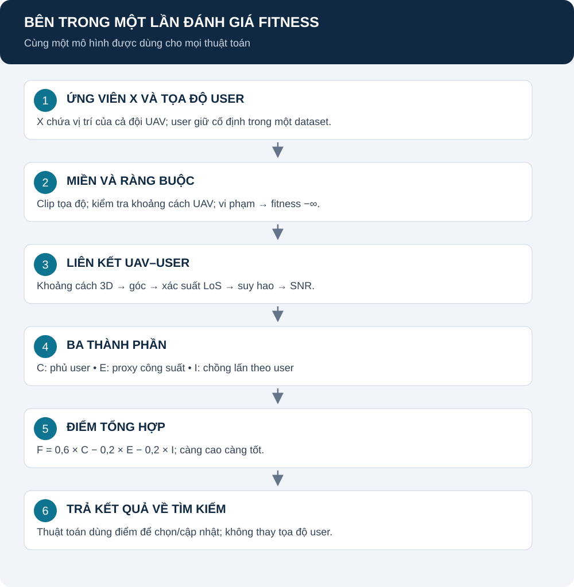

# Mô hình toán học và cách chấm một cấu hình UAV

[Mục lục](README.md) · [Thuật ngữ](GLOSSARY.md) · [Nguồn tham khảo](SOURCES.md)

Trang này định nghĩa bài toán chung cho các thuật toán. Chưa có kết quả study mới; các công thức là mô hình, không phải số đo.

## Mục lục

1. [Mô hình đánh giá tổng thể](#mo-hinh)
2. [Biểu diễn và ký hiệu](#ky-hieu)
3. [Khoảng cách, góc và kênh truyền](#kenh)
4. [Độ phủ C](#coverage)
5. [Proxy công suất E](#power)
6. [Proxy chồng lấn I](#overlap)
7. [Fitness và ràng buộc](#fitness)
8. [Nguồn từng phần và giới hạn](#nguon)
9. [Từ mô hình tới thí nghiệm](#thi-nghiem)

## 1. Mô hình đánh giá tổng thể

**Giải thích:** một ứng viên chứa cả đội UAV. Tọa độ UAV và user tạo ma trận N×M liên kết. C/I được tính từ ma trận SNR; E tính từ độ cao UAV. F trả về để thuật toán quyết định ứng viên tiếp theo.

Khối kiểm tra khả thi thuộc problem; khối kênh và chỉ số thuộc physics/objectives. Hình do dự án biên soạn từ [objective.py](../src/problem/objective.py) và [metrics.py](../src/objectives/metrics.py).

## 2. Biểu diễn và ký hiệu

Một nghiệm gồm các tọa độ UAV, cực đại hóa F trên miền hợp lệ:

$$
X=(x_1,y_1,z_1,\ldots,x_N,y_N,z_N)\in\mathbb{R}^{3N}.
$$

| Ký hiệu | Ý nghĩa | Đơn vị / giá trị |
|---|---|---|
| N, M | Số UAV, số user | N=4 trong notebook; M=50–500 |
| i, j | Chỉ số UAV, user | i=1..N; j=1..M |
| (x_i,y_i,z_i) | Vị trí UAV i | Mét |
| (u_j,v_j,h_j) | Vị trí user j, cố định trong run | Mét; không mặc định h_j=0 |
| D=3N | Số chiều nghiệm | 12 khi N=4 |
| P | Số cấu hình trong quần thể | 25 trong notebook |
| gamma | Ngưỡng liên kết SNR | 18 dB theo cấu hình mặc định |

Biểu diễn là lựa chọn triển khai của dự án. CSV hiện có user cao đến 132 m; không dùng công thức khoảng cách chỉ có z_i nếu h_j khác 0.

Trong các công thức dưới, clip(q,L,U) nghĩa là chặn q vào đoạn [L,U]: giá trị nhỏ hơn L được đưa về L, lớn hơn U đưa về U, còn lại giữ nguyên. Nếu đầu vào là vector, áp dụng riêng từng tọa độ. Cách viết toán tương đương:

$$
\mathrm{clip}(q,L,U)=\min\left(U,\max(L,q)\right).
$$

## 3. Khoảng cách, góc và kênh truyền

### 3.1. Hình học liên kết

$$
d_{ij}=\sqrt{(x_i-u_j)^2+(y_i-v_j)^2+(z_i-h_j)^2}.
$$

$$
\theta_{ij}=\frac{180}{\pi}\arcsin\left(\mathrm{clip}\left(\frac{z_i-h_j}{\max(d_{ij},10^{-3})},0,1\right)\right).
$$

**Bằng lời:** tính khoảng cách 3D; tỷ số chênh cao/khoảng cách cho góc ngẩng; đổi radian sang độ. d dùng mét, theta dùng độ. Sàn 1 mm và clip là quy tắc số học của code. Ép góc âm về 0 là giới hạn cần thẩm định khi user cao hơn UAV.

**Nguồn:** hình học Euclid và biểu thức chính xác theo [channel.py](../src/physics/channel.py); mô hình nguồn [A2G-1](SOURCES.md#a2g) xét user mặt đất, không tự xác nhận mở rộng user 3D này.

### 3.2. Xác suất LoS

$$
p_{ij}=\frac{1}{1+a\exp[-b(\theta_{ij}-a)]}.
$$

| Thành phần | Ý nghĩa |
|---|---|
| p_ij | Xác suất mô hình của đường nhìn thẳng, không phải lần lấy mẫu ngẫu nhiên |
| a, b | Tham số môi trường; code mặc định 9,61 và 0,16 |
| theta_ij | Góc theo độ, không truyền radian vào công thức này |

**Nguồn:** [A2G-1, mục II, (1)](https://arxiv.org/html/1705.03415). Mã: compute_los_probability trong channel.py. Bộ tham số được chọn trong network.py, cần kiểm tra phù hợp bối cảnh.

### 3.3. Suy hao và SNR

$$
L_{\mathrm{FS},ij}=20\log_{10}\left(\frac{4\pi f_c d_{ij}}{c}\right).
$$

$$
L_{ij}=L_{\mathrm{FS},ij}+p_{ij}\eta_{\mathrm{LoS}}+(1-p_{ij})\eta_{\mathrm{NLoS}}.
$$

$$
\mathrm{SNR}_{ij}=P_{\mathrm{tx,dBm}}-L_{ij}-P_{\mathrm{noise,dBm}}.
$$

| Ký hiệu | Ý nghĩa | Đơn vị / mặc định |
|---|---|---|
| f_c | Tần số sóng mang | 3,5×10^9 Hz |
| c | Vận tốc ánh sáng dùng trong code | 3×10^8 m/s |
| eta_LoS, eta_NLoS | Suy hao bổ sung | 1 và 20 dB |
| L_ij | Suy hao trung bình theo dB | dB |
| P_tx, P_noise | Công suất phát và tạp âm | 30 và −104 dBm |
| SNR_ij | Chênh tín hiệu/tạp âm sau suy hao | dB |

**Nguồn:** suy hao đối chiếu [A2G-1, mục II, (2)–(3)](https://arxiv.org/html/1705.03415); công suất thu theo (5), SNR triển khai từ công suất thu trừ tạp âm. Code không cộng công suất gây nhiễu liên UAV trong SNR và không lấy mẫu fading.

## 4. Độ phủ C

Đặt A_ij=1 nếu SNR_ij≥gamma, ngược lại bằng 0. Khi đó:

$$
C(X)=\frac{1}{M}\sum_{j=1}^{M}\mathbf{1}\left[\sum_{i=1}^{N}A_{ij}\geq 1\right].
$$

**Bằng lời:** user có ít nhất một liên kết đạt ngưỡng được đếm một lần. Mẫu số là toàn bộ M user; C thuộc [0,1].

**Ví dụ minh họa:** 90/100 user được phủ thì C=0,9, hiển thị 90%. User có ba liên kết vẫn chỉ đóng góp một vào tử số coverage. Đây không phải kết quả chạy.

**Nguồn:** định nghĩa tổng hợp nhiều UAV của dự án, [calculate_coverage_rate](../src/objectives/metrics.py); liên hệ bài toán coverage trong A2G-1 nhưng không gọi toàn bộ công thức là trích nguyên bài đó. Chưa bảo đảm dung lượng hoặc tốc độ.

## 5. Proxy công suất E

$$
r_i=\mathrm{clip}\left(\frac{z_i-z_{\min}}{z_{\max}-z_{\min}+10^{-6}},0,1\right).
$$

$$
P_i=P_0(1+0.5r_i)+P_{\mathrm{tx,W}}.
$$

$$
E(X)=\frac{\frac{1}{N}\sum_{i=1}^{N}P_i}{1.5P_0+P_{\mathrm{tx,W}}}.
$$

| Thành phần | Ý nghĩa | Đơn vị / giá trị |
|---|---|---|
| r_i | Độ cao tương đối trong miền cố định | Không đơn vị |
| z_min, z_max | Biên độ cao bài toán | 50 và 300 m mặc định |
| P_0 | Công suất hover nền giả định | 100 W |
| P_tx,W | Công suất phát dạng W trong proxy | 1 W |
| P_i | Công suất đại diện UAV i | W |
| E | Trung bình P_i chia công suất chuẩn | Không đơn vị |

**Bằng lời:** độ cao lớn hơn bị phạt công suất lớn hơn theo một luật tuyến tính giả định. Mẫu chuẩn hóa cố định theo bài toán, không lấy min/max quần thể.

**Nguồn:** mô hình riêng trong calculate_energy_consumption, [metrics.py](../src/objectives/metrics.py). Chưa có nguồn hiệu chuẩn vật lý cho luật tăng 50%. E không phải Joule và không phản ánh tổng năng lượng đội UAV khi đổi N; chưa có thời gian nhiệm vụ hoặc quỹ đạo bay.

## 6. Proxy chồng lấn I

$$
I(X)=\frac{1}{M}\sum_{j=1}^{M}\mathbf{1}\left[\sum_{i=1}^{N}A_{ij}\geq 2\right].
$$

**Bằng lời:** đếm user có ít nhất hai liên kết đạt ngưỡng. I thuộc [0,1], dùng cùng M như C.

**Ví dụ minh họa:** trong 100 user, 12 user có từ hai liên kết đạt ngưỡng thì I=0,12. Không suy ra diện tích chồng nhau bằng 12% hoặc nhiễu đồng kênh bằng 12%.

**Nguồn:** proxy của dự án tại calculate_interference_rate, [metrics.py](../src/objectives/metrics.py). Không gán cho công thức diện tích giao nhau hoặc SINR của bài báo khác.

## 7. Fitness và ràng buộc

$$
F(X)=w_C C(X)-w_E E(X)-w_I I(X).
$$

| Ký hiệu | Vai trò | Mặc định |
|---|---|---|
| w_C | Thưởng độ phủ | 0,6 |
| w_E | Phạt proxy công suất | 0,2 |
| w_I | Phạt chồng lấn | 0,2 |
| X | Phương án cần tối ưu | Vector 3N chiều |

**Nguồn:** thiết kế tổng có trọng số của dự án, metrics.py. Các trọng số không phải chuẩn IEEE; cần [sensitivity](SENSITIVITY.md) để đánh giá độ nhạy.

Miền mặc định: x/y trong [0,1000] m, z trong [50,300] m. Hai UAV phải cách nhau ít nhất d_min=10 m. evaluate clip vào miền, rồi kiểm tra khoảng cách; không đạt khoảng cách trả −∞. evaluate_detailed từ chối nghiệm không khả thi.

Mã ràng buộc: [objective.py](../src/problem/objective.py), [constraints.py](../src/problem/constraints.py). d_min là giả định mô phỏng, không chứng nhận an toàn bay.

## 8. Nguồn từng phần và giới hạn

| Phần | Nguồn | Điều chưa được suy ra |
|---|---|---|
| LoS/pathloss | A2G-1 và mã kênh | Không xác nhận mọi kịch bản user 3D |
| C | Định nghĩa code theo ngưỡng | Chưa đảm bảo dung lượng |
| E | Proxy riêng | Chưa là pin hoặc năng lượng nhiệm vụ |
| I | Proxy riêng | Chưa là nhiễu vật lý |
| F/trọng số | Thiết kế nhóm | Chưa tối ưu cho mọi bối cảnh |
| Nghiệm metaheuristic | Chấm và tìm kiếm | Chưa chứng minh tối ưu toàn cục |

[SOURCES](SOURCES.md) chỉ rõ nguồn nào đã đối chiếu được và nguồn nào chưa truy cập toàn văn. Không coi số liệu kiểm toán/test là kết quả study. Quy tắc bằng chứng: [REPORT_EVIDENCE](REPORT_EVIDENCE.md).

## 9. Từ mô hình tới thí nghiệm

[Notebook](NOTEBOOK_STUDY.md) giữ nguyên mô hình trên, chạy 12 case theo 80 vòng. [FE](EXPERIMENT_DESIGN.md) là luồng riêng dừng theo ngân sách đánh giá, với dữ liệu sinh mới. Không gộp hai giao thức.

Đọc [formulas](formulas.md) để tìm module; sau đó chọn [GA](DWGA.md), [PSO](DWPSO.md), [WOA](DWWOA.md), [I-WOA](DWI_WOA.md) hoặc hai chương hybrid. Kết quả mới chưa có; không bổ sung thứ hạng hoặc số giây bằng ước lượng.
